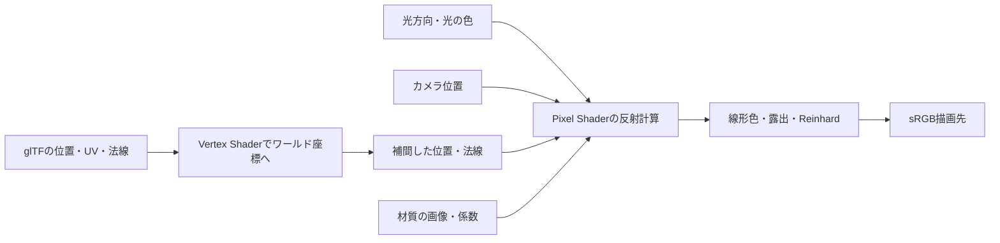

# サンプル06から07・08へ：Albedo、ライティング、PBR

06で読み込んだ同じShader Ballを使い、07ではLambertとBlinn-Phong、08ではMetallic-RoughnessのPBRへ進みます。形状・UV・カメラは共通なので、反射モデルと入力画像が見た目をどう変えるかを確認できます。

| 回 | 新しく学ぶ内容 | 主な入力 |
|---|---|---|
| [06 glTF](GltfLoading.md) | モデル・材質の参照とAlbedo表示 | 位置、UV、Base Color |
| 07 Lighting | 法線、光方向、視線方向、拡散反射、鏡面反射 | 上記＋法線、方向光、カメラ位置 |
| 08 PBR | 金属・粗さ、マイクロファセット、接線空間、色空間 | 上記＋接線、Normal、ORM、Emissive |

Lightingは光源から届く光の方向・色・強さを与える処理、Shadingは法線や材質と反射モデルから見える色を計算する処理として分けて考えます。この2回では1本の方向光を使い、Pixel Shaderで各ピクセルの反射を計算します。Shadow Mapによる遮蔽判定はまだ加えていません。



## 07：まず法線と反射の関係を理解する

Nは表面の単位法線、Lは表面から光源へ向かう単位方向、Vは表面からカメラへ向かう単位方向です。方向光のLは全ピクセルで同じです。Vは`normalize(cameraPosition - worldPosition)`で求めます。3つともワールド座標へ揃えます。

位置は`position * World`、法線は`normal * transpose(inverse(World))`で変換します。非一様スケールをかけたときに法線と面の接線の直交関係を保つため、法線には逆転置行列が必要です。現在のWorldは単位行列ですが、CPU側で逆転置も明示して渡しています。頂点間の補間で法線の長さは変わるので、Pixel Shaderでも正規化します。

### Lambert拡散反射

表面へ届く光の量は`max(dot(N,L),0)`に比例します。Lambert BRDFは`albedo / π`です。本サンプルの方向光の色・強さをLiとすると、直接光による拡散項は次になります。

```text
diffuse = albedo / π × max(N・L, 0) × Li
```

球の明るい側・暗い側が滑らかにつながります。光を動かすと明暗が動きますが、Lambertの反射自体は視線方向に依存しません。教材用に`ambient * albedo`という小さな一定項も足しています。これは環境マップから積分した照明ではありません。

### Blinn-Phong鏡面反射

LとVの中間方向`H = normalize(L+V)`を作り、Nとの一致度を累乗します。

```text
specular = specularStrength × max(N・H,0)^shininess × Li
```

07は白い鏡面色、shininess=32、specularStrength=0.3です。N・LまたはN・Vが0以下なら鏡面項を加えません。`SafeNormalize`で零に近いベクトルの除算を避けています。

このBlinn-Phongは見た目を調整しやすい経験的なモデルです。係数・指数を独立に指定し、エネルギー保存のための正規化やFresnelは組み込んでいません。Albedoに金色が描かれた部分も、07では拡散色＋白いハイライトで表示します。08で材質の金属特性へ進むための比較点になります。

## 08：金属と粗さを反射モデルへ結び付ける

08はglTFの`pbrMetallicRoughness`に沿って入力を読み、Cook-Torranceの鏡面反射とLambert拡散反射を組み合わせます。glTFの材質規約は[Khronos仕様](https://registry.khronos.org/glTF/specs/2.0/glTF-2.0.html#materials)を参照しています。

| 入力 | GPUの色空間 | 計算への反映 |
|---|---|---|
| Albedo / Base Color | sRGB | 線形化したRGB × baseColorFactor |
| Normal | UNORM・線形 | `2*rgb-1`、XYにnormalScale、正規化 |
| ORMのR | UNORM・線形 | `1 + strength*(R-1)`：一定拡散環境項のAO |
| ORMのG | UNORM・線形 | G × roughnessFactor |
| ORMのB | UNORM・線形 | B × metallicFactor |
| Emissive | sRGB | 線形化したRGB × emissiveFactor |

Metallic=0の非金属ではBase Colorを拡散色として使い、垂直入射での鏡面反射率F0を0.04とします。Metallic=1の金属は拡散反射をなくし、Base ColorをF0の色として使います。中間値はその間を補間します。

### D・F・Gの役割

鏡面BRDFは`D * F * G / (4 * NoL * NoV)`です。`NoL = max(N・L,0)`、`NoV = max(N・V,0)`とし、両方が正のときだけ評価します。

- D：GGXの微小面の法線分布。Roughnessが大きいほど広いハイライトになります。
- F：Schlick近似のFresnel。表面を浅い角度で見るほど反射が強くなります。
- G：height-correlated Smith GGXによる微小面の遮蔽。モデル全体の影を計算するShadow Mapとは役割が異なります。

Hは07と同じ半角ベクトルですが、08では累乗の鏡面項をD・F・Gへ置き換えます。[共有Pixel Shader](../Shaders/08_PBR/Pixel.hlsl)の`VisibilitySmithGGX`は`G/(4*NoL*NoV)`をまとめて計算しています。数式と実装の対応を学ぶ参考として[Filamentの材質モデル](https://google.github.io/filament/main/filament.html#materialsystem/standardmodel)も挙げています。

テクスチャのRoughnessは知覚的な粗さで、GGXのパラメータは`alpha=roughness²`です。このサンプルでは評価時だけRoughnessを最低0.045にして理想鏡面の特異点と精度問題を避けます。Roughness確認表示は元の材質値を表示します。

拡散項は`(1-F)*(1-metallic)*baseColor/π`です。方向光の直接反射に、AOを掛けた小さな一定拡散環境項とEmissiveを加えます。AOは直接光・鏡面反射・Emissiveに掛けません。glTFのAOは間接照明の遮蔽を表します。

### Normal Mapと接線の符号

頂点のN・Tを補間し、TからN方向の成分を引いて直交化します。Bは`cross(N,T)*tangent.w`です。glTFから左手系へZを反転するとき、接線のXYZとWの符号もローダーで変換済みです。

```text
normalTS = normalize((2*texture.rgb-1) のXYへ normalScale を適用)
normalWS = normalize(T*normalTS.x + B*normalTS.y + N*normalTS.z)
```

Normal MapのGチャンネルやUVのVを追加で反転しません。glTFの接線空間規約に沿った画像を使います。現在のWorldは単位行列で鏡映を追加していません。将来Worldへ負スケールを加える場合は、その鏡映による接線基底の符号も処理してください。

Normal Mapはライティングの法線を変えます。球の輪郭、三角形の位置、Depth Bufferに書かれる奥行きは変えません。「PBR without Normal Map」表示で微細な凹凸だけが消えることを比較できます。

## 共通定数・リソースの対応

[CPUのLightingConstants](../Common/Lighting.h)と[HLSLのScene](../Shaders/Lighting.hlsli)は同じ320-byte配置です。World、ViewProjection、NormalMatrixが各64-byte、以後は16-byteずつBase Color、Camera、Light Direction、Light Color、Ambient＋Exposure、Material係数、Emissive、表示設定を置きます。D3D12の格納領域は512-byte、VulkanはminUniformBufferOffsetAlignmentへ切り上げます。

| HLSL | Vulkan set 0 | 07 | 08 |
|---|---|---|---|
| b0 | binding 0 / UNIFORM_BUFFER | Scene | Scene |
| t0 | binding 1 / SAMPLED_IMAGE | Albedo | Albedo |
| s0 | binding 2 / SAMPLER | 材質Sampler | 共通材質Sampler |
| t1 | binding 3 / SAMPLED_IMAGE | ― | Normal |
| t2 | binding 4 / SAMPLED_IMAGE | ― | ORM |
| t3 | binding 5 / SAMPLED_IMAGE | ― | Emissive |

08は4個のSRVと1個のSamplerを明示して設定します。glTFのocclusionTextureとmetallicRoughnessTextureは同じORM PNGを参照するデータに限定し、GPUへは1画像として転送します。全画像はUV0・同じSamplerを使用するプロフィールです。ローダーはこの条件を確認して、違うデータにはJSON Pointer付きのエラーを出します。画像がない場合の代替生成、別々のOcclusion画像やSampler、接線の自動生成は後続で拡張する項目です。

`LoadGltfAlbedo`は06・07用、`LoadGltfPbr`は08用です。後者だけが追加画像の参照と材質係数を読みます。JSONは既存のMIT版nlohmann/jsonを使い、追加依存ライブラリはありません。

## 色とDepth Bufferを区別する

両回とも線形空間で照明計算を行い、`color*exposure/(1+color*exposure)`のReinhardで表示範囲へ収め、sRGB描画先でエンコードします。手動の`pow(color,1/2.2)`は重ねません。独立したHDR Render Targetを使うポストプロセスはまだありません。Albedo／材質値の確認モードではReinhardを通さず、sRGB描画先へ直接出力します。

Depth Bufferは04〜06と同じ「手前の面を残す」処理です。ライティングの明暗やNormal Map、AOとは独立しています。クリア1、深度範囲0〜1、LESS、深度書込有効を維持し、リサイズで再作成します。Depthを無効にすると、正しい反射式でも奥の面が手前へ上書きされます。

## 比較と次の段階

07はキー1=Lambert、2=Blinn-Phong、3=Albedo。08は1=PBR、2=Albedo、3=ワールド法線、4=Metallic、5=Roughness、6=AO、7=Emissive、8=Normal MapなしのPBRです。Spaceで方向光の回転を開始・停止できます。CLIの`--shading`で同じ表示を固定し、比較画像を取得できます。

直接光しかない金属領域は、光を反射する角度以外で暗くなります。この回の一定環境項は非金属の拡散反射にしか使っていません。Blender参考画像には別の照明条件があるため、同じ画像・形状でも明るさが一致する条件ではありません。IBL、環境Cubemap、複数光源、Shadow Map、Deferred Renderingを後で足すことで、反射と光の届き方をそれぞれ拡張できます。

API実装：[Direct3D12 07](Direct3D12/07_Lighting.md)、[Vulkan 07](Vulkan/07_Lighting.md)、[Direct3D12 08](Direct3D12/08_PBR.md)、[Vulkan 08](Vulkan/08_PBR.md)。

第9回まで進んだ後の読み物：[LambertとBlinn-PhongからPBRへ ライトとシェーディングを振り返る](LightingToRendering.md)。実描画とCyclesの参考画像を使い、反射モデルと入射光の違い、Cube map・IBL・Shadowの役割を整理します。

検証：`Tools/TestLoaders.ps1`、`Tools/TestSamples.ps1`、[Tools/TestLighting.ps1](../Tools/TestLighting.ps1)。最後のテストは全表示モードに加え、一定色の画像と既知の法線を持つ平面をGPUで描き、sRGB変換・各係数・ORMチャンネル・Normal Scale・接線基底・Lambert照明を期待画素と照合します。[実機検証記録](Verification.md)も参照してください。
