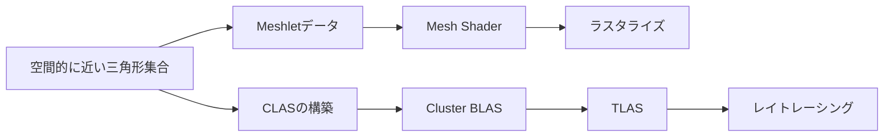

# Meshletとmeshoptimizer：形状をGPUの仕事単位へ分ける

[発展編目次](AdvancedGraphicsSamples.md) → [04 Mesh Shader基礎](Direct3D12/Advanced04_MeshShaderBasic.md) → 本章 → [05 GPU Driven Rendering](Direct3D12/Advanced05_GpuDrivenRendering.md) → [06 AS／TaskによるMeshlet Culling](Direct3D12/Advanced06_MeshletCulling.md)の順に読みます。本章のCPUデータと考え方はDirect3D12／Vulkanで共通です。

## Mesh ShaderとMeshletの役割

従来のIndexed Drawでは、Input AssemblerがIndex列から頂点を参照し、Vertex Shaderが頂点を変換します。Mesh ShaderではThread Groupが自分で形状データを読み、出力頂点と三角形の接続をまとめてラスタライザへ渡します。Pixel Shader、深度判定、Render Targetへの書込みはその後の処理です。

Meshletは、元のMeshの小さな三角形集合と、その三角形が参照する局所頂点集合です。シェーダステージや加速構造の名前ではありません。04はIndex列を32三角形ずつ読み、頂点を重複して出力するだけです。05以降でMeshletを用意すると、まとまりの中で頂点を共有し、不可視なまとまりを丸ごと省けます。

```text
元の頂点列 ← Meshlet頂点参照 ← Meshlet内の三角形Index
                             0,1,2などの局所番号
```

局所番号2は元の頂点番号2を意味しません。Meshletの頂点参照列の2番目を通して元の頂点へ到達します。UVやNormalの継ぎ目で別の頂点になっている入力は、その参照関係を保ちます。三角形の巻き順、材質境界とMASKの判定も維持します。

## 固定した依存をVisual Studioへ接続する

[meshoptimizer v1.3](https://github.com/zeux/meshoptimizer/releases/tag/v1.3)を`ThirdParty/meshoptimizer`へGit submoduleで導入し、`9e1f07b159d3cb777f1c67ed31fc11fd117986f4`へ固定します。CMakeによる別ソリューションは作らず、既存ソリューションの`MeshOptimizerCpu`静的ライブラリから上流のライブラリソースをコンパイルします。ベンダーソースは変更しません。初回取得は次のコマンドです。

```powershell
git submodule update --init --recursive
```

ライブラリはCPUで形状を分割するために使用します。D3D12／VulkanのGPUリソース、Pipeline、Descriptor、Barrierや描画関数をライブラリへ隠しません。

## WorkshopをMeshletへ変換する

固有Primitiveごとに`meshopt_buildMeshletsBound`で最大出力数を求め、`meshopt_buildMeshlets`で三角形を分割します。今回の上限は64頂点・96三角形、法線コーンを意識する重みは`0.25`です。これは両APIで揃える比較条件で、すべてのGPUで最速とする値ではありません。

生成結果の`vertex_offset`と`triangle_offset`、頂点数と三角形数を独自のGPU構造体へコピーします。元の頂点を参照するIndexは32bit、局所三角形Indexも32bitへ展開します。8bit Storageを追加で要求せず、CPUとSPIR-Vの配置を直接照合できる形にします。

境界は`meshopt_computeMeshletBounds`で求めます。GPUには、境界球の中心・半径、法線コーンの軸・Cutoff、コーンの頂点を渡します。Standard／Stressは同じ形状データを参照し、InstanceのWorld行列と材質参照を別に持ちます。カメラや遮蔽物が動いてもMeshlet分割をやり直しません。

## CPUとShaderで同じ形状を参照する

GPU用データは16-byteの値を組み合わせます。CPUのサイズ・offsetを`static_assert`で固定し、ShaderのSPIR-Vを逆アセンブルして一致を検査します。

| 構造体 | bytes | 主な内容 |
|---|---:|---|
| MeshVertex | 48 | 位置＋U、法線＋V、接線＋符号 |
| Meshlet | 64 | 頂点／三角形のoffsetと数、境界球、コーン、コーン頂点 |
| MeshPrimitive | 32 | 元Indexの範囲、材質、Meshlet範囲 |
| MeshMaterial | 80 | Base Color、Emissive／Cutoff、ORM係数、Texture参照、両面／Alpha情報 |
| MeshInstance | 144 | World、法線用逆転置、Primitive参照 |
| MeshFrame | 128 | 6平面、視点または方向光、候補数・判定・診断モード |

Mesh ShaderはInstanceとMeshletのIDから頂点参照を解決し、Pixel Shaderへ補間するUV・法線・接線と、補間しない材質IDを渡します。材質はPrimitiveを通して求めます。材質Textureは64枠の固定配列で、空き枠にも有効なDescriptorを設定します。非一様な材質番号は`NonUniformResourceIndex`で指定します。

既存のScene／照明／Deferredのbindingを維持し、Mesh用Storage Bufferをset 0のbinding 24〜33、可視リスト・引数UAVを34〜35、Texture配列を36、引数の読取りViewを37へ追加します。D3D12のb2に相当する16-byteの起動情報はRoot Constants、VulkanではPush Constantsです。材質ごとにPipelineやDescriptor Setを作り直す方式ではありません。

## 視錐台と法線コーン

視錐台の6面に対して球が完全に外側にあるMeshletを除外します。境界に触れる場合は残し、浮動小数点誤差のための余白を加えます。これは遮蔽物の後ろを調べるOcclusion Cullingではありません。

法線コーンは、Meshletの三角形の幾何法線が向く範囲です。その全体が視点に背を向けるときにMeshletを除外します。Normal Mapの法線で判定すると、実際に描画される三角形の表裏と一致しなくなります。両面材質と有効なコーンを作れないMeshletはCone Cullingを省略します。

このWorkshopは正の一様Scaleを使います。境界球の半径はScaleで拡大し、コーン軸と頂点もWorld空間へ変換します。一般の非一様ScaleやMirrorを同じ判定に入れるには、境界と向きの扱いを追加設計する必要があります。

## MeshletからDXR 2のClustered Geometryへ

小さな形状集合をGPUの処理単位にする考え方は、レイトレーシングの加速構造にもつながります。DXR Part 2のClustered Geometryでは、三角形クラスタからCLASを作り、その参照をまとめてCluster BLASを構築し、TLASへ接続します。仕様自身もMesh Shader用Meshletのような形状分割を利用例に挙げています。[DXR Part 2仕様](https://microsoft.github.io/DirectX-Specs/d3d/Raytracing2.html#clustered-geometry)



共有できるのは形状の分割や頂点・属性の管理という発想です。Meshletをそのまま加速構造として渡すことはできず、CLASの構築工程と入力の制約への対応が必要です。また、カメラ外の形状が反射や影へ寄与するため、ラスタライズ用の可視リストから単純にレイトレーシングの形状を削る設計にはしません。

GPU生成の引数で加速構造を操作する方向も、05のGPU Driven Renderingに通じます。Clusterの再利用、LOD、動的形状、ストリーミングを考える入口として紹介します。参照した仕様はv0.38、2026-09-08で、開発中との記載があります。今回のSM6.6／既存SDKの実行サンプルにはDXR 2の実装や必須機能を追加しません。

ライトを選ぶClustered ShadingのClusterは照明用の空間セルです。本章のMeshletとDXRのClustered Geometryは形状のまとまりを扱います。同じ名称を使う部分でも、保存するデータと目的を分けて読んでください。

## 次の2回で比較する処理

05ではComputeが可視Meshletリストと間接描画引数を作り、CPU読戻しを挟まず描画します。06ではAS／Taskが可視MeshletをPayloadへ詰めてMesh Shaderの仕事量を決めます。同じMeshlet、材質、カメラと判定を使い、処理の置き場所による違いを確認します。
