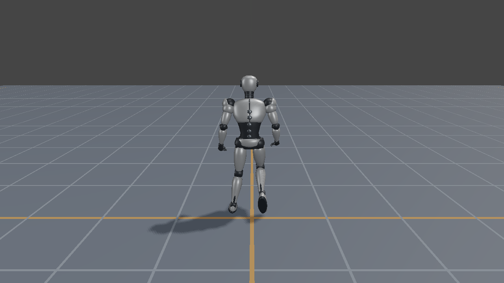
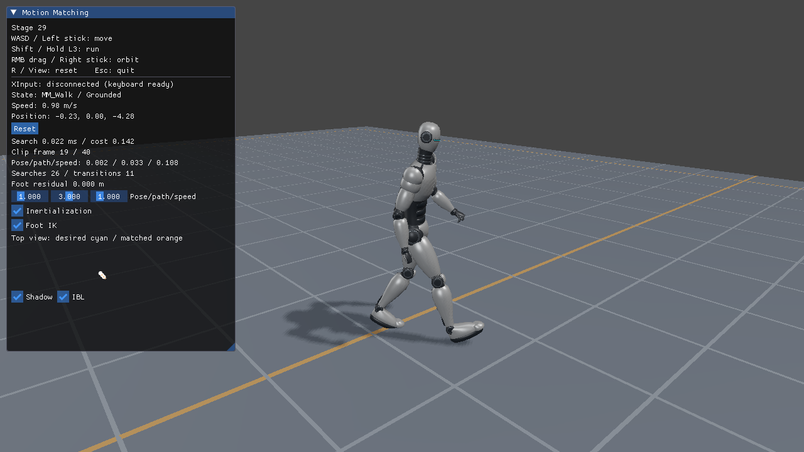

# 第29回：フレームを検索して動作をつなぐ

第28回は状態名からIdle／Walk／Runを選びました。この回では、現在の姿勢と「これから進みたい軌跡」に近いフレームを、データベースから選びます。CPUが姿勢と配置を決め、各APIのVertex Shader LBSとShadowへ渡します。



## 入力から描画まで

1. WASD／左スティックをカメラ基準の希望速度へ変換し、速度の変化を平滑化します。
2. 0.2／0.4／0.6秒先の希望位置・向きを予測します。
3. 現在の足位置・足速度・腰速度と、希望軌跡・速度を30要素へまとめます。
4. データベース全体の平均と標準偏差で正規化し、重み付き二乗距離が最小のフレームを検索します。
5. 現在の再生継続のコストとも比べ、10%以上改善した候補へ切り替えます。非ループの終端では次の候補へ移ります。
6. 位置・回転と速度の差を慣性化で減衰させ、足固定IKと腰位置補正を加えます。
7. 選択したRoot Motionの差分を配置へ適用し、骨格内では除去済みの姿勢をスキニングします。

シミュレーションは1/120秒、検索は10 Hzです。描画フレームレートから独立させています。短い非ループクリップの検索候補は、0.6秒先まで特徴量を評価できる範囲に限定します。再生を始めた後は終端まで進めます。ループの未来位置には周期ごとの移動量を加え、末尾から先頭へ戻る位置ジャンプを避けます。

## データと補正

SilverRobotMotionSetは13クリップを収録し、地上移動の検索候補は281フレームです。元モーションはQuaternius Universal Animation Library 1の固定Standard版、骨格とメッシュは既存のMITロボットです。配布の一覧、固定ハッシュ、元クリップ名はアセットの`MotionSet.json`とBlender正本のカスタム情報へ保存しています。

元データの合成Root変位と歩幅が合わない歩行・走行では、支持足から前進速度を求めて制作時に軌跡を補正しました。移動量はサンプルのデータに由来し、第28回の固定1.5／3 m/sとは異なります。待機から歩行・走行、左右旋回へは検索で切り替えます。無料素材で不足する発進・停止・旋回にはBlenderで作成した補助クリップを使います。

慣性化はローカル位置・回転のオフセットと速度を保持する臨界減衰です。回転はQuaternionの対数・指数で扱います。単に古いフレームを止めてクロスフェードする方式とは異なり、切替直前の速度も引き継ぎます。

足接地は制作時の足高さとワールド速度から判定します。接地中の足を固定し、脚の届く範囲へ腰位置を最大30 cm補正してから2ボーンIKを解きます。検索用姿勢はこのIKの前の姿勢です。足IKと慣性化はUIで比較できます。急旋回への応答を補う小さな旋回補正も含みます。モーション素材の不足を無制限の補正で隠す構成にはしていません。

## 操作と表示

| 動作 | キーボード／マウス | パッド |
|---|---|---|
| 移動 | WASD | 左スティック |
| 走行 | Shift | L3を保持 |
| カメラ | 右ドラッグ | 右スティック |
| Reset | R | View／Back |

UIは再生クリップ、検索コスト、検索時間、切替回数、足IKの残差を表示します。上面図の水色は希望軌跡、橙色は選択したモーションの軌跡です。Pose／path／speedの重みを変更して、姿勢のつながりと入力への追従を比較できます。この回は地上移動に集中し、ジャンプと障害物は次の回へ分けています。



## 再生成と検証

```powershell
./Tools/BuildSkinning.ps1 -Configuration Release
./Tools/TestMotionMatchingCpu.ps1
./Tools/TestMotionAssets.ps1
./Tools/TestMotionMatching.ps1 -Configuration Debug
./Tools/TestMotionMatching.ps1 -Configuration Release -CaptureDocs
```

オフラインビルダーは`MotionDatabaseBuilder <モーションのフォルダ> <出力.mmdb>`です。形式版・正規化係数・入力データの識別値を保存し、実行時に元モーションとの不一致を検出します。検索データを更新せずにglTFだけ差し替えた場合は、黙って再生せず再ビルドを求めます。

検証範囲と実機環境は[検証記録](MotionMatchingVerification.md)、次の段階は[ロードマップ](MotionMatchingRoadmap.md)を参照してください。
