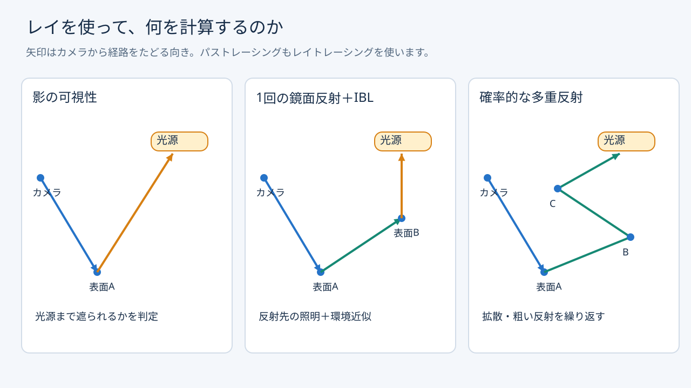
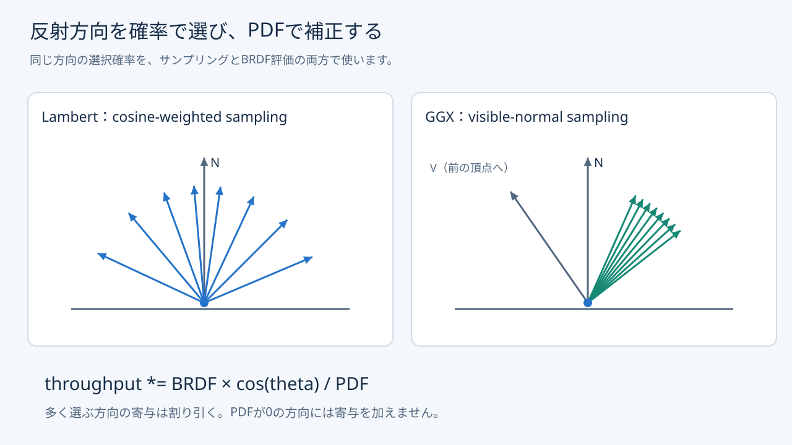
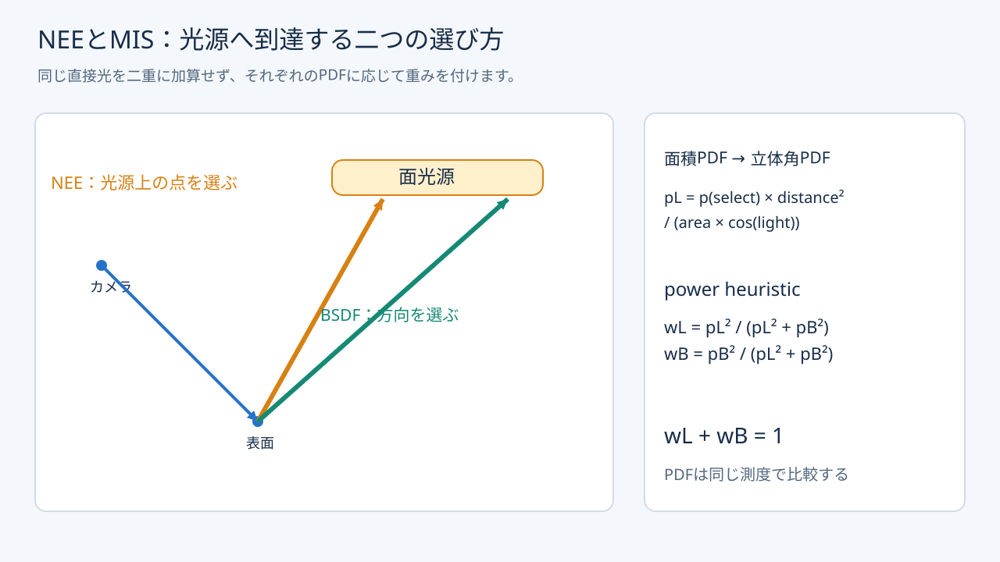
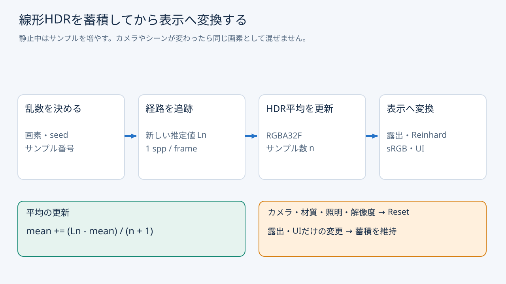
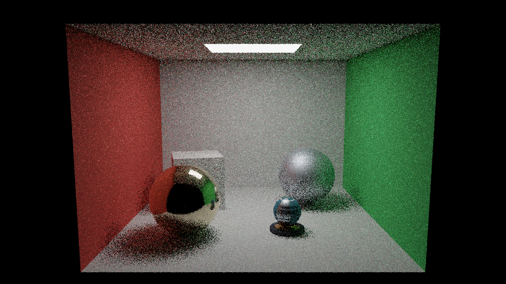
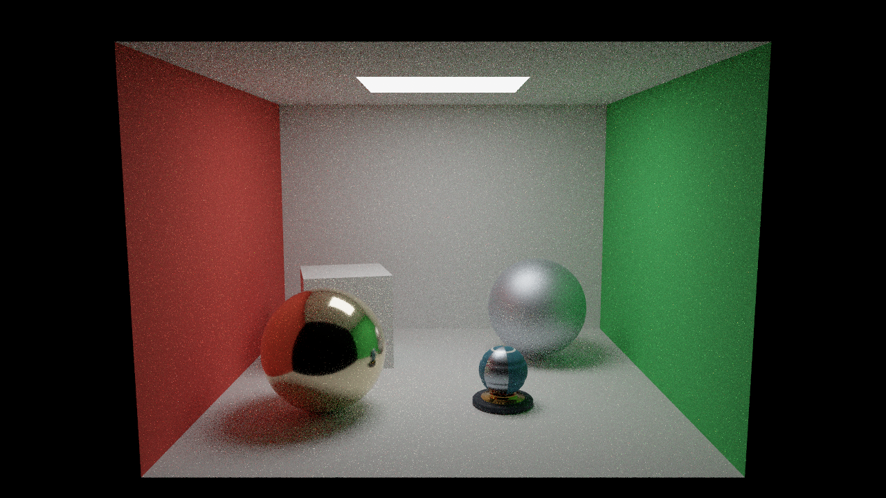

# パストレーシング入門：レイで光の経路を積分する

発展編01〜03では、カメラから表面を探し、光源までの遮蔽を調べ、鏡面方向へ1回の反射レイを飛ばしました。今回は、表面で反射する方向を確率で選び、その先でも同じ処理を続けます。局所的な色移りや粗い反射、多重反射を、光の経路から求める最初のパストレーシングです。

[Direct3D12の実装](Direct3D12/Advanced18_PathTracingBasic.md)／[Vulkanの実装](Vulkan/Advanced18_PathTracingBasic.md)／[共通アセット](Assets/PathTracing.md)／[検証記録](PathTracingVerification.md)


赤緑の壁から白い面へ届く色、箱の接地、金属球の反射を観察してください。1280×720、8バウンス上限、デノイズなしです。表示中のノイズも計算結果の一部です。

## レイトレーシングとパストレーシングの関係

レイトレーシングは、レイと形状の交差を求める仕組みです。DXRやVulkanのAcceleration StructureとRT Pipelineは、その探索をGPUで実行します。パストレーシングは、この仕組みを使って光輸送を推定する方法です。「レイトレーシングの代わりに別のAPIを使う」という関係ではありません。



| 手法 | レイで求めること | 間接光の扱い |
|---|---|---|
| 発展02の影 | 表面から光源が見えるか | 事前計算IBL |
| 発展03の鏡面反射 | 理想反射方向にある表面と、その照明 | 一次面の鏡面IBLを反射結果へ置換。反射先ではIBLを使用 |
| 基本26・27／発展16・17のRayQuery | Pixel／Computeから影や反射を問い合わせる | 各サンプルの既存の照明モデルを維持 |
| 今回のパストレーシング | BRDFに従って選んだ方向へ、さらに反射を続ける | シーン内の形状・発光・環境から推定 |

RayQueryは交差判定を呼び出す別の入口です。RayQueryでも同じパストレーシングの積分器を実装できます。今回は、発展01〜03からAPI処理を追いやすいRT Pipelineを使います。[Inline Raytracingの共通章](InlineRaytracing.md)も参照してください。

発展03もレイで反射先を描きますが、粗さに応じた確率的な反射方向、局所的な拡散GI、時間をかけた収束は扱いませんでした。今回は光源と環境を終点とする経路を足し合わせます。Irradiance Cubemap、粗さ別Specular Cubemap、BRDF LUTによるIBLは照明式へ加えません。ORMのAOも掛けません。パスで求めた遮蔽へAOを掛けると、別の遮蔽近似を重ねて暗くしてしまいます。

Workshopの見え方は旧サンプルと完全には一致しません。従来は照明近似だった発光面の周囲にも光が届き、反射回数や粗さも変わるためです。今回の直接光のみ／多重反射の比較は、同じ積分器・光源・材質・カメラで行います。

## 表面から出ていく光

表面位置を`x`、視線側の方向を`wo`、入ってくる光の方向を`wi`とすると、表面から出る放射輝度は次の式です。

```text
Lo(x, wo) = Le(x, wo)
          + ∫hemisphere f(x, wo, wi) Li(x, wi) |N・wi| dwi
```

`Le`は面自身の発光、`f`はBRDF、`Li`はその方向から来る光です。別の物体で反射した光も`Li`へ含まれます。この積分をすべての方向で細かく評価する代わりに、方向をいくつか確率的に選びます。

方向を確率密度`p(wi)`で選ぶと、1サンプルの寄与は`f × Li × cos / p`になります。多く選ぶ方向を大きく数えすぎないように、選んだ確率密度で割ります。画素へ複数サンプルを加えることで、その平均が積分へ近づきます。これがMonte Carlo推定です。

単にランダムな方向へレイを飛ばすだけでは、正しい明るさになりません。方向の選択とPDF、BRDF、余弦項を対応させる必要があります。詳しい導出は[pbrtのPath Tracing](https://pbr-book.org/4ed/Light_Transport_I_Surface_Reflection/Path_Tracing)を参照してください。

## throughputと経路の反復

最初に`radiance = 0`、経路の重み`beta = 1`とします。交差点へ到達するたびに、その面の発光と直接光へ`beta`を掛けて加算します。続く反射方向を選んだら、次の式で重みを更新します。

```text
beta *= f(wo, wi) * max(N・wi, 0) / pdf(wo, wi)
```

この`beta`がthroughputです。経路に含まれる各反射の影響を掛け合わせた値であり、明るさそのものではありません。最後に発光面や環境へ到達したとき、その放射輝度へ掛けます。

実装ではRay Generationのループから`TraceRay`し、Closest-hitからInstance ID、三角形番号、重心座標、距離、表裏を受け取ります。Ray Generationへ戻って材質を復元し、光源評価と次の方向の選択を行います。影レイもこの場所から発射します。Closest-hitから追加の`TraceRay`を呼ばないので、8バウンスを計算してもRT Pipelineの最大再帰深度は1です。

## 拡散反射とGGXのサンプリング

材質は既存の金属・粗さの規約を引き継ぎ、Lambert拡散とGGX鏡面を組み合わせます。非金属の`F0`は0.04、金属の`F0`はBase Color、GGXの`alpha`は`roughness²`です。Schlick Fresnelとheight-correlated Smithを使います。鏡面の粗さは最小0.045とし、初回はデルタ分布の完全鏡面を別実装しません。



拡散成分にはcosine-weighted hemisphere sampling、鏡面成分にはGGXの可視法線サンプリングを使います。可視法線は、入射方向から見えている微小面の法線を選ぶ方法です。[pbrtのMicrofacet Theory](https://pbr-book.org/4ed/Reflection_Models/Roughness_Using_Microfacet_Theory)を参考にしています。

一方の成分を選んでも、評価には合成したBRDFと混合PDFを使います。

```text
pBSDF = (1 - pSpecular) * pDiffuse + pSpecular * pGGX
```

選択確率`pSpecular`をPDFから抜くと、材質によって明るさが変わります。`BSDF.hlsli`の`SpecProbability`、`SampleBSDF`、`EvaluateBSDF`を一緒に読んでください。法線マップはシェーディング法線に使い、原点の移動と反射側の判定には幾何法線を使います。幾何表面の裏へ向かうサンプルは寄与0とし、引き直してPDFを変えてしまう処理は行いません。

材質Textureは従来のRTサンプルと同じくLOD 0に固定します。初回はレイ微分やRay Coneによるmip選択を扱いません。遠方の細かなTextureによるエイリアシングと、光輸送の推定によるノイズを区別してください。

## 面光源を直接選ぶ：NEE

BSDFの方向だけを選ぶと、小さな面光源へ偶然到達する回数が少なくなります。そこで各表面から、光源上の点も明示的に選びます。これがNext Event Estimation（NEE）です。選んだ点まで影レイを発射し、可視の場合だけ寄与を加えます。

CPUは発光材質の三角形を抽出し、World変換後の面積と材質の平均発光量からCDFを作ります。平均発光量は選択の効率を決める近似値です。選んだ位置の放射輝度はGPUでEmissive Textureをサンプリングして求めます。局所的に発光していない場所を選んだら寄与は0です。

三角形の選択確率を`pSelect`、面積を`A`、距離を`r`、光源側の余弦を`cosLight`とすると、方向に対するPDFは次の式です。

```text
pLight = pSelect * r² / (A * cosLight)
```

これは面積の測度から立体角の測度への変換です。距離の二乗と光源側の余弦を省くと、距離や向きによって誤った明るさになります。光源を動かした際はTLASと同時に面光源データも更新します。

## 二つの推定を組み合わせる：MIS

NEEを加えても、BSDF経路が発光面へ到達する場合があります。その両方を重み1で加えると、同じ直接光を二度数えます。Multiple Importance Sampling（MIS）は、両者のPDFから重みを作って推定を組み合わせます。



今回はpower heuristicを使います。NEE側は`pLight² / (pLight² + pBSDF²)`、BSDF側は逆の重みです。比較するPDFは両方とも立体角の測度に揃えます。カメラから直接見た発光面は重み1です。BSDF経路で到達した発光面は、前の交差点から見た光源PDFを計算します。Instanceの光源先頭番号と三角形番号で対応する光源を取得します。

環境は今回はBSDF経路のMissだけから求めます。環境をNEEで選んでいないので、MissへのMISの割引はありません。点光源と太陽光はデルタ光源で、連続的なBSDF方向の選択では到達できません。そのため「BSDFのみ」でもデルタ光源は直接評価します。Workshopの点光源は1個を一様に選び、光源数で補正します。室内にはデルタ光源がないため、面光源に対するサンプリング方式の違いを観察しやすくなっています。

実装と重みの考え方は[pbrtのA Better Path Tracer](https://pbr-book.org/4ed/Light_Transport_I_Surface_Reflection/A_Better_Path_Tracer)を参照してください。

## バウンス上限とRussian roulette

バウンス上限1では、最初の表面での散乱から発光面または環境へ到達する経路までを評価します。別の非発光面へ当たった後の散乱は行いません。上限8では、壁や床でさらに反射した光も含まれます。終端のレイが到達した発光と環境を評価してから終了するため、「1バウンスなのにBSDFだけでは光源へ到達できない」という実装にはしていません。

今回の上限は表面での散乱回数です。発展03の「1バウンス」は追加した鏡面レイの回数で、反射先での直接光評価も含む点を区別してください。

上限で打ち切ると、それより長い経路は省略されます。最大深度が有限である以上、無限回反射の積分に対して打切り誤差があります。

Russian rouletteは3回の散乱後から、throughputに応じて経路を確率的に終了する処理です。生き残る確率は最大0.95とし、生き残った場合はその確率で`beta`を割ります。期待値を保ちながら、寄与の小さい経路の計算を減らします。ノイズを消す処理ではなく、同じサンプル数では分散が増えることもあります。

## サンプル蓄積と表示



毎フレーム、各画素に1本の経路を追加します。乱数は画素、seed、サンプル番号で決まり、同じ条件で再現できます。サブピクセル位置にもジッターを加えます。蓄積するのはTone Map前の線形HDRです。

```text
mean[n + 1] = mean[n] + (sample - mean[n]) / (n + 1)
```

RGBA32Fの画像を使い、リセット後の最初のサンプルは古い画像を読まずに書き込みます。カメラ、材質、照明、積分設定、解像度が変わったらサンプル数を0へ戻します。露出とUI表示だけの変更では平均を維持します。異なる経路条件の画像を混ぜると残像や誤った収束になります。




冒頭の256 sppと比較してください。独立サンプルの標準誤差は概ね`1/sqrt(N)`で減るため、ノイズを半分にするには約4倍のサンプルが必要です。個々の画素が毎回単調に改善するわけではありません。

## 初回で扱わないものと次回への接続

今回の初期値は全解像度・1 spp／フレームで、カメラを動かすと蓄積を始め直します。ReSTIR、デノイズ、再投影、適応サンプリング、屈折・吸収、参加媒質、Wavefront化は実装していません。透明カバーのBLENDも描画対象に含めません。

後続回では、同じ室内とWorkshop、同じ材質・光源を使い、サンプリングの改善やノイズ処理による差を比較できます。今回の保存済みアセット、カメラ、seed、バウンス数、sppを比較条件として引き継いでください。理論図はSVGとPNGを同梱し、`Tools/DrawPathTracingFigures.py`から再生成できます。


## 反射だけのBSDFから透過へ

この回の`BSDF.hlsli`は、BSDFのうち反射成分だけを実装しています。本文でBRDFと呼んでいるのも、その範囲を表すためです。[発展19の共通解説](BRDFAndBSDF.md)では、BTDFを加えた誘電体と、内部の距離吸収を別々に扱います。[追加アセット](Assets/BSDFMaterials.md)はこのRoomを再利用します。発展18のコードと元アセットは維持します。
