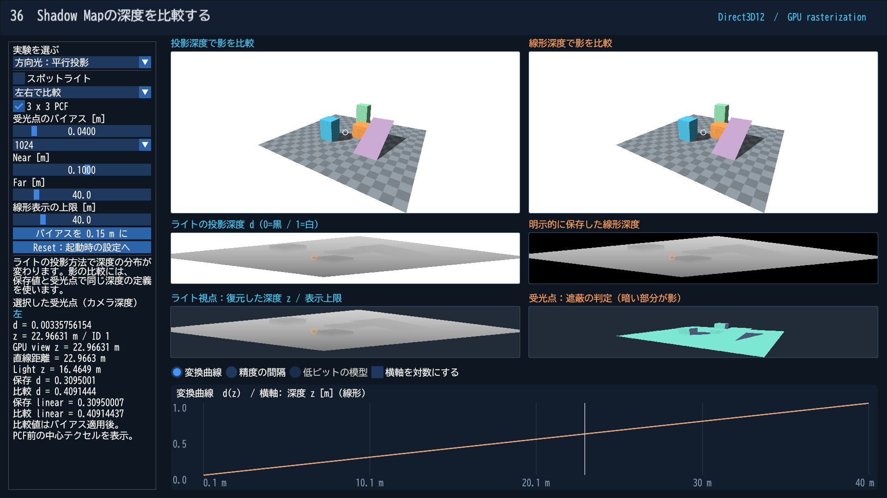
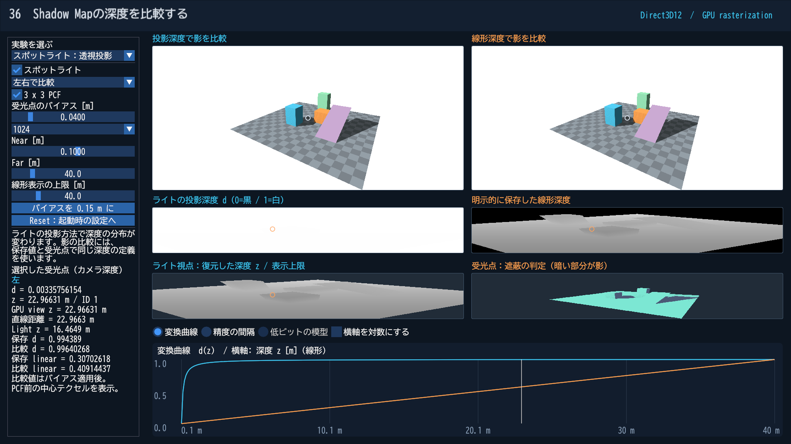

# Shadow Mapの深度：投影深度と線形深度は何が違う？

Shadow Mapは、ライトから見て最も手前にある面の深度を記録した画像です。受光点を同じライトの座標へ移し、記録された面より奥なら、その間に遮蔽物があると判断します。

「Shadow Mapでは線形Depthを使う」という説明は、条件を付ける必要があります。**どの投影を使い、何を保存し、何と比較するか**で意味が変わります。

[深度の基本](DepthPrecision.md)と[第13回のShadow Map](Direct3D12/13_ShadowMap.md)の続きとして、[Direct3D12 第36回](Direct3D12/36_ShadowDepth.md)／[Vulkan 第36回](Vulkan/36_ShadowDepth.md)を起動してください。

## 方向光の平行投影では、もともと線形

方向光は平行な光線として扱い、ライトから見える範囲を平行投影でShadow Mapへ写します。この場合の通常Zは、

$$d=\frac{z_L-n_L}{f_L-n_L}$$

です。z_Lはライト視点の視線方向に沿った深度です。ライトからの放射距離でも、閲覧用カメラの深度でもありません。

**操作：**「方向光：平行投影」を選びます。中段左の投影深度と、中段右の明示的な線形深度がほぼ同じ画像になります。式として同じ値ですが、一方は固定機能の深度出力、他方はシェーダーのカラー出力なので丸めが完全に一致するとは限りません。

比べるのは物体が描かれた部分です。背景は、投影深度側ではクリア値1の白、線形深度側では未描画を表す値−1を黒として表示しています。この背景色の違いは、物体の深度が非線形になったことを意味しません。

既存の第13回も方向光＋平行投影です。線形なのはShadow Mapという名前のためではなく、この投影を使っているためです。

## スポットライトでは投影深度が非線形

スポットライトの光線は一点から広がるので、この教材では透視投影を使います。通常Zはカメラの透視投影と同様に、

$$d=\frac{f_L(z_L-n_L)}{(f_L-n_L)z_L}$$

となります。これをそのままShadow Mapへ記録しても、受光点に同じ変換を適用すれば比較できます。Shadow Mapの比較に線形化が必須なわけではありません。

**操作：**「スポットライト：透視投影」を選びます。投影深度はほぼ白く、線形深度には広い明暗が見えます。それでも上段の影はほぼ一致します。同じ前後関係を異なる数値の表し方で比較しているからです。

## 明示的な線形深度をどう保存するか

ライトからのパスで、D32の通常の深度テストにより手前の面を選びます。それと同時に、別のR32_FLOATカラー出力へ次の値を記録します。

$$\ell=\frac{z_L-n_L}{f_L-n_L}$$

SV_Depthへこの値を書く実験ではありません。投影深度を使うDSV／深度アタッチメントと、追加のカラー出力は別の画像です。

| 方式 | 保存値 | 受光点の比較値 |
|---|---|---|
| 投影深度 | ライトの投影後のzc/wc | 同じライト行列を通したzc/wc |
| 明示的な線形深度 | 正規化したライト視点のz | 同じNear／Farで正規化したライト視点のz |

投影深度と線形深度を直接比較してはいけません。また、追加の線形テクスチャにはメモリ・帯域のコストがあります。これは定義を比較する教材であり、すべてのShadow Mapへ追加することを勧めるものではありません。

## 受光点、バイアス、PCFをつなげる

上段をクリックすると、カメラで選んだ受光点がライトの画像上にも橙色の印で表示されます。左の数値欄では、ライト視点のz、記録された値、バイアス適用後の比較値を確認できます。中心テクセルの値を表示しており、PCF後の平均とは区別します。

バイアスなしでは、面の傾き、テクセル内の位置の違い、数値誤差などから、表面が自分自身の影になる場合があります。これがShadow Acneです。本教材では、受光点のライト視点zを指定したmだけ手前へ移してから、選択した保存方式へ変換します。

$$z_{\mathrm{compare}}=\max(n_L,z_L-\mathrm{bias})$$

この単位はライトの視線方向のmです。ラスタライザーのDepthBiasやSlopeScaledDepthBiasとは別の、説明用の受光点バイアスです。Near／Farや投影が違うと、同じmでも投影深度の数値差は変わります。

**操作：**「バイアスなし」から少しずつ増やします。自己遮蔽が減る一方、大きすぎると影が浮いたり細い影が消えたりします。Reverse-Zだけでこれらの問題が消えるわけではありません。[Shadow Mapのアーティファクトと対策](https://learn.microsoft.com/en-us/windows/win32/dxtecharts/common-techniques-to-improve-shadow-depth-maps)

3×3 PCFは周辺9テクセルでそれぞれ比較し、9個の可視／遮蔽結果を平均します。保存深度を平均してから1回比較する処理ではありません。解像度を256へ下げた結果とPCFのON／OFFを見比べ、深度精度とXY方向のテクセル密度を別の問題として観察してください。PCFは面光源の物理的な半影を再現するものではありません。

## カメラとライトの設定は独立

完成画像を描くカメラはD32_FLOATのReverse-Z、Shadow MapはD32_FLOATの通常Zです。別々の画像とパスなので、同じ規約に統一する必要はありません。ライトの方式を変えても、カメラ用の深度テストは変えません。

ライト側もReverse-Zにする場合には、ライト投影、クリア値、深度テスト、Shadow比較の向き、保存深度へ加えるバイアスの符号などをまとめて見直します。本サンプルは通常Zのライトを維持し、線形／非線形の比較に集中します。

## 点光源の「距離」はもう一つの定義

点光源の全方向Shadow MapではCubemapが使われ、ライトからの放射距離length(P-L)を保存する方式もあります。これは各Cubemap面の視線方向のzとは異なります。Cubemapであることだけから、保存値が放射距離だとは判断できません。投影深度を使う方式もあり、いずれも比較側の定義を合わせます。

点光源のCubemap、Cascaded Shadow Maps、Variance Shadow Mapsは今回の実装には含めません。まず、**投影と保存値の定義を確認してから比較する**という基本を身に付けます。
