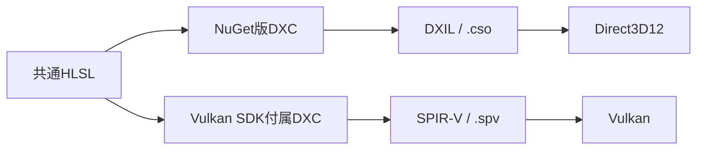

# 共通HLSLの規約

初回の4種類の描画テーマは、同じHLSLをDirect3D12とVulkanで使用します。シェーダ計算をAPI別に複製せず、コンパイラ出力とリソース・Viewportの設定で差を吸収します。

## コンパイル

両APIで`-HV 2021 -Zpr`と`vs_6_6`／`ps_6_6`を明示します。HLSLの言語版とShader Modelは別の指定です。D3D12は固定したNuGet版DXC、VulkanはSDK付属DXCを使用するため、コンパイラのバージョンは一致するとは限りません。

| API | コンパイラ | 出力 | API固有の指定 |
|---|---|---|---|
| Direct3D12 | Microsoft.Direct3D.DXC 1.9.2609.5 | DXIL / `.cso` | Debugでは`-Zi -Qembed_debug -Od` |
| Vulkan | `VULKAN_SDK/Bin/dxc.exe` | SPIR-V / `.spv` | `-spirv -fspv-target-env=vulkan1.3` |

Releaseは`-O3`、Debugは`-Zi -Od`です。出力は実行ファイル配下の`Shaders/Vertex.*`と`Shaders/Pixel.*`へ置きます。実行時コンパイル用のDXC DLLをアプリへ組み込む必要はありません。

VSのCustom Buildがソースと`Common.hlsli`の変更を追跡し、06の`Scene.hlsli`、07／08の`Lighting.hlsli`、08の`Scene.hlsli`も再コンパイルの入力に含めます。Vulkan出力はビルド後にSDKの`spirv-val --target-env vulkan1.3`で検証します。

## リソースと頂点入力

| HLSL | D3D12 | Vulkan（set 0） |
|---|---|---|
| `b0` | Root CBV | binding 0 / UNIFORM_BUFFER |
| `t0` | SRV Descriptor Table | binding 1 / SAMPLED_IMAGE |
| `s0` | Static Sampler | binding 2 / SAMPLER |
| `t1`（08） | SRV Tableの2番目 / Normal | binding 3 / SAMPLED_IMAGE |
| `t2`（08） | SRV Tableの3番目 / ORM | binding 4 / SAMPLED_IMAGE |
| `t3`（08） | SRV Tableの4番目 / Emissive | binding 5 / SAMPLED_IMAGE |

`Shaders/Common.hlsli`はDXCの`__spirv__`定義に応じて`[[vk::binding]]`と`[[vk::location]]`を有効化します。頂点入力はlocation 0が位置、1が色またはUVです。頂点→ピクセルのユーザー定義出力はlocation 0を使用します。`SV_Position`は組込みの位置出力です。

07／08では頂点入力にlocation 2=法線、08で3=接線を追加します。頂点→ピクセル出力は0=UV、1=World位置、2=World法線、08の3=World接線です。[ライティングからPBRへの共通解説](LightingAndPBR.md)で配置と式を説明しています。

## 行列、座標、色

行列は行ベクトル・row-majorで、CPUで`Model * View * Projection`を作り、HLSLで`mul(position, mvp)`を計算します。07／08はWorldとViewProjectionを分け、World位置もPixel Shaderへ渡します。定数バッファの行列は`float4x4`で64バイトです。CPU配置は`static_assert`で確認し、GPUの確保サイズはD3D12で256バイト単位、VulkanでデバイスのUniform Bufferアラインメントへ切り上げます。07／08の320バイトはD3D12で512バイト確保します。

初回は16バイト境界に揃う行列を使用し、`-fvk-use-dx-layout`やScalar Block Layoutの追加要求を持ち込みません。今後メンバーを増やすときは両出力のoffset・strideも確認してください。

カメラは左手系、深度は0〜1です。Vulkanは負の高さのViewportを使い、共通HLSLの+Y上向きを維持します。`-fvk-invert-y`を併用すると二重に反転するため指定しません。初回のカリングは無効です。

画像はWICでRGBA8に展開し、GPUテクスチャをsRGB形式で作成します。描画先も両APIでsRGB変換を行い、補間・計算は線形空間で揃えます。OBJのUVはCPU側でVを反転し、API別の反転処理を入れません。

glTFではUVのVを反転しません。08のAlbedo／EmissiveはsRGB、Normal／ORMはUNORMの線形データとして読みます。Normal・AO・Metallic・RoughnessをsRGBで読むと値が変わるので、画像の用途からView形式を選びます。

## 将来の拡張

SM6.6を指定しても、個々の機能がVulkanへ同じ条件で移植できるとは限りません。Wave命令、Bindless、64bit演算などを追加する際は、DXCのSPIR-V対応とGPUのfeature／extensionをテーマごとに確認します。Shader Modelの基準を上げる場合も必要なサンプルから変更し、対応環境をDocsへ記録します。

参考: [DXC](https://github.com/microsoft/DirectXShaderCompiler)、[HLSL to SPIR-V Feature Mapping](https://github.com/microsoft/DirectXShaderCompiler/blob/main/docs/SPIR-V.rst)、[Khronos HLSLガイド](https://github.khronos.org/Vulkan-Site/guide/latest/hlsl.html)
