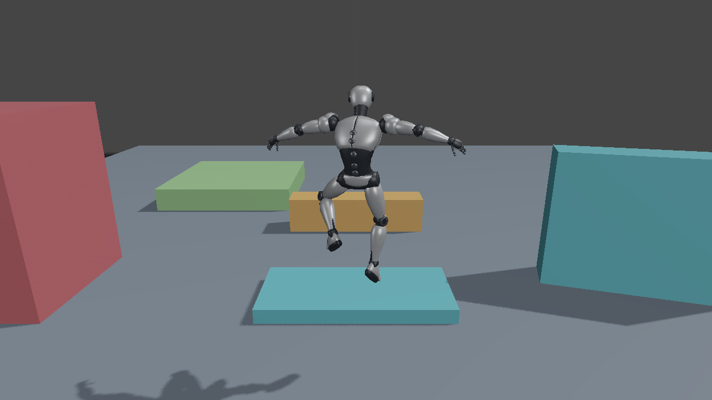

# 第30回：衝突判定を加えてキャラクターを動かす

第29回のモーションマッチングへ、静的な箱との衝突、接地、段差、通常ジャンプを加えます。希望した移動量をそのまま採用せず、キャラクターの体が通れる位置へ制限する回です。対応プロジェクトは`Direct3D12_30_TraversalController`と`Vulkan_30_TraversalController`です。



## 配置と姿勢の担当を決める

地上のクリップ検索、Root Motion、慣性化、足IKは[第29回](MotionMatching.md)を使います。`TraversalController`は`ResolveMovement`で希望移動を衝突判定へ渡し、実際に到達できた配置を返します。描画APIから独立したCPU処理です。

| 処理 | 担当 |
|---|---|
| 水平方向の希望変位 | 選択された地上クリップのRoot Motion |
| 到達できる位置 | カプセルと箱のスイープ、面に沿う滑り |
| ジャンプ・落下の高さ | 鉛直速度と重力 |
| 空中・着地の見た目 | JumpStart／JumpLoop／JumpLandの姿勢 |
| GPUへ渡す結果 | 配置行列とローカルTRSから作るボーンパレット |

空中の見た目はジャンプ用クリップへ切り替えます。クリップの高さと物理的なジャンプ軌道を二重に配置へ加算しません。空中では地上の足固定IKも停止します。

## カプセルと回転した箱

体の判定は半径25 cm、高さ1.8 mの直立カプセルです。レベルは直立した箱を並べ、水平回転だけに対応します。描画メッシュと判定用の箱は別々に持ちます。

`TraversalWorld.h`では、カプセルの軸となる鉛直線分を箱のローカル空間へ変換し、箱との最短距離からカプセル半径を引きます。正なら離れ、負なら侵入しています。最短距離を使って安全に進める距離を求め、最初に接触する位置まで進みます。終点だけを調べる方式と比べ、高速移動で薄い壁を通り抜けにくくなります。

接触後に残った変位から、接触法線へ向かう成分を取り除きます。これを最大5回繰り返し、壁に沿って滑る移動を作ります。任意の三角形地形や動的な物体の物理シミュレーションは扱いません。

## 接地と小さな段差

移動後に4 cm下へスイープし、上向きの面へ接触していて、鉛直速度が下向きなら接地とします。接地した位置を支持面へ寄せ、鉛直速度を0へ戻します。

地上で水平移動が塞がれたときは、25 cm上へ持ち上げた位置に空間があるか調べます。そこから水平移動して下へスイープし、元より先へ進める支持面が見つかれば段差を上ります。練習コースの水色の段差は20 cmです。橙色の65 cm障害物は歩くだけでは越えられず、通常ジャンプか迂回が必要です。

段差の角では、カプセルの丸みによって浅い接触法線が返ります。平らな床と同じ上向き法線だけを要求すると、角で接地を失って上れません。段差の高さと上方の空間を確認できた区間では接地を維持し、高い壁を同じ条件で上らないよう箱の上面高さも制限します。

## 通常ジャンプと落下からの復帰

Space／パッドAの押下時に接地していれば、上向き速度を5 m/sにします。1/120秒の各更新で、変位と速度を次のように計算します。

```cpp
delta.y = verticalVelocity * dt - 0.5f * 9.8f * dt * dt;
verticalVelocity -= 9.8f * dt;
position = level.Move(previousPosition, delta);
```

上昇が天井で遮られた場合も、位置補正の結果から鉛直速度を止めます。足元が-4 mを下回ったら、最後に通ったチェックポイントへ戻ります。Resetでは開始位置、検索・再生状態、入力履歴を初期化します。

## 三人称カメラの遮蔽

追従カメラの注視点から希望位置まで、半径12 cmの球をスイープします。球は高さ24 cmのカプセルとして同じ距離計算を使います。障害物があればカメラの距離を縮めます。キャラクターの移動判定と同じ箱を参照するため、見た目と判定の編集結果を両方へ反映できます。

## Blenderの練習コース

正本は`SourceArt/Blender/TraversalCourse/TraversalCourse.blend`です。

- `Render`：床、段差、ジャンプ障害物、台、回転した壁の見た目。
- `Collision`：ID、中心、半寸法、Yawを持つ箱Empty。
- `Targets`：開始位置とチェックポイント。

保存済みの正本を編集し、`export.py`で描画用のWorkshop形式と判定用`Traversal.json`を出力します。両方とも同じBlender座標から左手系・Y upへ変換します。通常の出力では正本を保存しません。`generate.py`は正本が存在しないときの初回制作専用です。

```powershell
& 'C:\Program Files\Blender Foundation\Blender 5.2\blender.exe' --background SourceArt/Blender/TraversalCourse/TraversalCourse.blend --python-exit-code 1 --python SourceArt/Blender/TraversalCourse/export.py
./Tools/TestMotionAssets.ps1
```

## 操作と確認する結果

| 動作 | キーボード／マウス | XInputパッド |
|---|---|---|
| 移動 | WASD | 左スティック |
| 走行 | Shift | L3を保持 |
| 通常ジャンプ | Space | A |
| カメラ | 右ドラッグ | 右スティック |
| Reset | R | View／Back |

壁へ斜めに進むと面に沿って滑り、低い段差では接地を維持します。ジャンプ中も本体と影は同じ姿勢を使います。UIでは位置、接地、カプセルの侵入量、復帰回数と検索結果を確認できます。UIが入力を取得している間、フォーカス喪失中、最小化中は操作を停止します。

実装への組込みは[Direct3D12](Direct3D12/30_TraversalController.md)／[Vulkan](Vulkan/30_TraversalController.md)、学習順は[第28〜30回の構成](MotionMatchingRoadmap.md)、実機結果は[検証記録](MotionMatchingVerification.md)を参照してください。
