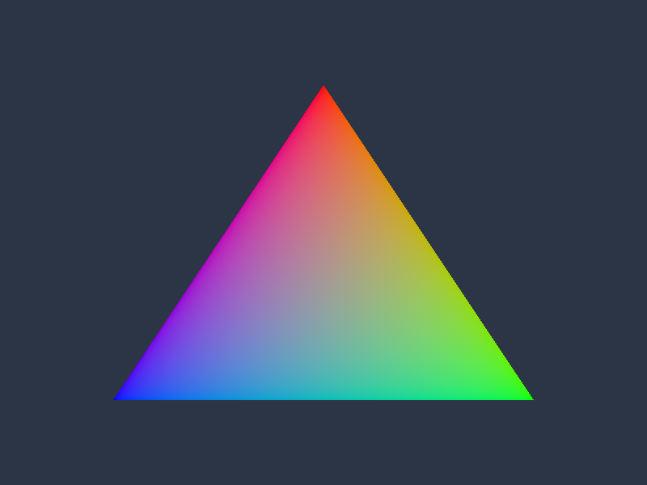

# Vulkan 02: NDC座標の三角形と頂点カラー

Vertex Bufferに位置と色を入れ、事前コンパイルした頂点・ピクセルシェーダで三角形を描きます。赤い頂点が上、青い頂点が左下、緑の頂点が右下です。



## ビルドと実行

Windows、Visual Studio 2026（v145）、Windows SDK 10.0.26100.0、x64が対象です。Vulkan SDKと付属DXCをインストールし、`VULKAN_SDK`を参照できる状態でVSを起動します。実行GPUにはVulkan 1.3、Dynamic Rendering、Synchronization2、graphics/present両対応Queueが必要です。

```powershell
msbuild .\Samples\Vulkan\02_Triangle\Vulkan_02_Triangle.vcxproj -p:Configuration=Debug -p:Platform=x64
& .\bin\x64\Debug\Vulkan_02_Triangle\Vulkan_02_Triangle.exe
```

コマンドはリポジトリ直下で実行します。D3D12のNuGet復元手順は[README](../../README.md)を参照してください。ESCまたは閉じるボタンで終了します。

## データと処理順

入力は`ColorVertex`（`float3 position`、`float4 color`）です。位置はx/yが−1〜1のNDCを想定し、頂点シェーダは`float4(position, 1)`を返します。この条件ではクリップ座標のxyzとNDCが一致するため、変換行列も定数バッファも不要です。色は頂点間で補間されます。

実装は[Sample.cpp](../../Samples/Vulkan/02_Triangle/Sample.cpp)、宣言は[Sample.h](../../Samples/Vulkan/02_Triangle/Sample.h)です。

- **`CreatePipeline`**: Vertex.spvとPixel.spvを読み、Shader Moduleを作ります。location 0を位置、1を色に割り当てます。Dynamic Renderingの描画先形式をPipelineに指定し、Render Passオブジェクトは作りません。
- **`CreateScene`**: HOST_VISIBLEの頂点Bufferを作り、Mapしてコピーします。可能ならHOST_COHERENTを選び、非coherentの場合はFlushMappedMemoryRangesを実行します。
- **`OnRender`**: Viewportはy=height、height=−heightにしてHLSLの+Y上向きを維持します。Vertex BufferとPipelineをBindし、vkCmdDrawで3頂点を描画します。


## 共通HLSLとの対応

[頂点シェーダ](../../Shaders/02_Triangle/Vertex.hlsl)と[ピクセルシェーダ](../../Shaders/02_Triangle/Pixel.hlsl)は両APIで同じファイルです。Shader Model 6.6／HLSL 2021を指定し、Vulkanでは`-spirv -fspv-target-env=vulkan1.3`でSPIR-V（`.spv`）へコンパイルします。実行時コンパイルは行いません。ソースまたは共通includeの変更時にはビルドで再生成します。

Vulkanのbinding/locationは`Common.hlsli`のマクロで指定し、D3D12向けでは属性部分だけを除きます。詳細は[共通シェーダの規約](../SharedShaders.md)を参照してください。

## リサイズと確認

最小化中は描画を止め、復帰後にサイズ変更を反映します。リサイズ時はGPU完了を待ち、Swapchainの画像・Viewを作り直します。3Dサンプルでは深度画像も作り直します。初回は理解しやすさを優先し、複数フレームを並行実行しません。

```powershell
& .\bin\x64\Debug\Vulkan_02_Triangle\Vulkan_02_Triangle.exe --frames 48 --test-window --screenshot ".\.cache\Vulkan_02_Triangle.png" --log ".\.cache\Vulkan_02_Triangle.log"
```

`--test-window`は640×480への変更、最小化、800×600への復帰を実行します。`--screenshot`はGPUから描画結果を読み戻してPNGを保存します。Debugの検証エラーが出た場合はログと終了コードで確認できます。画像・シェーダの欠落時も原因のファイル名を表示します。

テクスチャはsRGBとしてサンプリングし、色の補間・シェーダ計算は線形空間で行い、sRGB描画先で出力変換します。テクスチャの赤／緑／青／黄、上向き矢印、BOXの奥行きがAPI間で一致することを確認します。

初回検証の環境と結果は[検証記録](../Verification.md)に記載しています。

前のテーマ: [01 APIの初期化と画面クリア](01_Initialization.md)

次のテーマ: [03 NDC座標のテクスチャ表示](03_Texture.md)

同じテーマの別API: [Direct3D12](../Direct3D12/02_Triangle.md)
