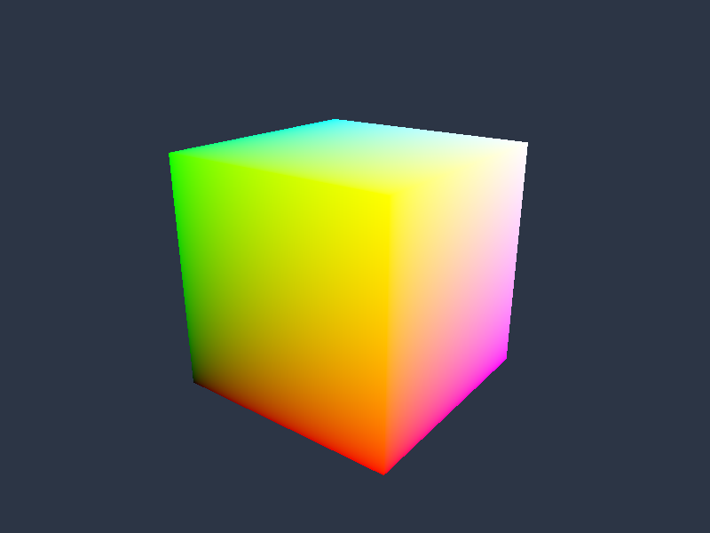

# Vulkan 04: 頂点カラーBOXと3D座標変換

8頂点と36インデックスでBOXを描きます。固定カメラを右上手前に置き、定数バッファのModel・View・Projection行列と深度バッファで3面が見える立体を表示します。



初期の描画領域は全サンプル共通で**1280×720ピクセル**です。掲載画像は変更前の800×600で取得したものを使用しています。

## ビルドと実行

Windows、Visual Studio 2026（v145）、Windows SDK 10.0.26100.0、x64が対象です。Vulkan SDKと付属DXCをインストールし、`VULKAN_SDK`を参照できる状態でVSを起動します。実行GPUにはVulkan 1.3、Dynamic Rendering、Synchronization2、graphics/present両対応Queueが必要です。

```powershell
msbuild .\Samples\Vulkan\04_Box\Vulkan_04_Box.vcxproj -p:Configuration=Debug -p:Platform=x64
& .\bin\x64\Debug\Vulkan_04_Box\Vulkan_04_Box.exe
```

コマンドはリポジトリ直下で実行します。D3D12のNuGet復元手順は[README](../../README.md)を参照してください。ESCまたは閉じるボタンで終了します。

## データと処理順

座標変換は左手系・行ベクトルです。`Common/Mesh.cpp`の`MakeSceneConstants`が`Model * View * Projection`を計算し、転置せずに`SceneConstants::mvp`へ保存します。HLSLは`row_major float4x4`と`mul(float4(position,1), mvp)`を使います。深度は0〜1、Clear値は1、比較はLESSです。リサイズ時にアスペクト比を更新します。

実装は[Sample.cpp](../../Samples/Vulkan/04_Box/Sample.cpp)、宣言は[Sample.h](../../Samples/Vulkan/04_Box/Sample.h)です。

- **`CreateScene`**: 32bit Index BufferとUniform Bufferを作ります。MVPは64バイトですが、確保するUniform Buffer領域はminUniformBufferOffsetAlignmentへ切り上げます。Descriptorのrangeは64バイト、offsetは0です。
- **`CreatePipeline / CreateDepth`**: set 0/binding 0をVertex可視のUNIFORM_BUFFERにします。D32_SFLOATのDepth Imageを作り、Dynamic RenderingのDepth AttachmentとPipelineの深度テストを設定します。
- **`OnRender`**: 深度ImageをDEPTH_ATTACHMENT_OPTIMALへ遷移し、フレーム間の深度書込みも同期します。Descriptor Set・Index BufferをBindし、vkCmdDrawIndexedで36インデックスを描画します。


## 共通HLSLとの対応

[頂点シェーダ](../../Shaders/04_Box/Vertex.hlsl)と[ピクセルシェーダ](../../Shaders/02_Triangle/Pixel.hlsl)は両APIで同じファイルです。Shader Model 6.6／HLSL 2021を指定し、Vulkanでは`-spirv -fspv-target-env=vulkan1.3`でSPIR-V（`.spv`）へコンパイルします。実行時コンパイルは行いません。ソースまたは共通includeの変更時にはビルドで再生成します。

MVP行列は`b0`で宣言します。Vulkanのbinding/locationは`Common.hlsli`のマクロで指定し、D3D12向けでは属性部分だけを除きます。詳細は[共通シェーダの規約](../SharedShaders.md)を参照してください。

## リサイズと確認

最小化中は描画を止め、復帰後にサイズ変更を反映します。リサイズ時はGPU完了を待ち、Swapchainの画像・Viewを作り直します。3Dサンプルでは深度画像も作り直します。初回は理解しやすさを優先し、複数フレームを並行実行しません。

```powershell
& .\bin\x64\Debug\Vulkan_04_Box\Vulkan_04_Box.exe --frames 48 --test-window --screenshot ".\.cache\Vulkan_04_Box.png" --log ".\.cache\Vulkan_04_Box.log"
```

`--test-window`は640×480への変更、最小化、1280×720への復帰を実行します。`--screenshot`はGPUから描画結果を読み戻してPNGを保存します。Debugの検証エラーが出た場合はログと終了コードで確認できます。画像・シェーダの欠落時も原因のファイル名を表示します。

テクスチャはsRGBとしてサンプリングし、色の補間・シェーダ計算は線形空間で行い、sRGB描画先で出力変換します。テクスチャの赤／緑／青／黄、上向き矢印、BOXの奥行きがAPI間で一致することを確認します。

初回検証の環境と結果は[検証記録](../Verification.md)に記載しています。

前のテーマ: [03 NDC座標のテクスチャ表示](03_Texture.md)

次のテーマ: [05 OBJモデルとテクスチャの読込](05_Model.md)

同じテーマの別API: [Direct3D12](../Direct3D12/04_Box.md)
