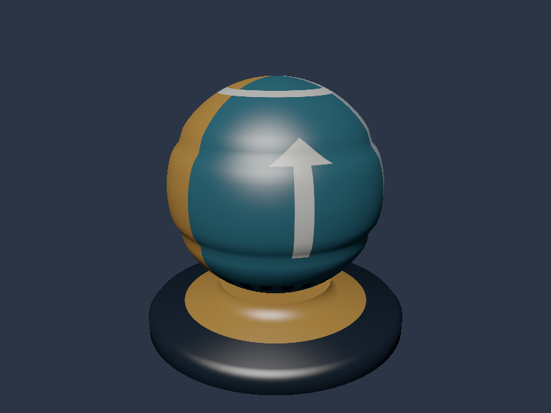
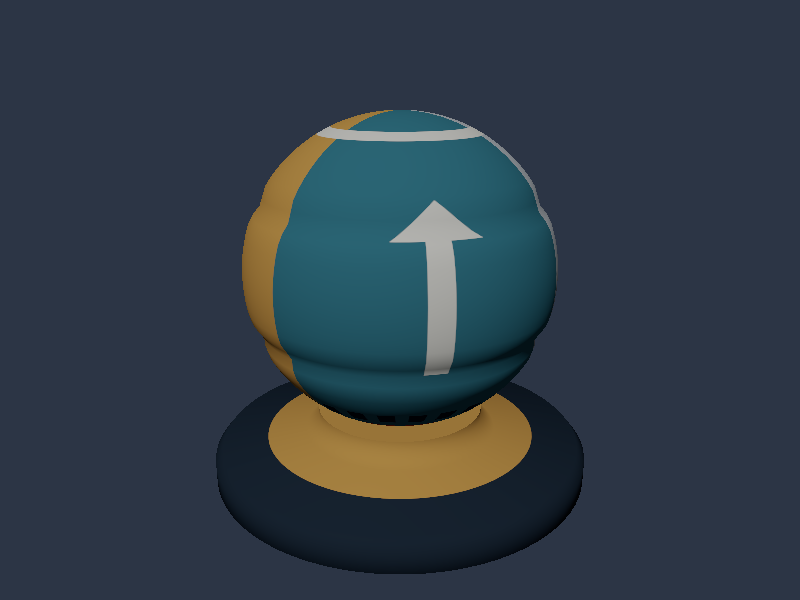

# Vulkan 07: LambertとBlinn-Phongのライティング

06のglTF Albedo表示へ法線・方向光・視線を加えます。Lambertの拡散反射と、Blinn-Phongの鏡面反射を切り替え、球の明暗とハイライトを比較します。



## ビルドと実行

Visual Studio 2026／v145、Windows SDK 10.0.26100.0、C++20、x64です。Vulkan SDKを導入し、`VULKAN_SDK`と付属DXCを使用します。Vulkan 1.3、Dynamic Rendering、Synchronization2が必要です。 nlohmann/jsonは06と同じ固定Submoduleを使用します。

```powershell
git submodule update --init --recursive
msbuild ShaderjpGraphicsSamples.sln -t:Restore -p:RestorePackagesConfig=true
msbuild Samples\Vulkan\07_Lighting\Vulkan_07_Lighting.vcxproj -p:Configuration=Debug -p:Platform=x64
& .\bin\x64\Debug\Vulkan_07_Lighting\Vulkan_07_Lighting.exe
```

VSでは`Vulkan_07_Lighting`をスタートアッププロジェクトにします。シェーダは-fspv-target-env=vulkan1.3で事前コンパイルし、ビルド内でspirv-valも実行します。アセットとシェーダは実行ファイル基準で読みます。

## 操作と比較

| キー | CLI | 表示 |
|---|---|---|
| 1 | `--shading lambert` | Lambert拡散反射 |
| 2 | `--shading blinn-phong` | Lambert＋Blinn-Phong。既定値 |
| 3 | `--shading albedo` | 06と同じAlbedoのみ |
| Space | `--rotate-light`で回転開始 | 方向光の回転を開始／停止 |



Lambertは法線と光の角度による明暗、Blinn-Phongはそれに視線依存の白いハイライトを加えます。光の回転を止めた同じ条件で見比べます。

## データからシェーダまで

[Sample.cpp](../../Samples/Vulkan/07_Lighting/Sample.cpp)にAPIリソースと描画処理、[共有Pixel Shader](../../Shaders/07_Lighting/Pixel.hlsl)に反射式を記述しています。[共通解説](../LightingAndPBR.md)ではN・L・V・H、逆転置行列、線形色、式を段階的に説明しています。

1. `LoadGltfAlbedo`で06と同じ位置・UV・法線・Albedo・Base Color Factor・Samplerを読みます。既定モデルはShaderBall_Albedo.gltfです。
2. location 0=位置（offset 0）、1=UV（12）、2=法線（20）のVertex Inputを定義します。strideは32-byte。Vertex／Index Bufferを作り、set 0のbinding 0にVertex／Fragment両段のUniform Buffer、1にSAMPLED_IMAGE、2にSAMPLERを置きます。Descriptor Set Layout、Pool、Set、Writeを順に確認できます。
3. 320-byteのLightingConstantsを、minUniformBufferOffsetAlignmentへ切り上げたHost Visible Bufferへ置きます。Descriptorのrangeは実データの320-byteです。毎フレーム更新し、非CoherentメモリではvkFlushMappedMemoryRangesを実行します。
4. 頂点シェーダでWorld位置・World法線を作り、ViewProjectionで画面へ投影します。
5. Pixel Shaderで法線を再正規化し、`albedo/π * saturate(N・L)`と、選択時に`0.3 * saturate(N・H)^32`を計算します。
6. 一定の小さな環境項を加え、ReinhardとsRGB出力で画面へ表示します。Albedoモードは反射計算・Reinhardを通しません。

各フレームのGPU完了を待つ同期方式を維持しています。光・表示の変更はCPU定数の更新で行い、シェーダを実行時コンパイルしません。

## Depth Bufferとライティング

`CreateDepth`でウィンドウサイズの`VK_FORMAT_D32_SFLOAT`を作ります。UsageはDEPTH_STENCIL_ATTACHMENT、Image ViewのaspectはDEPTHです。`OnRender`で初回UNDEFINEDからDEPTH_ATTACHMENT_OPTIMALへ遷移し、2回目以後は前フレームの深度書込との依存をSynchronization2でつなぎます。

バリアはEARLY_FRAGMENT_TESTSとLATE_FRAGMENT_TESTSを対象とし、destination accessにDEPTH_STENCIL_ATTACHMENT_READ／WRITEを指定します。Dynamic RenderingのpDepthAttachmentへViewを渡し、loadOp=CLEAR、clear=1.0、storeOp=DONT_CAREです。前フレームの深度値は次のクリアで使わなくても、書込同士の同期は必要です。

PipelineのdepthTestEnable／depthWriteEnableはTRUE、depthCompareOpはLESSです。手前の面の小さい深度を保存し、奥の面が後からカラーを上書きすることを防ぎます。リサイズではvkDeviceWaitIdleの後に深度画像とViewを作り直し、depthReady_をfalseへ戻します。

カメラと投影は左手系、深度範囲は0〜1です。球と台座の前後関係はこの比較で決まり、Pixel Shaderの明るさや反射モデルは比較値を変えません。Normal Mapを使う08も、変わるのは反射計算用の法線で、輪郭や深度を動かしません。Shadow Mapが光から見た遮蔽を判定する処理は別のテーマです。

VulkanのViewportは負のheightを維持し、HLSLの+Y上向きとDirect3D12の画面方向を合わせています。

## 検証と次の回

```powershell
& .\bin\x64\Debug\Vulkan_07_Lighting\Vulkan_07_Lighting.exe --shading lambert --frames 48 --test-window --screenshot ".\.cache\Vulkan-07.png" --log ".\.cache\Vulkan-07.log"
.\Tools\TestLoaders.ps1
.\Tools\TestSamples.ps1 -Topics 07_Lighting
.\Tools\TestLighting.ps1
```

`--model`で06と同じプロフィールのglTFへ差し替えられます。`--texture`はBase Colorだけを置換します。指定した相対パスは起動時の作業ディレクトリ、glTF内のURIはglTFの場所が基準です。

DebugではVulkan Validation Layerとテスト時の同期検証を有効にして検証しています。CPUの材質試験、実GPUの既知画素試験、リサイズ、最小化復帰、終了を確認し、[検証記録](../Verification.md)にバージョンを残しています。添付画像はこのAPIによる実GPU描画です。

07のBlinn-Phongは鏡面色と強さを独立に指定する経験的なモデルです。次の08では同じ形状・UV・カメラを使い、金属と粗さを入力へ加えてPBRへ進みます。

前：[06_Gltf](06_Gltf.md)。 次：[08 PBR](08_PBR.md)。 別API：[Direct3D12 07](../Direct3D12/07_Lighting.md)。
