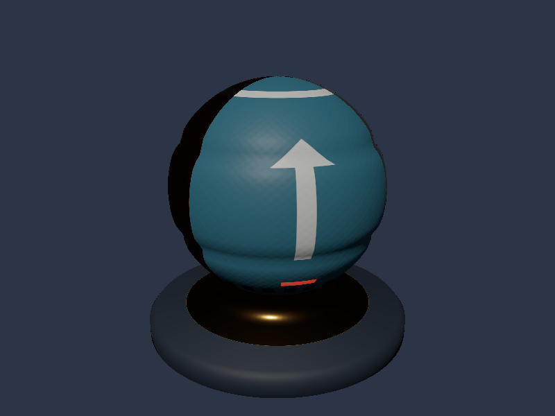
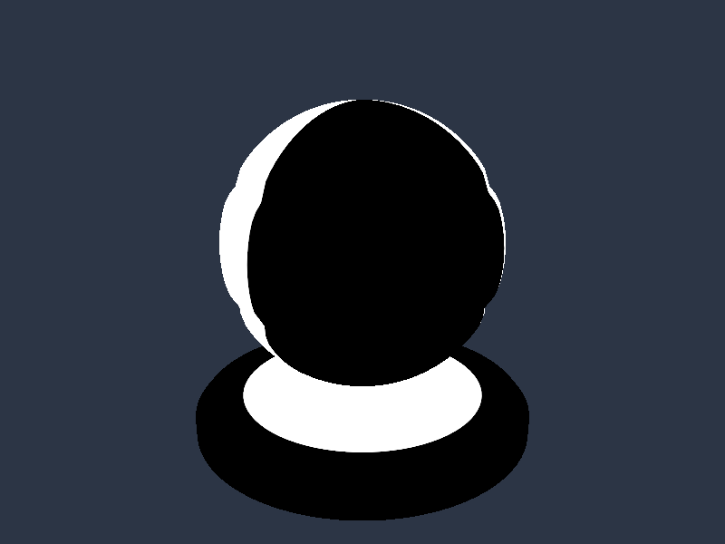
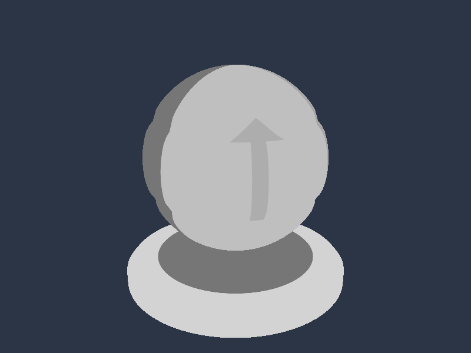

# Vulkan 08: Metallic-Roughness PBR入門

07の経験的な鏡面反射をGGXのマイクロファセット反射へ進め、同じShader BallにNormal・ORM・Emissiveを追加します。1本の方向光で材質の違いを確認します。



初期の描画領域は全サンプル共通で**1280×720ピクセル**です。掲載画像は変更前の800×600で取得したものを使用しています。

## ビルドと実行

Visual Studio 2026／v145、Windows SDK 10.0.26100.0、C++20、x64です。Vulkan SDKを導入し、`VULKAN_SDK`と付属DXCを使用します。Vulkan 1.3、Dynamic Rendering、Synchronization2が必要です。 nlohmann/jsonは06と同じ固定Submoduleを使用します。

```powershell
git submodule update --init --recursive
msbuild ShaderjpGraphicsSamples.sln -t:Restore -p:RestorePackagesConfig=true
msbuild Samples\Vulkan\08_PBR\Vulkan_08_PBR.vcxproj -p:Configuration=Debug -p:Platform=x64
& .\bin\x64\Debug\Vulkan_08_PBR\Vulkan_08_PBR.exe
```

VSでは`Vulkan_08_PBR`をスタートアッププロジェクトにします。シェーダは-fspv-target-env=vulkan1.3で事前コンパイルし、ビルド内でspirv-valも実行します。アセットとシェーダは実行ファイル基準で読みます。

## 操作と比較

| キー | CLI | 表示 |
|---|---|---|
| 1 | `--shading pbr` | PBR。既定値 |
| 2 | `--shading albedo` | Base Color |
| 3 | `--shading normal` | Normal Map適用後のワールド法線を色で表示 |
| 4 | `--shading metallic` | Metallic |
| 5 | `--shading roughness` | Roughness |
| 6 | `--shading ao` | strength適用後のAO |
| 7 | `--shading emissive` | Emissive |
| 8 | `--shading pbr-flat` | Normal MapなしのPBR |
| Space | `--rotate-light`で回転開始 | 方向光の回転を開始／停止 |





確認表示もsRGB描画先を使うので、例えば線形値0.5のスカラーは約188/255の明るさで見えます。画像として保存されたRGB値をそのまま線形値と解釈しないでください。

## glTFのPBR材質を読む

`LoadGltfPbr`はShaderBall_PBR.gltfを既定値に使います。POSITION／NORMAL／UV0にTANGENTを加え、CPUローダーでZとtangent.wを反転済みです。glTFのUVをOBJのようにV反転する処理はありません。

材質のtexture indexから画像をたどり、Albedo、Normal、ORM、Emissiveの4 PNGを読みます。Metallic／Roughness Factor、Normal Scale、Occlusion Strength、Emissive Factorも読みます。ORMはR=AO、G=Roughness、B=Metallicです。occlusionTextureとmetallicRoughnessTextureが同じPNGを指し、全画像が同じSampler・UV0を使う教材用プロフィールに限定します。

法線・接線の数、接線の単位長と直交、三角形内のWの一致、画像の参照、係数の範囲を確認します。未対応データにはファイル名とJSON Pointerを含むエラーを出します。06／07の`LoadGltfAlbedo`は追加画像を読みません。

## GPUへ4画像と接線を渡す

[Sample.cpp](../../Samples/Vulkan/08_PBR/Sample.cpp)の`CreatePipeline`／`CreateScene`／`LoadTexture`が中心です。位置0、UV12、法線20、接線32の48-byte PbrVertexをVertex Bufferへ転送し、Indexは32-bitです。

320-byteのLightingConstantsを、minUniformBufferOffsetAlignmentへ切り上げたHost Visible Bufferへ置きます。Descriptorのrangeは実データの320-byteです。毎フレーム更新し、非CoherentメモリではvkFlushMappedMemoryRangesを実行します。

Descriptor Setはset 0に、binding 0=Scene、1=Albedo、2=Sampler、3=Normal、4=ORM、5=Emissiveを配置します。PoolにはUniform Buffer 1、Sampled Image 4、Sampler 1を確保します。HLSLのt0〜t3はbinding 1／3／4／5で、Samplerがbinding 2に入る点を確認してください。

各画像はWICで展開し、Staging BufferからDevice Local Imageへ転送します。Synchronization2でUNDEFINED→TRANSFER_DST_OPTIMAL→SHADER_READ_ONLY_OPTIMALへ遷移し、COPY書込からFRAGMENT_SHADERのSAMPLED_READへ依存をつなぎます。Queue完了を待ってStagingを解放します。Albedo／EmissiveはR8G8B8A8_SRGB、Normal／ORMはR8G8B8A8_UNORMです。

すべてmip 0だけを転送し、SamplerのLOD範囲を0にします。描画時には4画像を同時に参照します。API側の転送・View・Descriptor・同期はこのプロジェクトに明示しています。

## PBRシェーダの順序

[Pixel.hlsl](../../Shaders/08_PBR/Pixel.hlsl)を両APIで共有します。SM6.6／HLSL 2021でDXILとSPIR-Vへ事前コンパイルします。

1. sRGBのBase ColorとEmissiveを線形値としてサンプルし、各Factorを掛けます。
2. 線形のORMからMetallic、Roughness、AOを取り出します。
3. 補間したNとTを直交化し、`B=cross(N,T)*w`で接線基底を作ります。Normal Scaleを適用した接線空間法線をワールドへ変換します。
4. F0を非金属の0.04と金属のBase Colorから補間します。
5. GGXのD、SchlickのF、Smith GGXのVisibilityで鏡面反射を評価し、`(1-F)*(1-metallic)*baseColor/π`を拡散BRDFとして配分します。
6. 直接光にNoLと光の色を掛けます。AOは一定拡散環境項だけ、Emissiveは発光項として加えます。
7. Reinhardで範囲を圧縮し、sRGB描画先で出力をエンコードします。

詳しい式と入力値の意味は[07→08の共通解説](../LightingAndPBR.md)を参照してください。

## Depth Bufferとライティング

`CreateDepth`でウィンドウサイズの`VK_FORMAT_D32_SFLOAT`を作ります。UsageはDEPTH_STENCIL_ATTACHMENT、Image ViewのaspectはDEPTHです。`OnRender`で初回UNDEFINEDからDEPTH_ATTACHMENT_OPTIMALへ遷移し、2回目以後は前フレームの深度書込との依存をSynchronization2でつなぎます。

バリアはEARLY_FRAGMENT_TESTSとLATE_FRAGMENT_TESTSを対象とし、destination accessにDEPTH_STENCIL_ATTACHMENT_READ／WRITEを指定します。Dynamic RenderingのpDepthAttachmentへViewを渡し、loadOp=CLEAR、clear=1.0、storeOp=DONT_CAREです。前フレームの深度値は次のクリアで使わなくても、書込同士の同期は必要です。

PipelineのdepthTestEnable／depthWriteEnableはTRUE、depthCompareOpはLESSです。手前の面の小さい深度を保存し、奥の面が後からカラーを上書きすることを防ぎます。リサイズではvkDeviceWaitIdleの後に深度画像とViewを作り直し、depthReady_をfalseへ戻します。

カメラと投影は左手系、深度範囲は0〜1です。球と台座の前後関係はこの比較で決まり、Pixel Shaderの明るさや反射モデルは比較値を変えません。Normal Mapを使う08も、変わるのは反射計算用の法線で、輪郭や深度を動かしません。Shadow Mapが光から見た遮蔽を判定する処理は別のテーマです。

VulkanのViewportは負のheightを維持し、HLSLの+Y上向きとDirect3D12の画面方向を合わせています。

## 検証と次の回

```powershell
& .\bin\x64\Debug\Vulkan_08_PBR\Vulkan_08_PBR.exe --shading pbr-flat --frames 48 --test-window --screenshot ".\.cache\Vulkan-08.png" --log ".\.cache\Vulkan-08.log"
.\Tools\TestLoaders.ps1
.\Tools\TestSamples.ps1 -Topics 08_PBR
.\Tools\TestLighting.ps1
```

`--model`でPBR用プロフィールに合うglTFへ差し替えられます。`--texture`はBase Colorだけを置換します。Normal／ORM／EmissiveはglTF内の参照を使います。指定した相対パスは起動時の作業ディレクトリ、glTF内のURIはglTFの場所が基準です。

DebugではVulkan Validation Layerとテスト時の同期検証を有効にして検証しています。CPUの材質試験、実GPUの既知画素試験、リサイズ、最小化復帰、終了を確認し、[検証記録](../Verification.md)にバージョンを残しています。添付画像はこのAPIによる実GPU描画です。

08は直接光のPBR入門です。一定拡散環境項は小さく、金属の環境反射はまだ加えていません。そのため金属領域は鏡面反射の方向以外で暗く見えます。Normal Mapで球の表面模様が出ること、金属のハイライトがBase Colorの色になること、粗さが異なる領域の反射、Emissiveの赤い模様を確認します。Blender参考画像とは光と表示変換の条件が異なります。

次はIBL・環境Cubemap、Shadow Map、複数光源、Deferred Renderingなどへ拡張できます。

前：[07_Lighting](07_Lighting.md)。 別API：[Direct3D12 08](../Direct3D12/08_PBR.md)。

この回のLambert＋GGXは表面の反射を表すBRDFです。BRDFもBSDFの反射成分に含まれます。透過や内部吸収を加えた場合の違いは[発展19の共通章](../BRDFAndBSDF.md)で同一アセットを使って比較します。
