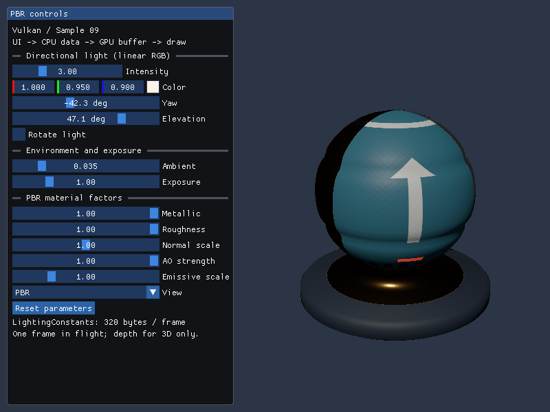
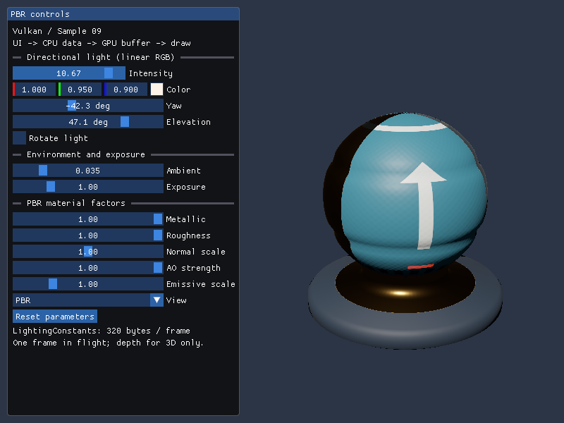

# Vulkan 09: Dear ImGuiと動的Uniform Buffer

08のPBR描画へDear ImGuiを加え、ライトと材質を編集します。パネルが変更したCPUデータを毎フレームUniform Bufferへ反映し、同じフレームの描画で参照します。D3D12と同じ320-byteのLightingConstants、同じPBR／UI HLSLを使います。



初期の描画領域は全サンプル共通で**1280×720ピクセル**です。掲載画像は変更前の800×600で取得したものを使用しています。

## ビルドと実行

Visual Studio 2026／v145、Windows SDK 10.0.26100.0、C++20、x64と、VULKAN_SDKで指定したVulkan SDKを使います。今回のSDKは1.4.341.1、実行時の基準はVulkan 1.3、Dynamic RenderingとSynchronization2です。nlohmann/json v3.12.0、Dear ImGui v1.92.9bは固定Submoduleです。

```powershell
git submodule update --init --recursive
msbuild Samples\Vulkan\09_ImGui\Vulkan_09_ImGui.vcxproj -p:Configuration=Debug -p:Platform=x64
& .\bin\x64\Debug\Vulkan_09_ImGui\Vulkan_09_ImGui.exe
```

VSでは`Vulkan_09_ImGui`をスタートアッププロジェクトにします。ShaderBall_PBR.gltfと4画像を使い、`--model`／`--texture`の対応範囲は08と同じです。シェーダ・画像は実行ファイル基準です。`--shading`と`--rotate-light`で起動時の表示を指定でき、起動後はパネルで変更します。

## パネルで試すこと

| 操作 | 効果 |
|---|---|
| Intensity／Color | 方向光の強度と線形RGB。積をlightColorに格納 |
| Yaw／Elevation | 表面から光源へ向かう方向を単位ベクトルに変換 |
| Rotate light | 約28.65度/秒でYawを更新 |
| Ambient／Exposure | 一定拡散環境項の明るさとReinhardの前の露出 |
| Metallic／Roughness | ORMのB／Gに掛ける係数 |
| Normal scale／AO strength | Normal MapのXYの強さ、一定拡散環境項に適用する遮蔽の強さ |
| Emissive scale | glTFのEmissive Factorに掛ける倍率 |
| View | PBR、材質チャンネル、ワールド法線、Normal MapなしPBRの8表示 |
| Reset parameters | ライト・表示・回転を初期状態へ戻し、材質係数はglTFの値へ戻す |

ドラッグまたはCtrl+クリックの数値入力で編集します。スライダーの範囲は数値入力にも適用します。Tabなどのキーボード操作も有効です。UIが入力を使っているときはESCを終了処理へ渡さず、UI外のESCまたは閉じるボタンで終了します。08の数字キー／Spaceの操作はウィジェットへ置き換えました。



強度を上げると白い矢印や塗装部分が明るくなります。モデル・テクスチャ・Pipelineはそのままで、UBOのlightColorの変更がGPU描画へ反映された比較です。

左にパネル、右に3D用Viewportを置きます。投影行列は右側のアスペクト比で計算し、小さいウィンドウではパネルがスクロールします。回転を止めて同じ値を使うと、D3D12の09と表示を比較できます。

## 本体・入力・描画を分ける

Dear ImGuiを`ThirdParty/imgui`のコミット`f1cc2ae15e53a861a874c3034aae6798fde194ab`へ固定します。本体4 cppと公式imgui_impl_win32.cppをコンパイルし、Submoduleのソースは改変しません。MITのLICENSE.txtも実行ファイル横へ配置します。[外部依存関係](../../ThirdParty/README.md)に取得・更新方法を記録しています。

[Common/Application.cpp](../../Common/Application.cpp)のWndProcから09の`OnMessage`へ入力を渡し、`ImGui_ImplWin32_WndProcHandler`を呼びます。Win32バックエンドがマウス・キーボード・時刻を処理し、`WantCaptureKeyboard`を確認してアプリ側のキー処理と調整します。リサイズ・最小化・終了は共通ライフサイクルに残しています。

UIの[ウィジェット](../../Samples/Shared/ImGuiPanel.h)は両APIで共有し、GPU側の実装はこのプロジェクトの[ImGuiRenderer.cpp](../../Samples/Vulkan/09_ImGui/ImGuiRenderer.cpp)に置きます。UI用HLSLもSM6.6／HLSL 2021、`-spirv -fspv-target-env=vulkan1.3`で事前コンパイルします。公式Vulkanレンダラーをそのまま組み込む構成とは異なり、教材用の小さな描画バックエンドで既存の共有HLSL方針を保ちます。

初期化時にRGBA8の固定フォントアトラスを転送します。`RendererHasVtxOffset`を設定し、`RendererHasTextures`は設定しません。1.92以降の動的フォント・画像の追加更新、ユーザー画像、複数Viewportには対応していません。拡張時は[公式バックエンド資料](https://github.com/ocornut/imgui/blob/v1.92.9b/docs/BACKENDS.md)を確認してください。

## Uniform Bufferを安全に更新する順序

[Sample.cpp](../../Samples/Vulkan/09_ImGui/Sample.cpp)の`OnUpdate`でWin32_NewFrame、ImGui::NewFrame、パネル、ImGui::Renderを呼びます。UIは[LightingControls](../../Common/LightingControls.h)のCPUデータを変更します。`OnRender`では前フレームのFenceを待ち、その値からLightingConstantsを作ってMap済みメモリへコピーします。

```cpp
CheckVk(vkWaitForFences(device_, 1, &fence_, VK_TRUE, UINT64_MAX), "Frame fence");
const auto constants = panel_.controls.MakeConstants(
    width_ - panel_.SceneLeft(width_), height_, model_);
std::memcpy(constants_.mapped, &constants, sizeof(constants));
Flush(constants_);
// ... Acquire、コマンド記録、Descriptor Setの設定とDraw ...
```

初期化時にHOST_VISIBLEのメモリを確保し、vkMapMemoryでCPUアドレスを得て、終了まで保持します。LightingConstantsの16-byte単位のfloat4／row_major float4x4配置は08と同じ320 bytesです。確保サイズはデバイスのminUniformBufferOffsetAlignmentへ切り上げ、Descriptorのrangeは実データの320 bytesとします。

`Flush`はHOST_COHERENTなら何もせず、非coherentなら確保済み・Map済みの範囲に`vkFlushMappedMemoryRanges`を行います。ここではoffset=0、size=VK_WHOLE_SIZEで全割当てを対象にし、末尾のnonCoherentAtomSize条件も満たします。FlushはCPUキャッシュの可視性を扱う処理で、前フレームのGPUの完了待ちを置き換えるものではありません。

シーンのDescriptor Setは08と同じです。set 0／binding 0に通常の`VK_DESCRIPTOR_TYPE_UNIFORM_BUFFER`を一度設定し、binding 1／3／4／5の4画像、binding 2のSamplerを保持します。内容が変わってもBufferのハンドルと範囲は変わらないので、vkUpdateDescriptorSetsを毎フレーム行う必要はありません。

この回の「動的更新」はUBOの内容を毎フレーム変える意味です。`VK_DESCRIPTOR_TYPE_UNIFORM_BUFFER_DYNAMIC`やdynamic offsetは使用しません。1フレームずつGPU完了を待って同じ領域を再利用します。並列に複数フレームを進める場合は、フレームごとの領域・完了Fence、minUniformBufferOffsetAlignmentとnonCoherentAtomSizeを考慮します。[Vulkanの同期仕様](https://docs.vulkan.org/spec/latest/chapters/synchronization.html)と[メモリ仕様](https://docs.vulkan.org/spec/latest/chapters/memory.html)が関連資料です。

## UIのリソースとDynamic Rendering

フォントはRGBA8 UNORMのImage・ImageViewです。Staging Bufferから転送し、UNDEFINED→TRANSFER_DST_OPTIMAL→SHADER_READ_ONLY_OPTIMALへSynchronization2で遷移させます。転送完了後にStagingを解放します。UI専用Descriptor Pool／Setを作り、set 0のbinding 0にUNIFORM_BUFFER、binding 1にSAMPLED_IMAGE、binding 2にClamp／LinearのSAMPLERを設定します。

UIの64-byte行列は共通HLSLのb0に相当し、通常のUniform BufferとしてVertex Shaderへ渡します。確保サイズはminUniformBufferOffsetAlignmentへ切り上げ、Descriptorのrangeは64 bytesです。GPU完了後に毎フレームMap済み領域へコピーし、必要ならFlushします。シーンの320-byte UBOとは別のBuffer・Pipeline Layoutで、UIもb0→binding 0、t0→binding 1、s0→binding 2の対応を保ちます。[DXCのSPIR-V資料](https://github.com/microsoft/DirectXShaderCompiler/blob/main/docs/SPIR-V.rst)でbinding属性の指定方法を確認できます。

ImGui::Renderが生成したImDrawDataを、`RenderImGui`が頂点・インデックスBufferへコピーして必要ならFlushします。容量が不足した場合だけ作り直し、Fence完了後なので古い領域をGPUが参照中に解放しません。ImDrawVertの位置・UV・RGBA8カラーを入力とし、ClipRectをScissorへ変換、IdxOffset／VtxOffsetを使ってvkCmdDrawIndexedを呼びます。16-bit／32-bit Index、ResetRenderStateコールバックも扱います。

UIのViewportにも負のheightを使い、同じHLSL投影でD3D12と上下方向を揃えます。Scissorは画面左上を基準にした正の矩形です。UIのPipelineはカリングなし、深度なし、SrcAlpha／OneMinusSrcAlphaの合成です。UIカラーはPixel Shaderで線形化し、PBRと同じsRGB描画先でエンコードします。フォントのアルファは線形の被覆率です。

## 3DのDepth BufferとUIを分ける

3DはD32_SFLOAT、毎フレーム1.0へクリア、LESS比較、深度書込みありです。左手系カメラの深度範囲は0〜1で、球と台座の前後関係を判定します。Normal Mapやライトの編集は反射を変え、輪郭や深度は動かしません。

3DのDynamic Renderingを終了したら、カラーImageのCOLOR_ATTACHMENT_OUTPUTでの書込みから、次の同ステージの読取り・書込みへBarrierを置きます。LayoutはCOLOR_ATTACHMENT_OPTIMALのままです。UIの二つ目のRendering Scopeはcolor.loadOp=LOADで既存のPBR画像を保持し、pDepthAttachment=nullptrとします。UI用PipelineのdepthAttachmentFormatはUNDEFINED、Depth Test／Writeは無効です。

この分離により、3Dの深度でパネルが隠れず、UIが球の深度を書き換えません。カラーのLOADとアルファ合成が前のPBR描画に依存するので、二つのRendering Scopeの間にも明示的な同期が必要です。UIの後で読戻し・Presentへ遷移するため、PNGにはパネルも含まれます。リサイズ時はGPU完了後にSwapchainとDepthを再作成し、カラー形式が変わればUIのPipelineも再作成します。編集値とフォントは保持します。

## 検証

```powershell
.\Tools\ValidateProjects.ps1
.\Tools\TestSamples.ps1 -Topics 09_ImGui -CaptureDocs
.\Tools\TestImGui.ps1 -CaptureDocs
.\Tools\TestImGui.ps1 -Configuration Release
.\Tools\TestFailureCases.ps1 -Topics 09_ImGui
```

TestImGuiは入力イベントでIntensityを編集し、Resetし、再編集します。UI外のGPU画像が変化し、Reset後に元の画素へ戻ることを確認します。DebugはValidation Layerと同期検証を有効化し、UIの二つのRendering Scope、リサイズ・最小化復帰・終了、欠落ファイルの終了処理も検証しています。SPIR-Vは通常ビルド内のspirv-valで検証します。環境と結果は[検証記録](../Verification.md)、上のPNGはVulkanによる実GPU描画です。

前：[08 PBR](08_PBR.md)。別API：[Direct3D12 09](../Direct3D12/09_ImGui.md)。
