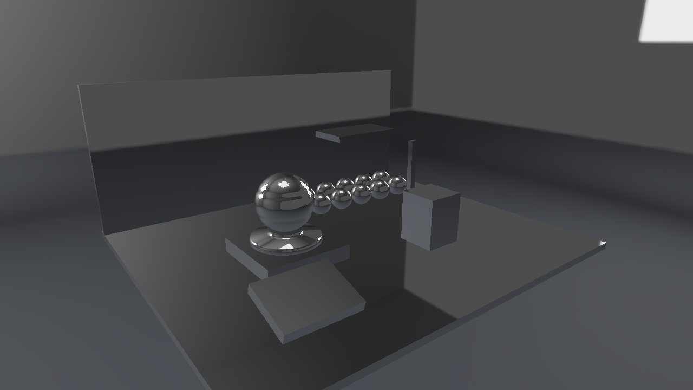
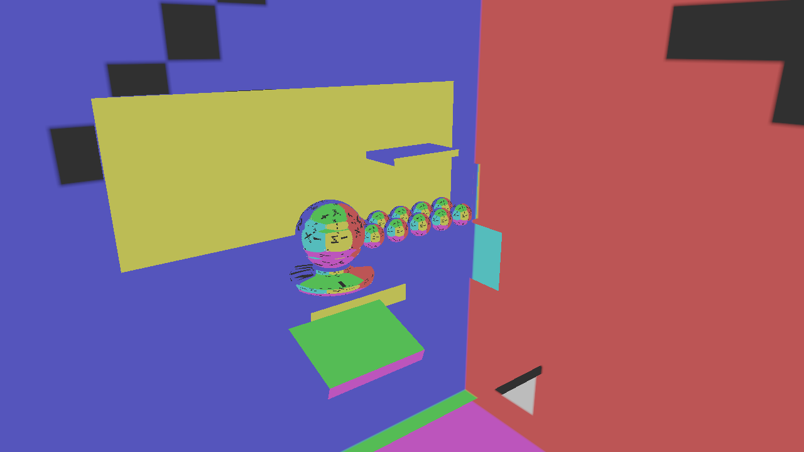

# Vulkan 第10回 CubemapとHDR環境を方向で参照する

第9回までの材質とUIに、周囲を参照するCubemapを加えます。6面の方向を診断し、HDRのSkyboxと理想鏡面を表示します。この回の鏡面表示はRoughnessを無視した方向確認です。PBRの環境反射は第12回で完成させます。



画像は1280×720の実GPUキャプチャです。形状と環境は[Lighting Labの自作アセット](../Assets/LightingLab.md)、反射の式と各回のつながりは[共通解説](../EnvironmentLighting.md)を参照してください。

## ビルドと標準の実行

Visual Studio 2026／v145、Windows SDK 10.0.26100.0、C++20、x64を使います。インストール済みのVulkan SDKと付属DXCを使い、Vulkan 1.3を対象にします。 DirectXTexはmay2026の固定Submoduleで、CPUのDDS読込に使います。Dear ImGuiの版は第9回と同じです。

```powershell
git submodule update --init --recursive
msbuild ShaderjpGraphicsSamples.sln -t:Restore -p:RestorePackagesConfig=true
msbuild Samples\Vulkan\10_Cubemap\Vulkan_10_Cubemap.vcxproj -p:Configuration=Debug -p:Platform=x64
& .\bin\x64\Debug\Vulkan_10_Cubemap\Vulkan_10_Cubemap.exe
```

VSではVulkan_10_Cubemapをスタートアッププロジェクトにします。実行には配布済みglTF・PNG・DDSを使い、BlenderやIBLベイクは不要です。アセットは実行ファイル基準で探すので、作業ディレクトリを変えても同梱データを読めます。

## アセットを読み込みGPUへ配置する

[Sample.cpp](../../Samples/Vulkan/10_Cubemap/Sample.cpp)のOnInitでSceneを読み、APIのデバイス・描画先・コマンド・同期を準備します。CreateSceneでは各モデルのVertex／Index Bufferと材質画像、環境の6面と各mip、BRDF LUTを作ります。環境のGPU転送とView作成もこのプロジェクト内にあります。

CPUのLoadLightingSceneは、各glTFを既存のLoadGltfPbrで読み、配置だけを別に保持します。モデルごとに1メッシュ・1材質のプロフィールです。LoadDdsはDirectXTexでDDSを展開し、数値形式・面・mip・バイト配置を返します。CommonはGPU Resourceを作りません。

`CreatePipeline`でset 0のDescriptor Set Layoutを作ります。b0はbinding 0のDynamic Uniform Buffer、t0はbinding 1、s0はbinding 2です。追加画像はbinding 3〜10、環境Samplerのs1はbinding 11へ置きます。HLSLのregisterとvk::bindingを対応させます。

`LoadDdsTexture`はVK_IMAGE_CREATE_CUBE_COMPATIBLE_BIT、6 arrayLayers、実データ分のmipLevelsでImageを作り、全面・mipを持つCUBE Image Viewを設定します。各VkBufferImageCopyのmipLevelとbaseArrayLayerをDDSの面・mipへ対応させます。Staging Bufferからコピーする前後に、全面・mipを対象とするSynchronization2のBarrierを置きます。

転送先のLayoutはUNDEFINED→TRANSFER_DST_OPTIMAL→SHADER_READ_ONLY_OPTIMALです。転送書込みからFragment Shaderのサンプル読取りへ依存を接続し、Queue完了後にStaging Bufferを解放します。RGBA16F／RG16Fは線形データとして扱います。

モデルごとの480-byte UBOはminUniformBufferOffsetAlignmentへ切り上げ、Dynamic Offsetで選びます。前フレームのFence完了後にUBOとDescriptorを書き換えます。Viewportは通常描画・Skybox・Shadowのすべてで負の高さを使い、共有HLSLの+Y-upを保ちます。


## HLSLでこの回の照明を計算する

共有する[Pixel.hlsl](../../Shaders/LightingLab/Pixel.hlsl)と[Scene.hlsli](../../Shaders/LightingLab/Scene.hlsli)はSM6.6／HLSL 2021で事前コンパイルします。LAB_TECHNIQUE=10で、この回までの計算を有効にします。CPUとHLSLはWorld、ViewProjection、Normal Matrix、材質・光、逆ViewProjection、Light ViewProjection、環境とShadow設定の480-byte配置を揃えています。

Skyboxの頂点シェーダは、画面全体を覆う三角形を`SV_VertexID`から作ります。NDCの遠端をinverse ViewProjectionでワールドへ戻し、カメラ位置との差から参照方向を求めます。Skyboxは深度1、LESS_EQUAL、深度書込みなしです。その後に通常のモデルをLESS・深度書込みありで描きます。

表面の理想鏡面は`reflect(-V, N)`で環境を引きます。Vは表面からカメラへ向かう方向なので、入射方向として使う際に符号を反転します。反射とSkyboxの双方へ同じ環境回転を適用します。

## 表示を切り替えて観察する

`--shading mirror --environment orientation`では、+X／-X／+Y／-Y／+Z／-Zの面名と矢印を確認します。Environment yawを変えるとSkyboxと映り込みが同じ規約で回転します。StudioとRoomを切り替えると、白いパネルと暖色・寒色の光の違いが見えます。



この診断表示は`reflect(-V, N)`の方向から環境のmip 0を読みます。PBRのRoughnessやFresnelを含めた完成した照明と区別してください。Combinedは従来の方向光と材質の表示で、まだ拡散・鏡面IBLを足しません。

```powershell
& .\bin\x64\Debug\Vulkan_10_Cubemap\Vulkan_10_Cubemap.exe --shading mirror --environment studio --no-ui --frames 8 --screenshot ".\.cache\Vulkan_10_Cubemap.png"
& .\bin\x64\Debug\Vulkan_10_Cubemap\Vulkan_10_Cubemap.exe --scene "Assets/Scenes/LightingLab/MaterialStudy.json" --environment room
```

`--scene`は指定した配置JSONへ、`--environment`はstudio／room／orientationへ切り替えます。`--no-ui`は撮影時にUIを隠します。環境強度、回転、直接光の強度、露出はUIで変更し、Resetで標準値へ戻します。

カメラの深度は引き続き0〜1、LESS比較、毎フレーム1へクリアします。リサイズではGPU完了後に描画先とカメラ用深度を作り直し、環境データと編集値は保持します。

## 検証と記事画像

```powershell
.\Tools\ValidateProjects.ps1
.\Tools\TestLightingLabAssets.ps1
.\Tools\TestLightingLab.ps1 -CaptureDocs
.\Tools\TestLightingLab.ps1 -Configuration Release
.\Tools\TestSamples.ps1 -Topics 10_Cubemap -CaptureDocs
```

TestLightingLabはCPUのDDS・配置読込と不正データの拒否、両APIの環境切替、IBLの寄与、Shadow・遮蔽物の移動、実ウィジェットの編集とResetを確認します。TestSamplesはリサイズ・最小化復帰・読戻し・終了を確認します。Debugではグラフィックス検証Layerを有効にし、Vulkanでは同期検証も使います。結果と環境は[検証記録](../Verification.md)を参照してください。

前：[第9回](09_ImGui.md)。 次：[第11回](11_DiffuseIBL.md)。 別API：[Direct3D12 第10回](../Direct3D12/10_Cubemap.md)。
