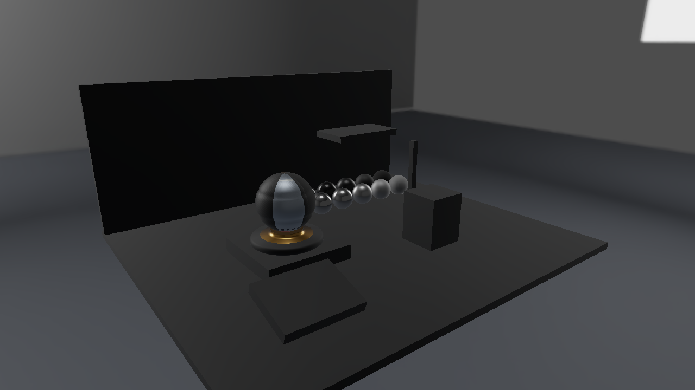
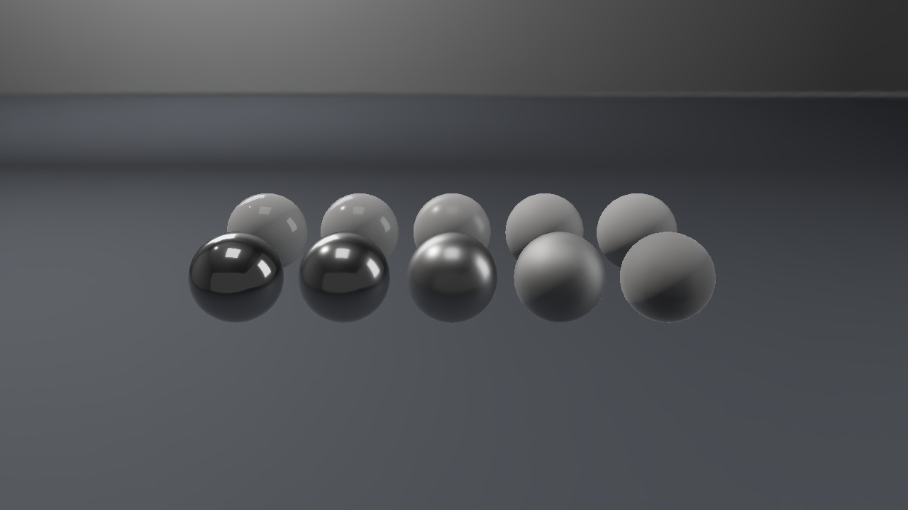

# Vulkan 第12回 粗さ別CubemapとBRDF LUTで鏡面IBLを加える

第11回で暗いままだった金属に、周囲の環境が映るようにします。粗さ別に積分したGGX環境CubemapとBRDF LUTを組み合わせ、直接光・拡散IBL・鏡面IBLを合成します。


画像は1280×720の実GPUキャプチャです。形状と環境は[Lighting Labの自作アセット](../Assets/LightingLab.md)、反射の式と各回のつながりは[共通解説](../EnvironmentLighting.md)を参照してください。

## ビルドと標準の実行

Visual Studio 2026／v145、Windows SDK 10.0.26100.0、C++20、x64を使います。インストール済みのVulkan SDKと付属DXCを使い、Vulkan 1.3を対象にします。 DirectXTexはmay2026の固定Submoduleで、CPUのDDS読込に使います。Dear ImGuiの版は第9回と同じです。

```powershell
git submodule update --init --recursive
msbuild ShaderjpGraphicsSamples.sln -t:Restore -p:RestorePackagesConfig=true
msbuild Samples\Vulkan\12_SpecularIBL\Vulkan_12_SpecularIBL.vcxproj -p:Configuration=Debug -p:Platform=x64
& .\bin\x64\Debug\Vulkan_12_SpecularIBL\Vulkan_12_SpecularIBL.exe
```

VSではVulkan_12_SpecularIBLをスタートアッププロジェクトにします。実行には配布済みglTF・PNG・DDSを使い、BlenderやIBLベイクは不要です。アセットは実行ファイル基準で探すので、作業ディレクトリを変えても同梱データを読めます。

## アセットを読み込みGPUへ配置する

[Sample.cpp](../../Samples/Vulkan/12_SpecularIBL/Sample.cpp)のOnInitでSceneを読み、APIのデバイス・描画先・コマンド・同期を準備します。CreateSceneでは各モデルのVertex／Index Bufferと材質画像、環境の6面と各mip、BRDF LUTを作ります。環境のGPU転送とView作成もこのプロジェクト内にあります。

CPUのLoadLightingSceneは、各glTFを既存のLoadGltfPbrで読み、配置だけを別に保持します。モデルごとに1メッシュ・1材質のプロフィールです。LoadDdsはDirectXTexでDDSを展開し、数値形式・面・mip・バイト配置を返します。CommonはGPU Resourceを作りません。

`CreatePipeline`でset 0のDescriptor Set Layoutを作ります。b0はbinding 0のDynamic Uniform Buffer、t0はbinding 1、s0はbinding 2です。追加画像はbinding 3〜10、環境Samplerのs1はbinding 11へ置きます。HLSLのregisterとvk::bindingを対応させます。

`LoadDdsTexture`はVK_IMAGE_CREATE_CUBE_COMPATIBLE_BIT、6 arrayLayers、実データ分のmipLevelsでImageを作り、全面・mipを持つCUBE Image Viewを設定します。各VkBufferImageCopyのmipLevelとbaseArrayLayerをDDSの面・mipへ対応させます。Staging Bufferからコピーする前後に、全面・mipを対象とするSynchronization2のBarrierを置きます。

転送先のLayoutはUNDEFINED→TRANSFER_DST_OPTIMAL→SHADER_READ_ONLY_OPTIMALです。転送書込みからFragment Shaderのサンプル読取りへ依存を接続し、Queue完了後にStaging Bufferを解放します。RGBA16F／RG16Fは線形データとして扱います。

モデルごとの480-byte UBOはminUniformBufferOffsetAlignmentへ切り上げ、Dynamic Offsetで選びます。前フレームのFence完了後にUBOとDescriptorを書き換えます。Viewportは通常描画・Skybox・Shadowのすべてで負の高さを使い、共有HLSLの+Y-upを保ちます。


## HLSLでこの回の照明を計算する

共有する[Pixel.hlsl](../../Shaders/LightingLab/Pixel.hlsl)と[Scene.hlsli](../../Shaders/LightingLab/Scene.hlsli)はSM6.6／HLSL 2021で事前コンパイルします。LAB_TECHNIQUE=12で、この回までの計算を有効にします。CPUとHLSLはWorld、ViewProjection、Normal Matrix、材質・光、逆ViewProjection、Light ViewProjection、環境とShadow設定の480-byte配置を揃えています。

鏡面側は`Prefilter(R, Roughness*8) * (F0*A+B)`です。Rは反射方向、AとBはBRDF LUTをNoVとRoughnessで参照した値です。非金属のF0は0.04、金属のF0はBase Colorから求めます。

事前フィルタはV=Nを仮定したGGXの積分で、mip 0は理想鏡面、mip 1〜8は粗さごとの積分を保存します。BRDF LUTはSchlick Fresnelの係数を分離し、height-correlated SmithのVisibilityを用いて積分します。実行時に積分は行わず、配布済みDDSを参照します。

このsplit-sum近似には、視線と法線を同一とする事前計算や粗さの量子化による誤差があります。CyclesのPrincipled BSDFと同じ画素を得ることを保証する式ではありません。

## 表示を切り替えて観察する

Diffuse IBL only、Specular IBL only、Combinedを見比べます。Metallic=1の比較球にも環境のパネルが映り、Roughnessが大きい球では反射が広がります。Roomへ切り替えると同じ材質へ暖色と寒色の反射が加わります。





材質比較プリセットでは10個の球を近くから見ます。Metallicの二つのグループで同じBase Colorを使い、各グループの左から右へRoughnessを増やしています。背景・光・カメラを固定し、反射の広がりを比較します。

Environment intensityは入射光の係数、Exposureは各項を合成した後の表示前の係数です。粗さ別のmipを通常の画像縮小用mipと混同しないでください。近くの展示物の動的な映り込みや、位置ごとに異なる反射はまだ扱いません。

```powershell
& .\bin\x64\Debug\Vulkan_12_SpecularIBL\Vulkan_12_SpecularIBL.exe --shading combined --environment studio --no-ui --frames 8 --screenshot ".\.cache\Vulkan_12_SpecularIBL.png"
& .\bin\x64\Debug\Vulkan_12_SpecularIBL\Vulkan_12_SpecularIBL.exe --scene "Assets/Scenes/LightingLab/MaterialStudy.json" --environment room
```

`--scene`は指定した配置JSONへ、`--environment`はstudio／room／orientationへ切り替えます。`--no-ui`は撮影時にUIを隠します。環境強度、回転、直接光の強度、露出はUIで変更し、Resetで標準値へ戻します。

カメラの深度は引き続き0〜1、LESS比較、毎フレーム1へクリアします。リサイズではGPU完了後に描画先とカメラ用深度を作り直し、環境データと編集値は保持します。

## 検証と記事画像

```powershell
.\Tools\ValidateProjects.ps1
.\Tools\TestLightingLabAssets.ps1
.\Tools\TestLightingLab.ps1 -CaptureDocs
.\Tools\TestLightingLab.ps1 -Configuration Release
.\Tools\TestSamples.ps1 -Topics 12_SpecularIBL -CaptureDocs
```

TestLightingLabはCPUのDDS・配置読込と不正データの拒否、両APIの環境切替、IBLの寄与、Shadow・遮蔽物の移動、実ウィジェットの編集とResetを確認します。TestSamplesはリサイズ・最小化復帰・読戻し・終了を確認します。Debugではグラフィックス検証Layerを有効にし、Vulkanでは同期検証も使います。結果と環境は[検証記録](../Verification.md)を参照してください。

前：[第11回](11_DiffuseIBL.md)。 次：[第13回](13_ShadowMap.md)。 別API：[Direct3D12 第12回](../Direct3D12/12_SpecularIBL.md)。
