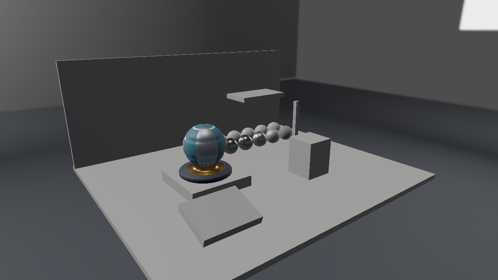

# Vulkan 第13回 方向光のShadow mapをIBLへ組み合わせる

第12回の照明を引き継ぎ、光源と表面の間にある形状によって方向光を遮ります。2048×2048のShadow Map、深度比較、受光面のバイアス、3×3 PCFを実装し、遮蔽物を動かして影が追従することを確認します。


画像は1280×720の実GPUキャプチャです。形状と環境は[Lighting Labの自作アセット](../Assets/LightingLab.md)、反射の式と各回のつながりは[共通解説](../EnvironmentLighting.md)を参照してください。

## ビルドと標準の実行

Visual Studio 2026／v145、Windows SDK 10.0.26100.0、C++20、x64を使います。インストール済みのVulkan SDKと付属DXCを使い、Vulkan 1.3を対象にします。 DirectXTexはmay2026の固定Submoduleで、CPUのDDS読込に使います。Dear ImGuiの版は第9回と同じです。

```powershell
git submodule update --init --recursive
msbuild ShaderjpGraphicsSamples.sln -t:Restore -p:RestorePackagesConfig=true
msbuild Samples\Vulkan\13_ShadowMap\Vulkan_13_ShadowMap.vcxproj -p:Configuration=Debug -p:Platform=x64
& .\bin\x64\Debug\Vulkan_13_ShadowMap\Vulkan_13_ShadowMap.exe
```

VSではVulkan_13_ShadowMapをスタートアッププロジェクトにします。実行には配布済みglTF・PNG・DDSを使い、BlenderやIBLベイクは不要です。アセットは実行ファイル基準で探すので、作業ディレクトリを変えても同梱データを読めます。

## アセットを読み込みGPUへ配置する

[Sample.cpp](../../Samples/Vulkan/13_ShadowMap/Sample.cpp)のOnInitでSceneを読み、APIのデバイス・描画先・コマンド・同期を準備します。CreateSceneでは各モデルのVertex／Index Bufferと材質画像、環境の6面と各mip、BRDF LUTを作ります。環境のGPU転送とView作成もこのプロジェクト内にあります。

CPUのLoadLightingSceneは、各glTFを既存のLoadGltfPbrで読み、配置だけを別に保持します。モデルごとに1メッシュ・1材質のプロフィールです。LoadDdsはDirectXTexでDDSを展開し、数値形式・面・mip・バイト配置を返します。CommonはGPU Resourceを作りません。

`CreatePipeline`でset 0のDescriptor Set Layoutを作ります。b0はbinding 0のDynamic Uniform Buffer、t0はbinding 1、s0はbinding 2です。追加画像はbinding 3〜10、環境Samplerのs1はbinding 11へ置きます。HLSLのregisterとvk::bindingを対応させます。

`LoadDdsTexture`はVK_IMAGE_CREATE_CUBE_COMPATIBLE_BIT、6 arrayLayers、実データ分のmipLevelsでImageを作り、全面・mipを持つCUBE Image Viewを設定します。各VkBufferImageCopyのmipLevelとbaseArrayLayerをDDSの面・mipへ対応させます。Staging Bufferからコピーする前後に、全面・mipを対象とするSynchronization2のBarrierを置きます。

転送先のLayoutはUNDEFINED→TRANSFER_DST_OPTIMAL→SHADER_READ_ONLY_OPTIMALです。転送書込みからFragment Shaderのサンプル読取りへ依存を接続し、Queue完了後にStaging Bufferを解放します。RGBA16F／RG16Fは線形データとして扱います。

モデルごとの480-byte UBOはminUniformBufferOffsetAlignmentへ切り上げ、Dynamic Offsetで選びます。前フレームのFence完了後にUBOとDescriptorを書き換えます。Viewportは通常描画・Skybox・Shadowのすべてで負の高さを使い、共有HLSLの+Y-upを保ちます。

## 光源からの深度パス

ShadowはD32_SFLOATのImageにDEPTH_STENCIL_ATTACHMENTとSAMPLEDの用途を持たせます。光源のDynamic Rendering Scopeは深度だけをCLEAR・STOREします。前フレームのFragmentサンプル読取りから深度書込みへ、さらにEarly／Late Fragment Testsの書込みからFragmentのサンプル読取りへBarrierを置きます。LayoutはDEPTH_ATTACHMENT_OPTIMALとDEPTH_READ_ONLY_OPTIMALを切り替えます。カメラ用の深度Imageとは別に保持します。

## HLSLでこの回の照明を計算する

共有する[Pixel.hlsl](../../Shaders/LightingLab/Pixel.hlsl)と[Scene.hlsli](../../Shaders/LightingLab/Scene.hlsli)はSM6.6／HLSL 2021で事前コンパイルします。LAB_TECHNIQUE=13で、この回までの計算を有効にします。CPUとHLSLはWorld、ViewProjection、Normal Matrix、材質・光、逆ViewProjection、Light ViewProjection、環境とShadow設定の480-byte配置を揃えています。

光源の方向にカメラを置き、Orthographic Projectionで固定の範囲を記録します。WorldとLight ViewProjectionを通した位置がShadow Mapに対応します。NDCのXYをUVへ変換し、Yを反転して上から下へ進む画像の行へ揃えます。Zの範囲は0〜1です。

深度比較は`受光面の深度 - bias <= 記録された深度`です。範囲外の位置は遮蔽なしとします。3×3 PCFではテクセル座標に-1〜1のオフセットを加えて9回比較します。境界は画像範囲へ制限します。

Shadow Visibilityは方向光の直接反射へ掛け、拡散IBL、鏡面IBL、Emissiveへは掛けません。Normal Mapの模様は形状を動かしていないため、通常のShadow Mapへそのまま投影されません。

## 表示を切り替えて観察する

No shadow、Hard shadow、3x3 PCFを切り替え、床・球・箱の明暗を比較します。Occluder Xで箱を動かすと、カメラの画面だけでなく光源から見た深度も更新されます。Receiver biasを調整し、自己遮蔽と影の浮きの関係を見ます。



Shadow depthでは光源の深度画像を画面全体へ表示します。3×3 PCFは9点の深度比較結果を平均し、深度そのものを平均してから比較する処理ではありません。面光源による半影を再現するものではありません。

```powershell
& .\bin\x64\Debug\Vulkan_13_ShadowMap\Vulkan_13_ShadowMap.exe --shading pcf --environment studio --no-ui --frames 8 --screenshot ".\.cache\Vulkan_13_ShadowMap.png"
& .\bin\x64\Debug\Vulkan_13_ShadowMap\Vulkan_13_ShadowMap.exe --scene "Assets/Scenes/LightingLab/MaterialStudy.json" --environment room
```

`--scene`は指定した配置JSONへ、`--environment`はstudio／room／orientationへ切り替えます。`--no-ui`は撮影時にUIを隠します。環境強度、回転、直接光の強度、露出はUIで変更し、Resetで標準値へ戻します。Shadow enabled、PCF、Receiver bias、Occluder XもUIで変更できます。CLIの--occluder-xは-1.5〜1.5の範囲です。

カメラの深度は引き続き0〜1、LESS比較、毎フレーム1へクリアします。リサイズではGPU完了後に描画先とカメラ用深度を作り直し、環境データと編集値は保持します。Shadow Mapは固定2048×2048なのでウィンドウのリサイズでは作り直しません。

## 検証と記事画像

```powershell
.\Tools\ValidateProjects.ps1
.\Tools\TestLightingLabAssets.ps1
.\Tools\TestLightingLab.ps1 -CaptureDocs
.\Tools\TestLightingLab.ps1 -Configuration Release
.\Tools\TestSamples.ps1 -Topics 13_ShadowMap -CaptureDocs
```

TestLightingLabはCPUのDDS・配置読込と不正データの拒否、両APIの環境切替、IBLの寄与、Shadow・遮蔽物の移動、実ウィジェットの編集とResetを確認します。TestSamplesはリサイズ・最小化復帰・読戻し・終了を確認します。Debugではグラフィックス検証Layerを有効にし、Vulkanでは同期検証も使います。結果と環境は[検証記録](../Verification.md)を参照してください。

前：[第12回](12_SpecularIBL.md)。 次の拡張では、動的Reflection Probe、より広いShadowの範囲、反射や間接光の近似を検討できます。 別API：[Direct3D12 第13回](../Direct3D12/13_ShadowMap.md)。

続き：[第14回 Render-to-Texture](14_RenderTexture.md)でHDRの描画先とモニターを加え、第15回のBloom、第16回のGPUパーティクルへ進みます。
