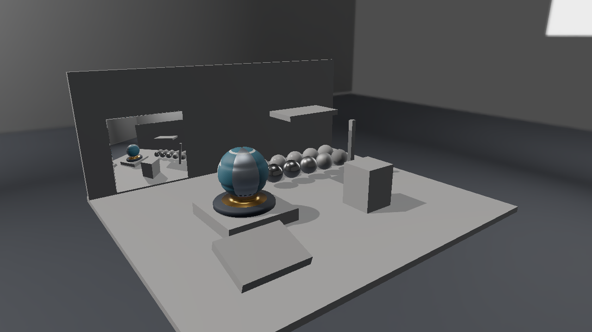
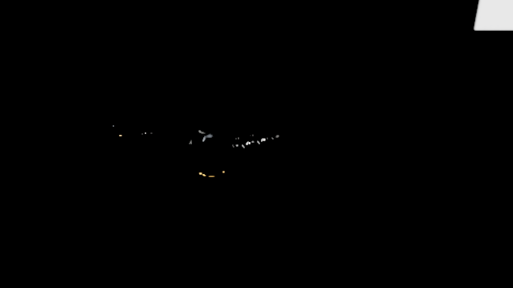

# Vulkan 第15回 Compute ShaderでBloomを実装する

第14回の表示変換前のHDR画像をCompute Shaderへ渡し、明るい部分の抽出、縮小、横・縦のGaussian Blur、合成を行います。画像へ書き込むUAV／Storage Imageと、Dispatch間の依存を追います。


この回の完成表示。1280×720、RTX 4070の実GPU読戻しです。

## ビルドと実行

VS 2026／v145、Windows SDK 10.0.26100.0、C++20、x64を維持します。Vulkan SDKのDXCを使い、Vulkan 1.3を対象にします。

```powershell
msbuild ShaderjpGraphicsSamples.sln -t:Restore -p:RestorePackagesConfig=true
msbuild Samples\Vulkan\15_ComputeBloom\Vulkan_15_ComputeBloom.vcxproj -p:Configuration=Debug -p:Platform=x64
& .\bin\x64\Debug\Vulkan_15_ComputeBloom\Vulkan_15_ComputeBloom.exe
```

Blenderはアセットを編集・再書出しするときだけ使います。実行には同梱glTF・PNG・DDSを使い、追加のランタイム依存はありません。[共通章](../PostProcessing.md)と[モニターの制作](../Assets/Monitor.md)も参照してください。


## Computeの画像処理を描画へ接続する

```text
HDRシーン
→ Extract：2×2の平均と明るい部分の抽出
→ Horizontal：横方向9 tap
→ Bloom：縦方向9 tap
→ HDRシーン + Bloom × Strength
→ ExposureとReinhard → UI
```

Extract、Horizontal、Bloomは別のRGBA16F画像です。幅と高さを`(size+1)/2`へ切り上げます。横と縦のフィルタは、入力画像と出力画像を分けます。隣の画素を読む処理で同じ画像を上書きすると、スレッドの実行順で結果が変わってしまいます。

```hlsl
[numthreads(8, 8, 1)]
void CSMain(uint3 id : SV_DispatchThreadID)
{
    if (any(id.xy >= dimensions.zw)) return;
    // 有効な画素だけを読む、計算する、outputTextureへ書く。
}
```

DispatchのGroup数も8で切り上げます。余分なスレッドは先頭の境界判定で戻ります。2×2の縮小と9 tapの読込みでは、座標を有効範囲へclampします。これで641×479などの奇数サイズも扱えます。

## リソースとシェーダへの接続

入力はSampled Image、出力はRGBA16FのStorage Imageへ接続します。出力ImageにSTORAGE | SAMPLEDを指定し、Compute PSOのSet 0ではbinding 0にUniform、1に入力、4に出力を置きます。Vulkan用HLSLは出力へrgba16fのImage Format属性を付けます。

## ThresholdとGaussian Blur

今回の明るさ判定はRGBの最大成分です。2×2の平均色Cに対して、次の係数を掛けます。

```text
brightness = max(C.r, C.g, C.b)
Extract = C × max(brightness - Threshold, 0) / max(brightness, 0.000001)
```


```hlsl
float3 c = 0;
for (uint y = 0; y < 2; ++y)
    for (uint x = 0; x < 2; ++x)
        c += inputTexture.Load(int3(
            min(id.xy * 2 + uint2(x, y), dimensions.xy - 1), 0)).rgb * .25;
float bright = max(c.r, max(c.g, c.b));
c *= max(bright - settings.y, 0) / max(bright, 1e-6);
outputTexture[id.xy] = float4(c, 1);
```

黒入力でゼロ除算を起こさず、Thresholdを超えた分を取り出します。Thresholdの値は表示変換前の線形HDRに対するものです。トーンマッピング済みの0〜1画像を処理すると、光源と反射の強さの差が既に圧縮されています。

9 tapは中心と左右4点です。重みを正規化し、横方向の後に縦方向を掛けます。一般的な分離可能なGaussian Filterで、いきなり81点を読む代わりに2パスへ分けます。今回の実装は少数のtapを読む入門用で、groupsharedを使った最適化や多段階のBloomではありません。

## 合成前に途中画像を見る

Post viewをExtract、Horizontal blur、Bloomへ切り替えます。画像は照明用の線形データですが、画面で観察する際には露出とReinhardを通します。Finalでは、元のHDRへBloomを加算してから表示変換します。PNGのRGB同士を足してFinalを再現する比較ではありません。

Bloomは明るい画素を周辺へ広げる画像処理です。発光模様や光源の見え方を変えますが、発光面から床へ光が伝わる計算を追加するものではありません。


## 書込みと読込みを同期する

書込み先はGENERAL、読取り側はSHADER_READ_ONLY_OPTIMALです。COMPUTE_SHADER／SHADER_STORAGE_WRITEから、次のCOMPUTE_SHADER／SHADER_SAMPLED_READへImage Barrierで接続します。合成はFRAGMENT_SHADERのSampled Readへつなぎます。

Graphics・Compute・Presentに対応するQueue Familyを確認し、同じQueueへ記録します。VK_FEATURE shaderStorageImageExtendedFormatsも確認して有効化します。別Queueへの所有権移動やAsync Computeは今回追加しません。

GPUの初期化、リソース、Pipeline、転送、描画、同期、解放は、このプロジェクトの[Sample.cpp](../../Samples/Vulkan/15_ComputeBloom/Sample.cpp)へ置いています。CommonはCPUの配置読込と数学を担当します。共有HLSLは[Shaders/PostProcess](../../Shaders/PostProcess)、UIは[PostProcessPanel.h](../../Samples/Shared/PostProcessPanel.h)です。

## 元画像と途中画像を比較する



HDR input：Bloomを合成する前の表示。1280×720、RTX 4070の実GPU読戻しです。



Extract：半解像度の明るい部分。1280×720、RTX 4070の実GPU読戻しです。


横方向だけをぼかした途中画像。1280×720、RTX 4070の実GPU読戻しです。


横・縦のフィルタを終えたBloom画像。1280×720、RTX 4070の実GPU読戻しです。

Thresholdを上げると抽出する画素が減り、Strengthを上げると合成の寄与が増えます。Exposureは合成後の表示へ作用します。UIや文字はBloomの入力に含めません。

```powershell
& .\bin\x64\Debug\Vulkan_15_ComputeBloom\Vulkan_15_ComputeBloom.exe --post-view bloom --environment studio --no-ui --frames 8 --fixed-dt 0.016666667 --screenshot .\.cache\Vulkan_15_ComputeBloom.png
```

`--post-view`はfinal／grayscale／extract／horizontal／bloom／monitor／inputです。第14回ではBloomの途中表示を使いません。第16回は`--pause`、`--particles 257`、`--gravity 3`も指定できます。

## 検証する

```powershell
.\Tools\ValidateProjects.ps1
.\Tools\TestPostProcessAssets.ps1
.\Tools\TestPostProcess.ps1 -CaptureDocs
.\Tools\TestPostProcessFailures.ps1
.\Tools\TestPostProcess.ps1 -Configuration Release
.\Tools\TestSamples.ps1 -Topics 15_ComputeBloom
```

`--capture-gpu`は撮影時だけ線形HDR画像と粒子Bufferを読み戻し、PNGと同名の`.gpu`フォルダへ保存する診断オプションです。通常のフレームでは使いません。黒入力、一定色、端の単一画素、641×479、257粒子、実ウィジェットのStep／Resetを[GPU数値検証スクリプト](../../Tests/VerifyPostProcess.py)で確認します。両API・両構成で成功しています。HDR導入前後の最大差は8bitで1、Bloomにより3,863〜3,865画素が変わり、粒子のReset後は初期Bufferと完全一致しました。環境と実測値は[検証記録](../Verification.md)へまとめています。

前：[第14回](14_RenderTexture.md)。別API：[Direct3D12 第15回](../Direct3D12/15_ComputeBloom.md)。次：[第16回](16_GpuParticles.md)。

画像と新規アセット、コードは自作。Copyright (c) 2026 masafumi、[MIT License](../../LICENSE)。比較はStudio、直接光3、環境強度1、露出1、同じ配置とカメラを使います。掲載画像は8 frames、固定dt 1／60で撮影しています。

## カメラ操作

WASDで移動、Q/Eで上下移動、右ドラッグで視線を回転、Shiftで加速します。Rで選択中の固定カメラへ戻り、UIのResetはカメラと設定を初期化します。ImGuiの操作中はカメラ入力を抑えます。[共通の操作と検証手順](../CameraNavigation.md)も参照してください。
