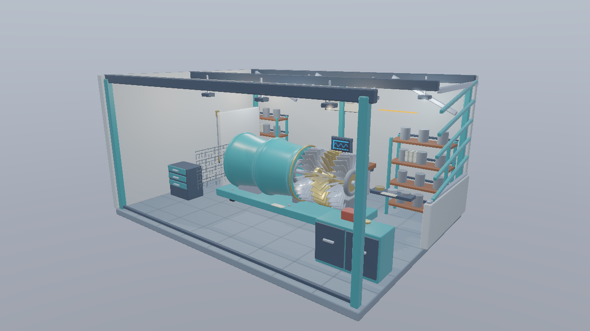
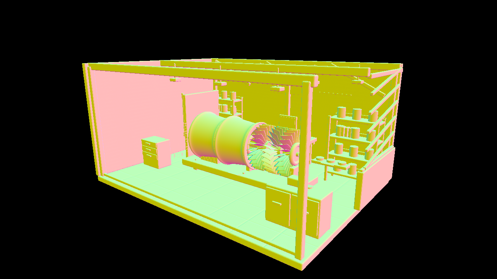
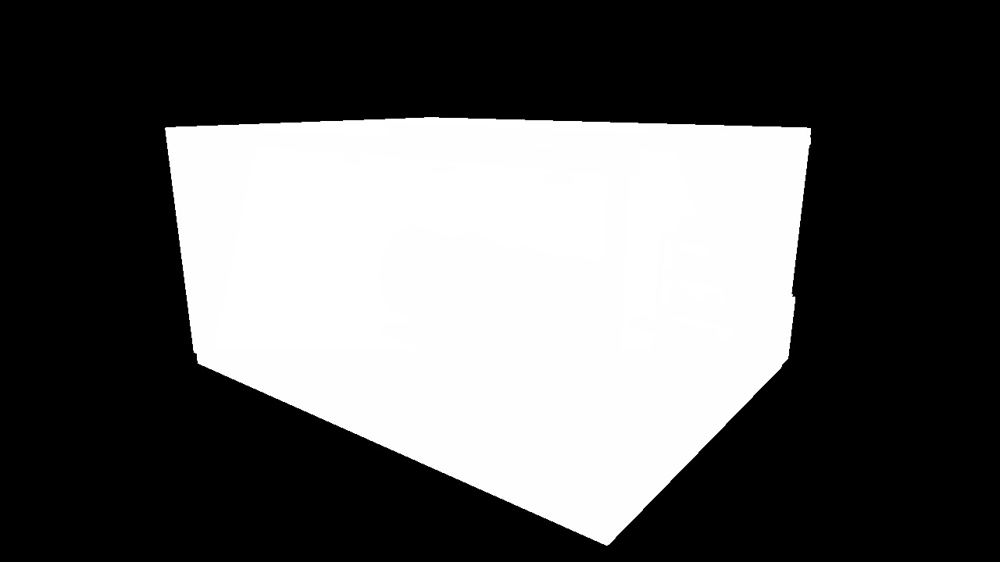
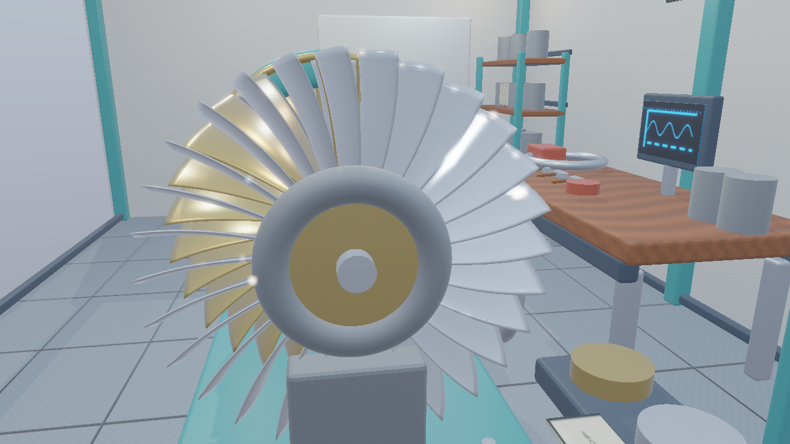
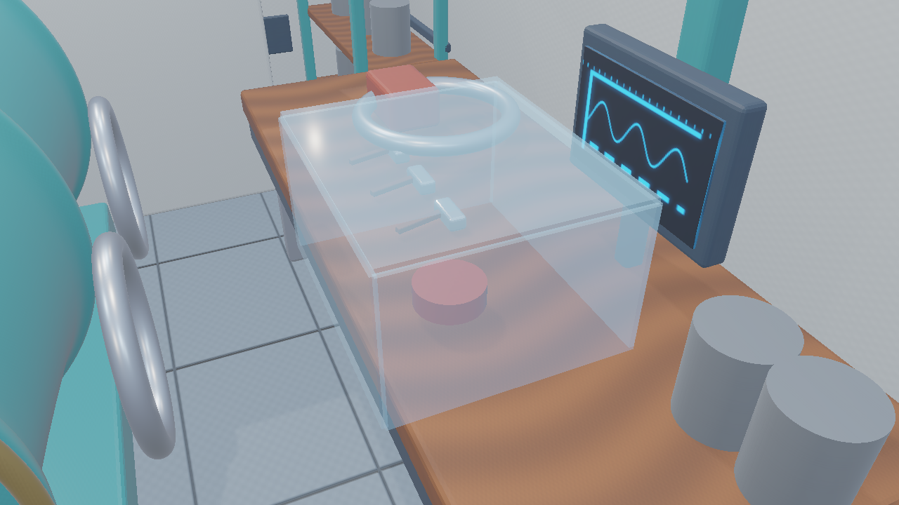
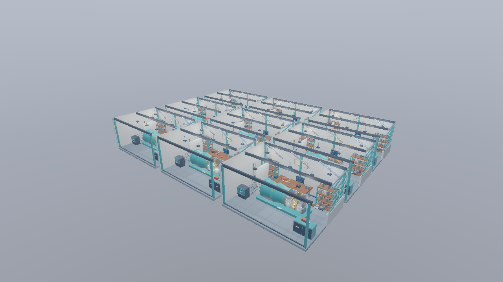
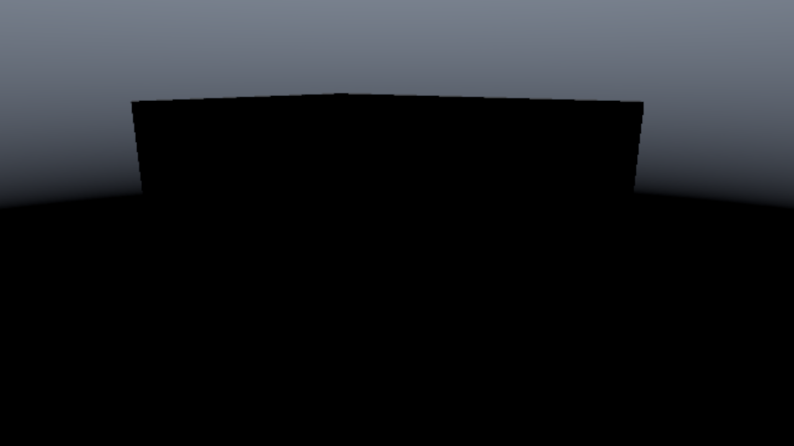

# Vulkan 第17 G-bufferを構築してPixel Shaderで照明を計算する

Workshopの工房を使い、PBR、IBL、Shadow Map、HDR、BloomをDeferred Renderingへ統合します。モデルの描画で材質・法線を記録し、その画像を全画面のPixel Shaderから参照します。位置はDepthから再構築し、位置用のRender Targetは作りません。



1280×720、Standard、Heroカメラ、OpaqueMask、露出1、環境強度0.8。比較画像はRTX 4070で実際に描画した結果です。[共通章](../DeferredRendering.md)と[Workshop制作仕様](../Assets/Workshop.md)も参照してください。

## ビルドと実行

VS 2026／v145、Windows SDK 10.0.26100.0、C++20、x64の規約を維持します。Vulkan 1.3、Dynamic Rendering、Synchronization2、graphics／compute／presentに対応するQueueを使います。MASKのclipに対応するshaderDemoteToHelperInvocationと、HDR Storage Imageの機能も初期化時に確認します。

```powershell
msbuild ShaderjpGraphicsSamples.sln -t:Restore -p:RestorePackagesConfig=true
msbuild Samples\Vulkan\17_DeferredPixel\Vulkan_17_DeferredPixel.vcxproj -p:Configuration=Debug -p:Platform=x64
& .\bin\x64\Debug\Vulkan_17_DeferredPixel\Vulkan_17_DeferredPixel.exe
```

アプリは同梱glTF・PNG・DDS・JSONを使います。Blenderと再ベイクは不要です。第17・18回は別の実行ファイルを持ち、共通HLSLと同じG-buffer設定で比較します。

## 処理の流れ

```text
Shadow Map → G-buffer → Pixel Shader / Draw → RGBA16F HDR
→ Skybox → Forward透明合成 → Bloom → 露出・Reinhard・sRGB → UI
```

G-bufferはBase Color＋AO、Octahedral法線RG、Metallic＋Roughness、HDR Emissiveの4枚とDepthです。合計18 B／画素です。法線はNormal Map適用後のワールド法線を16bit×2へ符号化し、位置は画素中心とDepthを逆ViewProjectionで変換して復元します。詳しい格納形式と数式は[共通章](../DeferredRendering.md#位置を保存しないg-buffer)で説明しています。

## リソースと接続

固有Primitiveと画像を共有し、配置ごとに定数を設定してDrawします。Standardの点光源8個、Stressの72個はStructured Bufferで渡します。両版とも全ライトを同じ順に評価します。ディレクショナルライトのShadowは2048×2048で、MASKもAlpha判定を行います。

G-bufferの各チャンネルは整数画素の`Load`で読み、画素境界で材質や法線を混ぜません。Clear Depth 1の画素はライティング結果を0にして、後のSkyboxへ渡します。Fullでは透明カバーを別のForwardパスで合成します。

主なコードは[Sample.cpp](../../Samples/Vulkan/17_DeferredPixel/Sample.cpp)、[Workshop CPUローダー](../../Common/Workshop.cpp)、[共通の照明](../../Shaders/Deferred/Lighting.hlsli)です。APIの初期化・リソース作成・転送・描画・同期・終了処理は各サンプルにあります。

## シェーダ

```hlsl
float4 PSMain(Fullscreen i) : SV_Target {
    return float4(ShadePixel(uint2(i.position.xy)), 1);
}
```

[LightingPixel.hlsl](../../Shaders/Deferred/LightingPixel.hlsl)は全画面三角形の画素座標を使います。Drawは3頂点で、深度テストを行わずHDRへ書きます。モデルの深度はG-buffer構築で決まり、ライティングではDepthをテクスチャとして読みます。

`ShadePixel`はG-bufferを復号し、ワールド位置を再構築して、共通のGGX・Schlick・Smith・LambertとIBLを評価します。PS／CSの違いはDrawかDispatchか、およびHDRへの書込み方法です。Forward診断と透明合成も同じBRDFを使います。

## 同期

Dynamic Renderingで4枚のColor Attachmentを構築し、Color Attachment書込みからFragment／ComputeのSampled ReadへBarrierを入れます。DepthはDepth Stencil Read Onlyへ移し、ライティングの読込と後続の読み取り専用Depthテストへ接続します。

PS出力のHDRはColor Attachmentです。Skyboxと透明を加えた後、ComputeのSampled Readへ同期してBloomへ渡します。

Queue FamilyはGraphics・Compute・Presentの3用途を確認します。負高さViewport、深度0〜1、row-majorを維持します。単一フレームをGPU完了後に再利用し、Swapchain取得SemaphoreとLayout遷移も同期します。[Vulkan同期例](https://docs.vulkan.org/guide/latest/synchronization_examples.html)

## 操作と比較画像

- SceneとPresetでStandard／Stress、Opaque／OpaqueMask／Fullを切り替えます。
- Camera、20秒のCamera Path、Play、Frameで同じ構図を再現できます。
- ViewでBase Color、AO、符号化／復号法線、Metallic、Roughness、Emissive、Depth、Shadow Map、照明の寄与、Bloom途中画像を表示します。
- Shadow、3×3 PCF、Bias、Occluder X、IBL、Bloom、Threshold、Strength、Exposureを変更し、Resetで基準へ戻します。
- Forward diagnosticではG-buffer構築を省略し、直接HDRへ描画します。

```powershell
& .\bin\x64\Debug\Vulkan_17_DeferredPixel\Vulkan_17_DeferredPixel.exe --no-ui --shading normal
& .\bin\x64\Debug\Vulkan_17_DeferredPixel\Vulkan_17_DeferredPixel.exe --workshop-scene Stress --camera StressHero
& .\bin\x64\Debug\Vulkan_17_DeferredPixel\Vulkan_17_DeferredPixel.exe --preset Full --camera Transparency
```



復号したワールド法線。Normal MapもG-bufferへ反映されています。



Depth。通常の透視投影深度なので、多くの表面が1に近い値になります。



材質接写。金属の曲面と粗さを確認します。



Fullの透明カバー。G-buffer後のForward合成です。



Stress全景。同じ部品を共有して3×3へ配置します。



Bloomの抽出画像。表示のためReinhardを適用しています。

## GPU時間と検証

UIはパス別のGPU時間を表示します。ReleaseのベンチマークはUIとVSyncを無効化し、60 framesの準備後に同じ経路を1200 frames評価します。

```powershell
& .\bin\x64\Release\Vulkan_17_DeferredPixel\Vulkan_17_DeferredPixel.exe --benchmark --workshop-scene Standard --timings D:\Temp\Vulkan-ps-Standard.json
& Tools\TestWorkshopLoader.ps1
& Tools\TestDeferred.ps1 -Configuration Debug
& Tools\TestDeferred.ps1 -Configuration Release -Benchmark
```

計測はGPU時間の平均・中央値・p95をJSONへ、フレームごとの結果をCSVへ保存します。Benchmark中はOpaqueMaskと照明条件を固定します。PS／CSの処理時間はGPU・シーン・構成に依存します。[検証記録](../DeferredVerification.md)には実測値、SDK／コンパイラ／GPU、画像条件をまとめています。

本サンプルではディレクショナルライトのShadowを統合しています。点光源Shadow、IBLの局所遮蔽、Cyclesの間接光とは差があります。次のTiled／Clustered Renderingでは、この全ライトのループを画素ごとの候補へ絞り込んで比較します。

## カメラ操作

WASDで移動、Q/Eで上下移動、右ドラッグで視線を回転、Shiftで加速します。Rで選択中の固定カメラへ戻り、UIのResetはカメラと設定を初期化します。ImGuiの操作中はカメラ入力を抑えます。[共通の操作と検証手順](../CameraNavigation.md)も参照してください。
