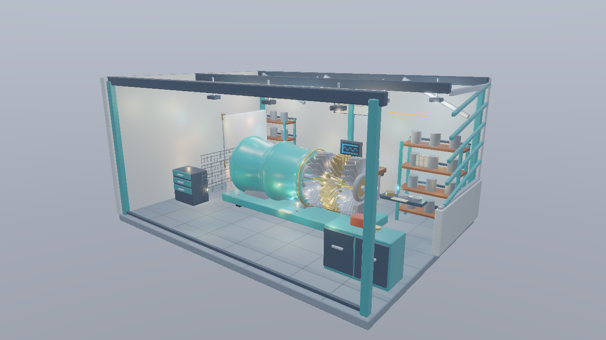
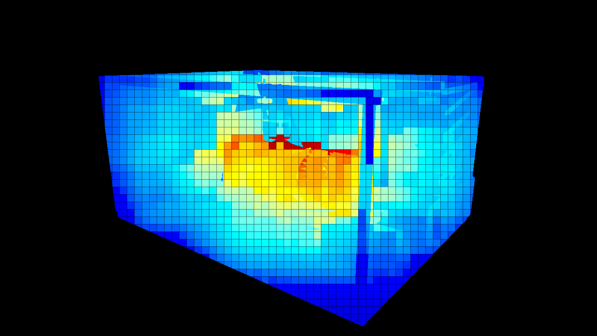
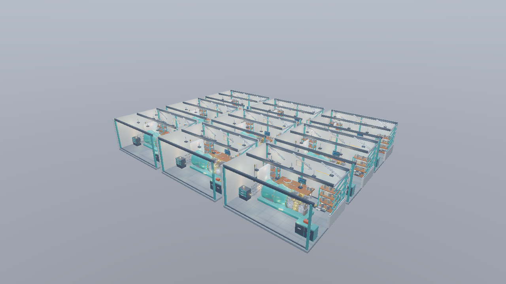
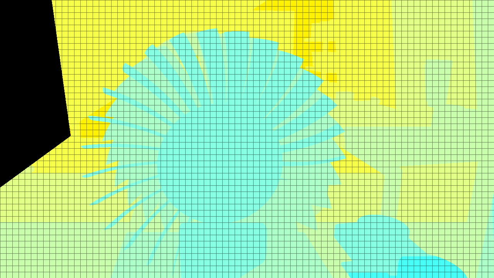

# Vulkan 第20 Clustered Shadingで多数の点光源を絞り込む

第18回のCompute版Deferredへ、GPUで作るライトリストを加えます。画面の16×16タイルを24段の対数Zスライスへ分け、表面が存在するクラスターごとに点光源を判定します。同じライト列を全評価するモードと比較し、光を変えずに計算対象を減らすことを確かめます。



1280×720、Standard、Hero、OpaqueMask。既存8個に追加256個を加えた264点光源、追加ライトの半径1.6 m、強度0.4、露出1、環境強度0.8です。Shadow、IBL、Bloomを維持しています。[共通章](../LightCulling.md)と[Workshop](../Assets/Workshop.md)も参照してください。

## ビルドと実行

VS 2026／v145、Windows SDK 10.0.26100.0、C++20、x64を維持します。Vulkan SDK 1.4.341.1のDXCを使い、Vulkan 1.3へコンパイルします。SPIR-Vをspirv-valで検証します。実行には同梱のglTF、PNG、DDS、JSONを使い、Blenderと再ベイクは不要です。

```powershell
msbuild ShaderjpGraphicsSamples.sln -t:Restore -p:RestorePackagesConfig=true
msbuild Samples\Vulkan\20_ClusteredShading\Vulkan_20_ClusteredShading.vcxproj -p:Configuration=Debug -p:Platform=x64
& .\bin\x64\Debug\Vulkan_20_ClusteredShading\Vulkan_20_ClusteredShading.exe
```

第19・20回は独立した実行プロジェクトです。両方で`All lights`、`Tiled`、`Clustered`を切り替えられ、既定モードだけを変えています。点光源の数、配置、半径、材質、カメラを揃えて比較してください。

## 処理の流れ

```text
Shadow Map → G-buffer
→ TileDepth（16×16）：最小／最大Zと24-bitのスライスマスク
→ CullLights（64 threads）：セルごとのライトIDリスト
→ LightingCompute（8×8）：選ばれたライトを評価してHDRへ書く
→ Skybox → Forward透明 → Bloom → 表示変換 → UI
```

G-bufferは従来の4カラー＋Depth、18 B／画素です。Normal Map適用後の法線をOctahedral方式で2成分へ保存し、ワールド位置は深度から再構築します。位置用ターゲットとクラスタIDの画像は追加しません。

## リソースと接続

追加ライトは[LightGridData.h](../../Samples/Shared/LightGridData.h)の固定HashからCPUで生成します。既存の`range`なしのライトを維持し、追加ライトには有限rangeを設定します。Standardは264個、Stressは2,376個、512個／区画を指定したStressは4,680個です。ライトとカメラのBufferを更新するのは、前フレームのGPU完了待機の後です。

1セルに`uint2`のHeaderと256個の`uint` Indexを予約します。Headerは候補数と容量超過の有無です。Indexへの書込みは設定容量内に限定し、容量超過のセルではシェーディングを全ライト評価へ戻します。候補を黙って切り詰めません。

候補数、半径、強度、容量、アニメーションをUIで操作できます。既存のScene／Preset／Camera／カメラ経路、Forward診断、Shadow／PCF、Bloom、Resetも維持します。BLENDは不透明Depthのリストを使わず、従来のForwardパスで全ライトを評価します。

主なコードは[Sample.cpp](../../Samples/Vulkan/20_ClusteredShading/Sample.cpp)、[TileDepth.hlsl](../../Shaders/LightCulling/TileDepth.hlsl)、[CullLights.hlsl](../../Shaders/LightCulling/CullLights.hlsl)、[共通BRDF](../../Shaders/Deferred/Lighting.hlsli)です。GPUリソースの作成・転送・同期・解放は各APIのサンプルで追えます。

## シェーダで行うライト判定

近い距離を細かく、遠い距離を広く扱う24段の対数スライスを使います。Near／Farと投影係数は、実際にG-bufferを描くカメラから渡します。

```hlsl
uint slice = min(uint(floor(log2(max(z, nearPlane) / nearPlane)
                 * 24 / log2(farPlane / nearPlane))), 23);
uint cell = (slice * tilesY + tileY) * tilesX + tileX;
```

TileDepthは、表面が所属するsliceのbitを共有変数へInterlockedOrで集めます。CullLightsはマスクを読み、有効なセルだけでライトを判定します。無効セルのHeaderも0へ上書きするため、前フレームのリストが残りません。

Z範囲はスライス境界とタイルで観測した最小／最大Zを交差させます。同じXYタイルで奥行きが離れた表面を分けつつ、クラスターの空いた端を除けます。法線方向によるライトの背面除外は行いません。

不透明Depthから有効セルを決めているため、透明カバーは全ライトのForwardパスを使います。透明物にもクラスターを使う拡張では、その表面を含むセルの登録を追加する必要があります。

## APIの同期

ライトリストはDevice-local MemoryのStorage Bufferです。タイル深度とマスクもStorage Bufferとして書き、同じGraphics／Compute／Present Queueへ記録します。G-bufferのAttachment書込みとDepth書込みをComputeのサンプル読取りへ接続する既存バリアを維持します。

TileDepthからCullLightsへ、ComputeのStorage書込みを次のStorage読取り・書込みへ接続します。CullLightsの後はHeader／IndexのStorage書込みをライティングの読取りへ渡します。

```cpp
barrier.srcStageMask = VK_PIPELINE_STAGE_2_COMPUTE_SHADER_BIT;
barrier.srcAccessMask = VK_ACCESS_2_SHADER_STORAGE_WRITE_BIT;
barrier.dstStageMask = VK_PIPELINE_STAGE_2_COMPUTE_SHADER_BIT;
barrier.dstAccessMask = VK_ACCESS_2_SHADER_STORAGE_READ_BIT;
vkCmdPipelineBarrier2(commands_, &dependency);
```

set 0、b0=0／t0=1／s0=2を維持します。グリッド定数はbinding 19、Header／Indexは20／21、タイル深度とマスクは22／23です。StructuredBufferとRWStructuredBufferは、読取り・書込みの違いに関わらずStorage BufferのDescriptorを使います。作成時にStorage Bufferの範囲上限を確認します。[KhronosのCompute間の同期例](https://docs.vulkan.org/guide/latest/synchronization_examples.html)も参照してください。

## 比較画像と操作

```powershell
& .\bin\x64\Debug\Vulkan_20_ClusteredShading\Vulkan_20_ClusteredShading.exe --light-culling all --no-ui
& .\bin\x64\Debug\Vulkan_20_ClusteredShading\Vulkan_20_ClusteredShading.exe --light-culling cluster --light-view count --no-ui
& .\bin\x64\Debug\Vulkan_20_ClusteredShading\Vulkan_20_ClusteredShading.exe --workshop-scene Stress --camera StressHero
& .\bin\x64\Debug\Vulkan_20_ClusteredShading\Vulkan_20_ClusteredShading.exe --lights-per-room 512 --light-radius 1 --animate-lights
```



表面が参照する候補数を青から赤へ表示します。赤は128個以上、暗い線は16画素の境界です。実際の数と有効セル平均はUIで確認できます。ライティングの画と候補数の画を分け、リストを増やす位置を観察してください。



Stress、StressHero、OpaqueMask、2,376点光源。形状・材質・画像を共有する3×3のWorkshopです。追加数、半径、強度が同じなら、All／Tiled／Clusteredの画は一致する範囲に収まります。



MaterialsカメラでNear 0.05 m、Far 150 m、24 slicesの所属を色で示します。室内から近い表面と遠い表面を観察します。表面のワールド位置画像から分類せず、DepthからView Zを戻してセルを選びます。


容量を1へ下げた診断です。既存の無限rangeライトだけでも容量を超えるため、可視セルが赤くなります。通常のLighting表示へ戻すと全ライトへフォールバックし、光が欠けないことを確認できます。

## GPU時間と検証

UIの`tile-depth`、`cull`、`lighting`を分け、生成パスも含む`total`で比較します。統計用Headerの読戻しはGPU完了後に読み、GPUの描画時間とCPU集計を分けています。

```powershell
& Tools\TestLightGrid.ps1 -Configuration Debug
& Tools\TestLightGrid.ps1 -Configuration Release -CaptureDocs
& Tools\TestLightGrid.ps1 -Configuration Release -BenchmarkOnly
```

同一APIのAll／Tiled／ClusteredでG-bufferとDepthのバイト一致、HDRの絶対誤差`1e-3`＋相対誤差`2e-3`を確認します。Standard、Stress、透明、641×479、室内カメラ、最大4,680ライト、移動、容量超過を含みます。GPUから読んだ全リストはCPUの独立した球／平面判定とも照合します。SDK、GPU、実測値と撮影条件は[検証記録](../LightCullingVerification.md)にまとめます。

後続では、可変長リスト、ライト階層、法線コーンによるライト除外、透明物のクラスター登録へ進めます。照明の絞り込みと、Mesh Shaderによる形状のカリングを分けて計測できる構成です。

## カメラ操作

WASDで移動、Q/Eで上下移動、右ドラッグで視線を回転、Shiftで加速します。Rで選択中の固定カメラへ戻り、UIのResetはカメラと設定を初期化します。ImGuiの操作中はカメラ入力を抑えます。[共通の操作と検証手順](../CameraNavigation.md)も参照してください。
