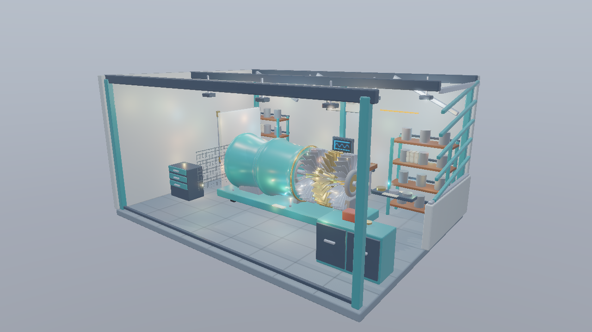
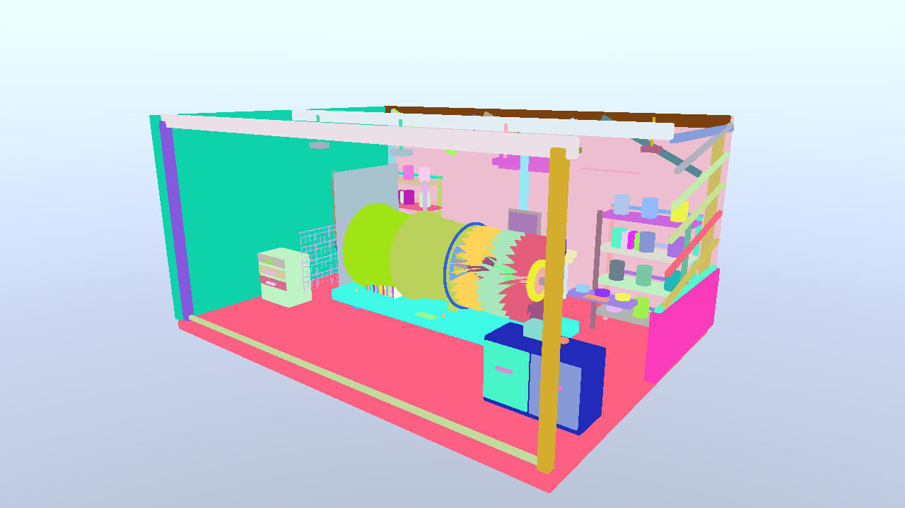
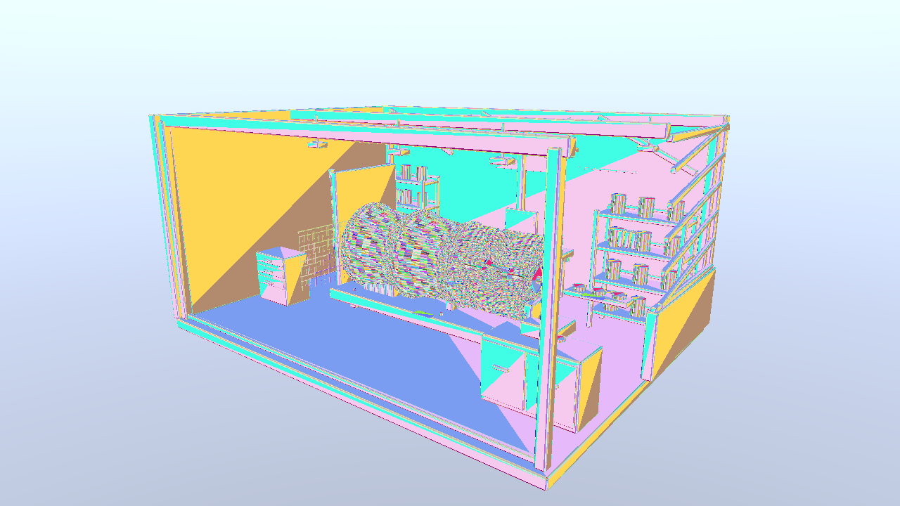
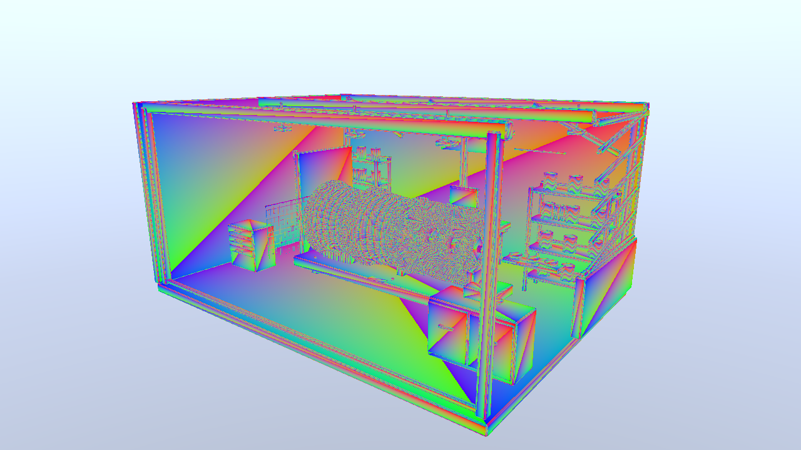
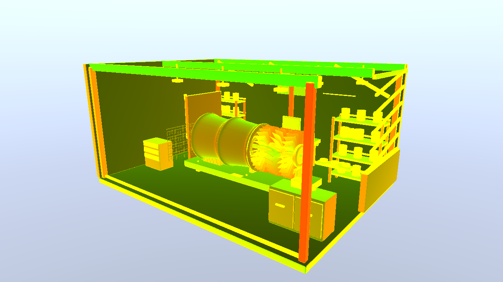
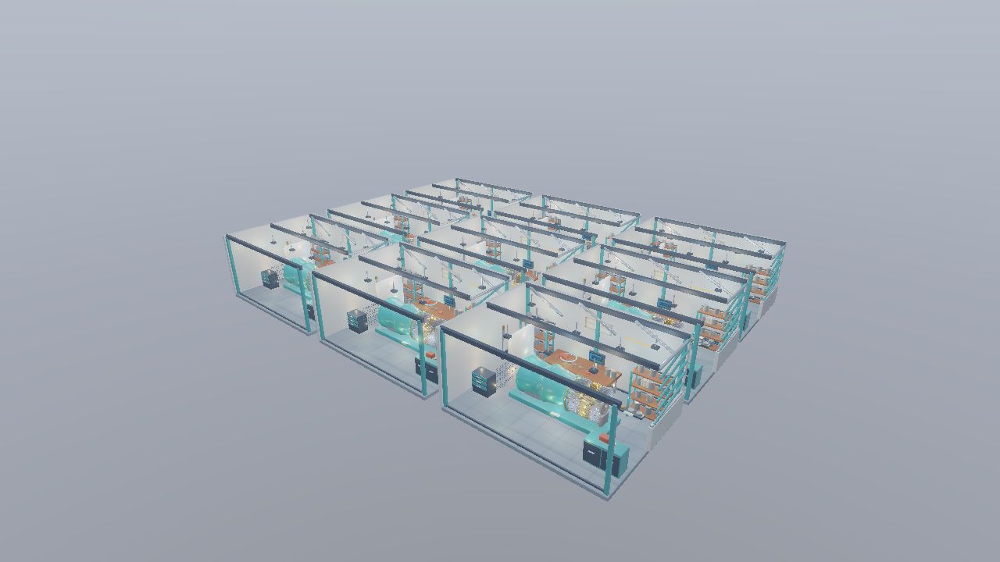
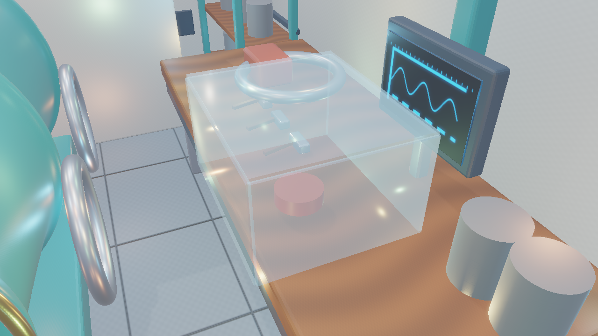

# Vulkan 第21回：Visibility Bufferで材質評価を後段へ移す

第19回のTiledライトカリングとWorkshopを引き継ぎ、G-bufferの4枚を**配置・三角形IDの整数ターゲット1枚**へ置き換えます。Compute Shaderで元の頂点と材質を読み、UV・法線・接線を復元してPBRを評価します。アルゴリズム、勾配の式と第19・20回との比較は[共通章](../VisibilityBuffer.md)、実測と数値検証は[検証記録](../VisibilityVerification.md)を参照してください。



1280×720、Standard／Hero／OpaqueMask、264点光源、Tiled、Shadow・PCF・IBL・Bloom有効、露出1、環境強度0.8です。G-bufferへ位置や重心座標を保存せず、可視性用の画像はID 8 B＋Depth 4 Bの12 B／画素です。

## ビルドと実行

VS 2026／v145、SDK 10.0.26100.0、C++20、x64、Vulkan SDK 1.4.341.1と付属DXCを使います。Shader Model 6.6／HLSL 2021をオフラインでコンパイルし、配布済みWorkshopのglTF・PNG・DDS・JSONだけで実行できます。

```powershell
msbuild ShaderjpGraphicsSamples.sln -t:Restore -p:RestorePackagesConfig=true
msbuild Samples\Vulkan\21_VisibilityBuffer\Vulkan_21_VisibilityBuffer.vcxproj -p:Configuration=Release -p:Platform=x64
bin\x64\Release\Vulkan_21_VisibilityBuffer\Vulkan_21_VisibilityBuffer.exe
```

## アルゴリズムの流れ

1. 固有頂点・Indexを共有Bufferへ連結し、配置表からWorld Matrix、形状の先頭、材質を参照する。
2. Indexed Drawで最前面の配置IDと三角形IDをDepthとともに記録する。MASKだけはAlpha判定する。
3. 同じDepthから第19回のライトリストを作る。
4. 可視画素のIDが示す3頂点を読み、同次座標から透視補正した重心座標とUV勾配を計算する。
5. `SampleGrad`で材質を評価し、同じBRDF・ライト・Shadow・IBLでHDRへ書く。
6. Skybox、Forward透明合成、Bloom、表示変換を行う。

Tiled／Clusteredはライトの選び方、Visibility Bufferは可視面の保存方法です。第21回は既定をTiledに揃え、第19回との比較でG-bufferを置き換えた効果を調べます。パネルと`--light-culling cluster`で第20回のリストにも接続できます。

## リソースと接続

`Sample::CreateScene`は固有形状を連結します。同じBufferへ頂点入力とStorageのusageを、IndexへIndex入力とStorageのusageを指定します。各DrawはBuffer先頭のオフセットをずらし、Computeでは参照表から頂点・Indexの先頭を加えます。Sceneが変わっても共有形状は再アップロードしません。

| リソース | 形式・サイズ | 用途 |
|---|---|---|
| Visibility | `VK_FORMAT_R32G32_UINT` | Color Attachmentから整数Sampled Imageの`Load`へ |
| Depth | `VK_FORMAT_D32_SFLOAT` | 深度テスト、位置復元、ライトカリング |
| Vertex／Index | 頂点48 B、Indexはuint32 | Vertex／Index inputとStorage Buffer |
| Instance | 144 B／配置 | World／Normal Matrix、先頭と材質・三角形数 |
| Material | 80 B／材質 | Factor、画像ID、Alpha条件 |
| 画像Descriptor配列 | 固有画像64個まで | 元のsRGB／線形Image Viewを再利用 |
| HDR | `R16G16B16A16_SFLOAT` | ComputeのStorage Imageから後続Color Attachment・Sampled Imageへ |

既存のset 0、`b0／t0／s0`とbinding 0／1／2を維持します。binding 24〜27へ頂点・Index・配置・材質のStorage Buffer、28へ64要素のSampled Image配列を追加します。旧G-buffer用の未使用bindingは予約し、対応する画面サイズの材質画像は作りません。全64要素へ有効なViewを設定し、Partially Bound、Variable Descriptor Count、Update After Bindは必要ありません。

Physical Deviceの選択では`shaderSampledImageArrayNonUniformIndexing`、`geometryShader`、Sampled ImageのDescriptor上限78以上を確認します。`geometryShader`はFragmentの`SV_PrimitiveID`が要求するSPIR-VのGeometry capabilityのために有効にし、Geometry Shaderは実行しません。Vulkan 1.3のDynamic Rendering、Synchronization2、Storage Image拡張形式、Graphics／Compute／Presentを扱える同じQueue Familyを使います。未対応GPUは必要なfeatureを示して起動を拒否します。

配置・定数を書き換える前にFenceでGPU完了を待ち、非coherentなホストメモリはFlushします。頂点・Indexは第19・20回と同じHOST_VISIBLE配置を使います。転送やメモリ配置の最適化を別に加えず、可視性の方式による差を計測します。

## ラスタパスのシェーダ

[VisibilityVertex.hlsl](../../Shaders/Visibility/VisibilityVertex.hlsl)は位置とUVだけを出し、[VisibilityPixel.hlsl](../../Shaders/Visibility/VisibilityPixel.hlsl)は次の2整数を返します。

```hlsl
uint2 PSMain(VisibilityVertex i, uint primitiveId : SV_PrimitiveID,
             bool front : SV_IsFrontFace) : SV_Target0
{
    if (emissiveFactor.w == 1)
        clip(baseTexture.Sample(materialSampler, i.uv).a * baseColorFactor.a - screen.w);
    return uint2(uint(screen.z), primitiveId | (front ? 0 : 0x80000000));
}
```

Rの0は背景、配置番号は1から始めます。Gの上位bitは裏面、残りが三角形番号です。MASKではPixel ShaderによるAlpha判定を維持します。OPAQUEではAlbedo・Normal・ORM・Emissiveを読まずにIDを記録します。

## Computeの属性復元と材質評価

Storage Bufferの頂点は3本の`float4`として読み、位置・UV・法線・接線へ戻します。IAの48 BのStructをfloat3／float2のままStorageへ宣言すると、std430では64 Bになるためです。SPIR-VのMember Offset 0／16／32とArray Stride 48も検証し、追加のScalar Block Layout featureや複製頂点を使わず両APIのデータを揃えます。

[VisibilityRead.hlsli](../../Shaders/Visibility/VisibilityRead.hlsli)がIDの読込からPBRまでを実装します。配置表のIndex先頭と三角形番号から3つのIndexを読み、頂点先頭を加えます。World／ViewProjectionへ変換したClip座標と画素中心から透視補正した重みを計算します。

重心座標の解析的微分を使うため、別の三角形に属する隣接画素のUVは参照しません。全画像を`SampleGrad`で読み、`NonUniformResourceIndex`で画素間の異なる材質を明示します。法線・接線の変換とNormal Map、裏面反転を適用した後、共通の`ShadeSurface`で照明を評価します。

[VisibilityCompute.hlsl](../../Shaders/Visibility/VisibilityCompute.hlsl)は8×8のThread Groupを使い、`Dispatch((width+7)/8, (height+7)/8, 1)`します。画面外のスレッドは最初に戻り、背景IDはBuffer参照前に戻ります。

## 同期

IDは`COLOR_ATTACHMENT_OPTIMAL → SHADER_READ_ONLY_OPTIMAL`、Depthは`DEPTH_STENCIL_ATTACHMENT_OPTIMAL → DEPTH_STENCIL_READ_ONLY_OPTIMAL`へ遷移します。`ImageBarrier`はSynchronization2でColor／Depthの書込みから後続のCompute・Shader読込へ依存関係を記録します。整数IDはフィルタせず`Load`で読みます。

ライトリストのStorage Buffer書込みからComputeの読込へのBarrierは第19回を維持します。HDRは`GENERAL`でComputeから書き、Skyboxと透明合成の前に`COLOR_ATTACHMENT_OPTIMAL`へ戻し、Storage書込みからColor Attachmentの読込・書込みへ同期します。Bloomの前には`SHADER_READ_ONLY_OPTIMAL`へ遷移します。GraphicsとComputeは同じQueueへ記録し、Async Computeは導入しません。

Viewportは従来どおり負の高さです。画素中心をNDCへ戻すYの符号と、解析的UV微分の`−2/height`も両APIで共通にします。SPIR-Vは通常のビルドで`spirv-val --target-env vulkan1.3`を通します。

## 比較画像と操作



Instance IDは配置単位の色です。Stressの同じ設備でも配置IDは異なり、元のVertex／Indexと画像は共有します。



Triangle IDはPrimitive内の番号で色を付けます。配置を識別する値ではないため、異なるPrimitiveで同じ色が現れます。



RGBは元の3頂点の重みです。細い羽根と面取りを拡大し、属性を元の三角形から再計算することを確かめます。



RGは画面X／Y方向のUV勾配の長さを32倍して表示します。値が1を超える部分は表示上だけ飽和します。テクスチャのmip選択に使う値は飽和させません。

右ドラッグ、WASD、Q／E、Shift、RとResetで視点を操作できます。View、Scene、Preset、Shadow、IBL、Bloom、ライト数、候補リスト、容量を切り替えます。Forward診断ではPixel Shaderの従来材質と見比べられます。

```powershell
Vulkan_21_VisibilityBuffer.exe --shading barycentrics --no-ui
Vulkan_21_VisibilityBuffer.exe --workshop-scene Stress --camera StressHero --no-ui
Vulkan_21_VisibilityBuffer.exe --light-culling cluster --no-ui
Vulkan_21_VisibilityBuffer.exe --list-capacity 1 --light-view overflow --no-ui
```

## 性能比較と検証



Stress／StressHero、OpaqueMask、2,376点光源です。設備を反復しても固有VB／IBと画像は共有し、配置表とIDで見えている形状を識別します。



Standard／Transparency、Full。カバーはVisibility Bufferへ書かず、復元した不透明面のHDRとDepthを使うForwardパスで合成します。

RTX 4070での全体平均GPU時間です。Release・1280×720・OpaqueMask・UI非表示、同じ20秒経路と1200フレームで測定しました。

| Scene | 第19回 | 第20回 | 第21回 Tiled | 第21回 Clustered |
|---|---:|---:|---:|---:|
| Standard | 1.205 ms | 4.619 ms | 0.967 ms | 3.244 ms |
| Stress | 2.356 ms | 5.297 ms | 2.067 ms | 5.475 ms |

同じ機材で第19・20・21回を再計測しました。[共通章の比較条件](../VisibilityBuffer.md)、[結果と限界](../VisibilityVerification.md)を確認してください。IDパスの`geometry`と、材質復元を含む`lighting`を分け、最終的にはフレーム全体で判断します。

```powershell
& Tools\TestVisibility.ps1 -Configuration Debug
& Tools\TestVisibility.ps1 -Configuration Release -CaptureDocs
& Tools\TestVisibility.ps1 -Configuration Release -BenchmarkOnly
& Tools\TestSamples.ps1 -Configuration Debug -Topics 21_VisibilityBuffer
& Tools\TestCameraNavigation.ps1 -Configuration Debug -Topics 21_VisibilityBuffer
```

整数IDの範囲、共有参照、Depthの一致、Near面のクリップ、重心座標とUV勾配の独立したCPU計算、MASK／両面／BLEND、容量超過、641×479、カメラ・Reset・リサイズ・最小化復帰・終了を検証します。画像やSourceArtの正本を変更せず、実GPUから新しい1280×720画像を撮影します。
