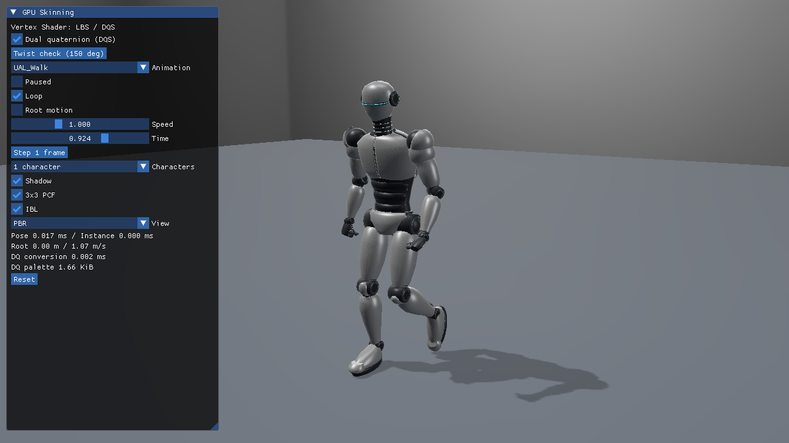
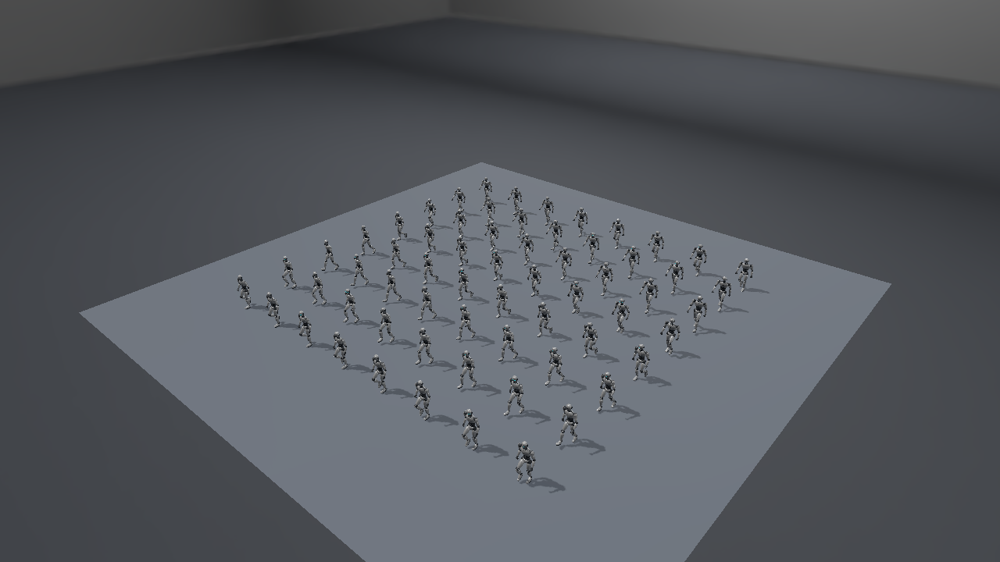
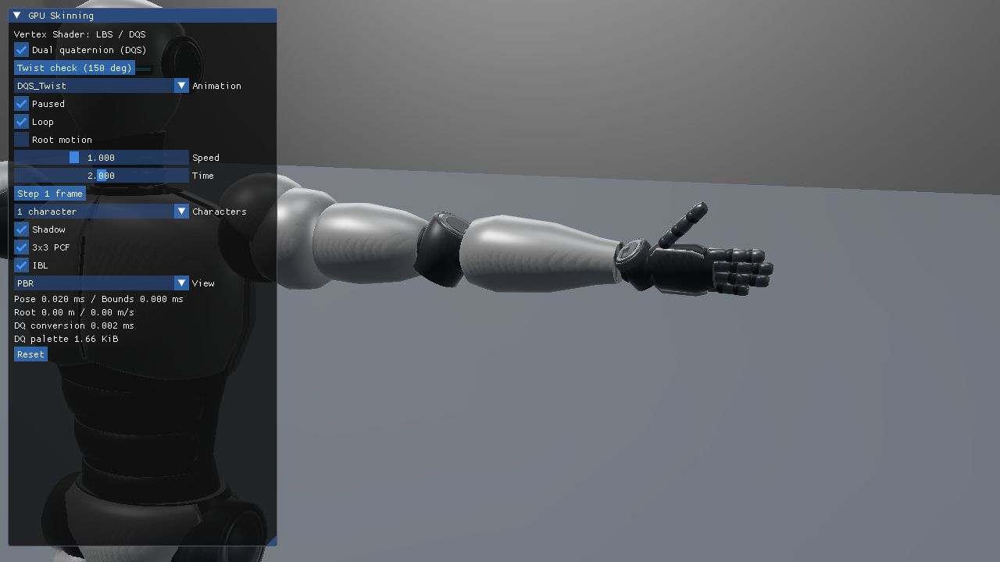

# 24. VulkanでDual Quaternion Skinning

基本22のIndexed Vertex Shader描画へDQSを追加し、同じ姿勢でLBSと切り替えます。[共通DQS解説](../DualQuaternionSkinning.md)で変形と符号合わせを、[検証記録](../DualQuaternionVerification.md)でCPU／GPU照合と性能を説明します。



## 独立したVulkan実装

[Sample.cpp](../../Samples/Vulkan/24_DualQuaternionSkinning/Sample.cpp)にDevice、Descriptor、Buffer、Pipeline、Command Buffer、Fence、終了処理があります。Vulkan 1.3、導入済みVulkan SDKのDXC、HLSL 2021／SM6.6を使い、オフラインSPIR-Vを`spirv-val --target-env vulkan1.3`で検査します。Mesh／Task拡張は要求しません。

CPUはglTFのTRSと階層を評価した後、逆バインドとMesh Global逆行列を含むpaletteをDQへ変換します。Direct3D12版とCPUコード・HLSLは共通です。カメラはLH、depth 0..1、Viewportは従来通りnegative heightです。

## DescriptorとDQの配置

`CreateSkinResources`でHost Visibleの行列・DQ paletteを確保し、`UpdateSkinBuffers`でmemcpyします。非coherentメモリは`Flush`します。更新は前フレームのFence完了待ちの後です。

| set 0 binding | HLSL register | 内容 |
|---|---|---|
| 38 | t96 | JOINTS＋WEIGHTS、32 byte |
| 39 | t97 | LBS行列、64 byte |
| 40 | t98 | DQをfloat4×2で格納、計32 byte／ジョイント |
| 41 | u7 | capture専用の変形結果、48 byte／頂点 |

Binding40はこの独立プロジェクトではDQ用です。`skinDualQuaternionParts[2 * (paletteBase + joint)]`がReal、次がDualです。LBSの動的Meshlet境界をDQSへ流用しません。基本24はIndexed描画を行い、MeshletのFrustum／Cone判定は行いません。

## Push constantと2つの描画パス

`BindMesh`は16 byteのPush constantのmodeへ`0x10000`を設定します。同じ`ReferenceVertex`のSPIR-Vが`SkinVertexAt`でLBS／DQSを選びます。DQは最大ウェイトのQuaternionへ符号を合わせ、Realの長さで両成分を正規化し、Dualの直交条件を補正します。

```text
vkCmdPushConstants(selected deformation)
Shadow: bind shadow pipeline → vkCmdDrawIndexed → light depth
Color : bind PBR pipeline    → vkCmdDrawIndexed → HDR color
```

両Graphics Pipelineが同じ変形関数を呼ぶため、DQSへ切り替えると影も同じ形状になります。位置に加え法線・接線も回転します。元Vertex／Indexは全Actorで共有し、64体はActorごとに位相とpaletteを変えます。Studio IBL、静的床、方向光、2048×2048 Shadow、3×3 PCFを継承します。

## 検査用Computeと同期

通常の表示はVSのみです。`--capture-gpu`時だけ検査用Compute Pipelineと実サイズの出力Bufferを使い、VSと同じHLSL変形関数をCSから呼び出します。同じGraphics Queueに記録し、Storage書込み、後続アクセス、Copy、Host読取りを`vkCmdPipelineBarrier2`で順序付けます。Fence完了後、非coherentならInvalidateして読戻します。

読戻しは共有関数のCS実行結果であり、VSの出力を直接取得したものではありません。Depth／Shadow／HDRと実ImGui操作の描画比較も併用します。ベンチマークではcaptureを無効にします。

## 実行と比較

```powershell
& .\bin\x64\Debug\Vulkan_24_DualQuaternionSkinning\Vulkan_24_DualQuaternionSkinning.exe
& .\bin\x64\Debug\Vulkan_24_DualQuaternionSkinning\Vulkan_24_DualQuaternionSkinning.exe `
  --skinning lbs --animation DQS_Twist --animation-time 2 --pause-animation --camera Twist
```

初期値はDQS／Walk／Root motion OFF。ImGuiの`Dual quaternion (DQS)`で切り替え、`Twist check (150 deg)`で最大ねじりを停止表示します。Reset、6クリップとA／Tポーズ、1／64体、Shadow、Root motion、再生操作を利用できます。






## Compute／Mesh版へ進む

[基本25 DQS Compute Cache](25_DualQuaternionComputeCache.md)ではCSの出力をShadow／Colorで共有し、[発展11 DQS Mesh Shader](Advanced11_DualQuaternionMeshSkinning.md)ではMS内で直接変形します。[共通の実行方式とDQS境界](../DualQuaternionStages.md)と[検証・性能](../DualQuaternionStagesVerification.md)で同じ姿勢の結果を比較できます。
