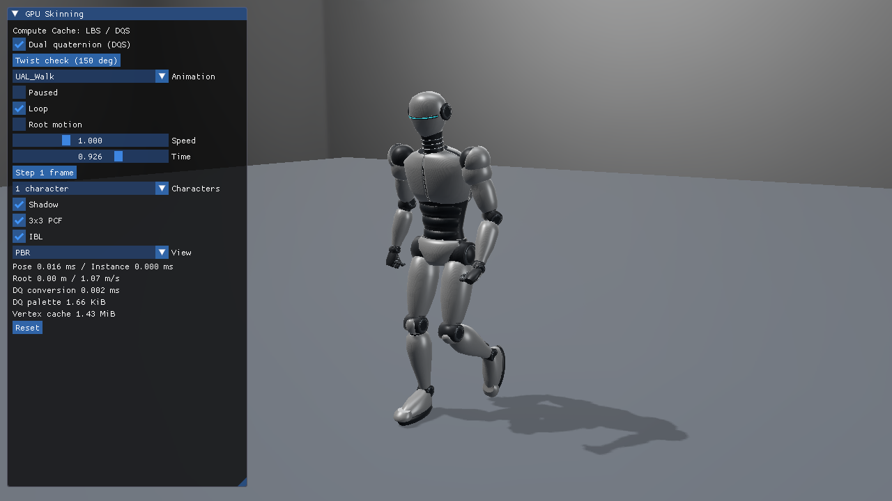

# 25. VulkanでDQSをComputeキャッシュする

基本24のDQSをCSで一度だけ変形し、同じ頂点をShadowとPBR Colorで使います。[DQSの数学](../DualQuaternionSkinning.md)、[3方式とキャッシュの理由](../DualQuaternionStages.md)、[数値検証と実測](../DualQuaternionStagesVerification.md)を合わせて参照してください。



## このプロジェクトの入力と初期化

[Sample.cpp](../../Samples/Vulkan/25_DualQuaternionComputeCache/Sample.cpp)にデバイス初期化、Buffer、Pipeline、転送、Barrier、描画、終了処理があります。VS 2026／v145／Windows SDK 10.0.26100.0、C++20、x64 Debug／Releaseを維持します。Vulkan 1.3、導入済みSDK付属DXC、SM6.6／HLSL 2021を使います。オフラインSPIR-Vはビルド時にspirv-valで検査します。Mesh／Task拡張は要求しません。Descriptor Setはset 0へまとめます。

元頂点とウェイトは共有Storage Buffer、DQ／行列はHost VisibleのStorage Buffer、変形結果はDevice LocalでSTORAGE_BUFFER／VERTEX_BUFFER用途のBufferです。CreateSkinResourcesで確保し、非coherentのUploadはFlushします。

入力はset 0のbinding 38／39／40／41です。1ジョイントはLBS行列64 byte、DQ32 byte。ImGui切替のため両方のpaletteを毎フレーム生成します。変形済み頂点は位置＋UV、法線＋UV、接線のfloat4×3＝48 byteです。元形状とIndexは全Actorで共有します。

## HLSL：DQのブレンドをCSへ移す

[SkinningCompute.hlsl](../../Shaders/Skinning/SkinningCompute.hlsl)の64 thread groupが元頂点の連続範囲を処理します。dispatchInstanceからActorの出力先とpalette先頭を取り出します。

```hlsl
MeshInstance instance = meshInstances[dispatchInstance];
if (id.x >= dispatchBase) return;
skinCache[instance.primitive.y + id.x] =
    SkinVertexAt(id.x, instance.primitive.z);
```

`BindMesh`のmode bit `0x10000`がDQSを選びます。`SkinVertexAt`の内部は[共通DQS HLSL](../../Shaders/Skinning/DualQuaternion.hlsli)で、最大ウェイトのQuaternionへReal／Dualの両方の符号を合わせ、正規化し、位置・法線・接線を変形します。LBSに切り替えると同じdispatchで行列ブレンドを実行します。

[CacheVertex.hlsl](../../Shaders/Skinning/CacheVertex.hlsl)は変形を再計算せず、キャッシュ頂点へWorldとlight／camera VPを掛けます。床は静的Vertex Bufferを使います。PBR Pixel Shader、Studio IBL、2048×2048 Shadow、3×3 PCF、HDRは基本24と同じです。

## APIの描画と同期

`PrepareMeshIndirect`で前のアクセスをCompute Storage Writeへ同期し、Actorごとに`vkCmdDispatch`します。完了後、`vkCmdPipelineBarrier2`で次を指定します。

```text
srcStage  = COMPUTE_SHADER
srcAccess = SHADER_STORAGE_WRITE
 dstStage = VERTEX_ATTRIBUTE_INPUT
 dstAccess= VERTEX_ATTRIBUTE_READ
```

`DrawObjects`は同じBufferを`vkCmdBindVertexBuffers`でbindし、Actorのbyte offsetだけを変え、Shadow／Color双方で`vkCmdDrawIndexed`します。1つのGraphics Queueで順序を保ち、次フレームの上書きはFence完了後です。UploadのFlushと、GPU内のCS→Vertex Barrierは別の役割です。

キャッシュは現在の体数分だけ書きます。1体で約1.43 MiB、64体で約91.22 MiBです。Shadow＋Colorの2パスで変形計算を繰り返す費用を減らす一方、書込み・読込み・同期と確保領域が増えます。パス数と対象頂点数を揃えて[性能表](../DualQuaternionStagesVerification.md)を評価してください。

## 操作と再現

```powershell
& .\bin\x64\Debug\Vulkan_25_DualQuaternionComputeCache\Vulkan_25_DualQuaternionComputeCache.exe `
  --skinning dqs --animation UAL_Walk --characters 64 --root-motion off
```

初期値はDQS／Walk／1体／Root motion OFFです。ImGuiでLBS／DQS、6クリップとA／Tポーズ、150度手首ねじり確認、速度・Seek・Pause・Step、1／64体、Shadow、PCFを切り替えます。ResetはDQS／Walk／Root motion OFFへ戻します。Root motionの進行トラックは既存サンプルと共通で、CSのメッシュローカル変形の後にInstance Worldへ適用します。

`--capture-gpu`では描画に使ったキャッシュを読戻し、独立NumPy参照と位置・法線・接線を比較します。Vertex版／Mesh版とはDepth・Shadow・HDRも比較します。性能測定では読戻しを無効にします。


