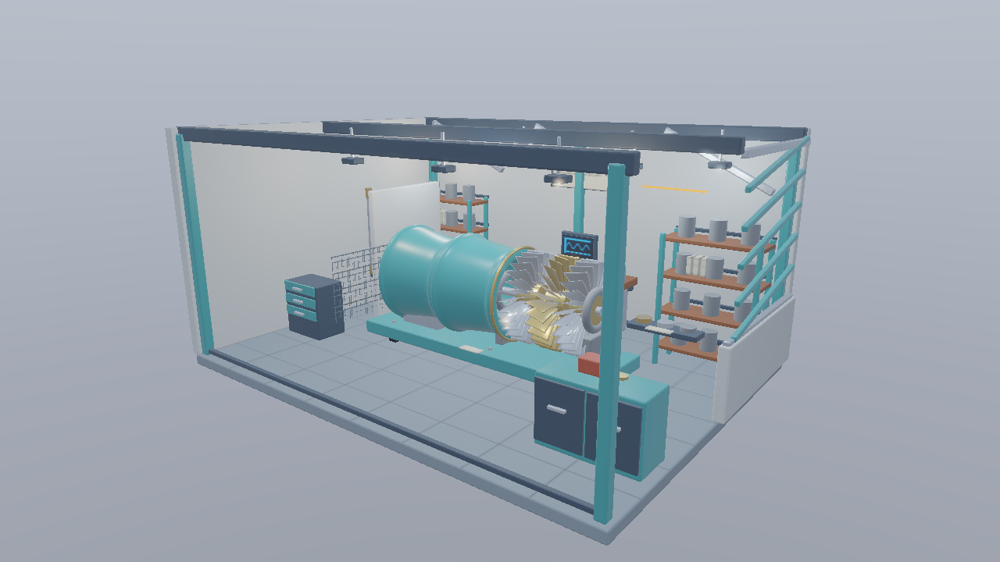

# Deferredの表面からRayQueryで影を調べる（Vulkan）

基本18 DeferredComputeから進む独立した実行プロジェクトです。[共通解説](../InlineRaytracing.md)／[検証記録](../InlineRaytracingVerification.md)も確認してください。

## 実装と観察

G-bufferは基本18と同じ4枚＋Depth、18 B／画素です。位置はDepthから復元し、Compute Shader内で表面からディレクショナルライトへレイを飛ばします。点光源は既存の照明を維持し、この回では影を付けません。

<code>--sun-shadow rayquery|map</code>で方式を切り替え、<code>--no-shadow</code>で影を無効化します。既定はRayQueryです。UIのInline Raytracingを開くと方式を変更できます。Shadow Mapモードは基本18と同じ画を比較するために残しています。RayQueryではShadow Mapの形状描画を省き、Depthのclear・遷移を診断用に維持します。

OPAQUEは自動でヒットを確定し、MASKは候補ヒットのInstance／三角形／重心座標からUVとAlphaを調べて確定します。片面／両面はTLASのInstanceフラグとレイの背面カリングを揃えます。遮蔽物の移動時はGPU完了後にTLASを再構築し、BLASを再利用します。

## 方式の比較

上の完成画像がRayQueryです。同じカメラのShadow Mapと影OFFを比べます。材質・IBL・点光源は同じです。Shadow Mapの解像度とPCFによる差は、RayQueryの交差判定の差と分けて観察します。

| Shadow Map | 影OFF |
|---|---|
|  |  |

## APIと実行

Vulkan 1.3、KHR Acceleration Structure／Ray Query、Deferred Host Operations、Buffer Device Address、非一様画像参照を使用します。rayQueryを有効化し、rayTracingPipelineは要求しません。

VS 2026／v145、Windows SDK 10.0.26100.0、C++20、SM6.6／HLSL 2021、x64 Debug／Releaseを使用します。発展16はMesh ShaderとBindless、発展17はMesh／Task Shaderも必要です。初期1280×720、OPAQUE／MASK対応です。FullのBLENDはエラーになります。

    msbuild Samples\Vulkan\26_InlineRaytracingShadows\Vulkan_26_InlineRaytracingShadows.vcxproj -p:Configuration=Debug -p:Platform=x64
    .\bin\x64\Debug\Vulkan_26_InlineRaytracingShadows\Vulkan_26_InlineRaytracingShadows.exe

[Sample.cpp](../../Samples/Vulkan/26_InlineRaytracingShadows/Sample.cpp)に初期化、リソース作成、AS構築、描画、同期、解放があります。WASD／Q/E／右ドラッグ／Shift／Rのカメラ操作とImGui入力抑制を継承します。

## 検証

Tools/TestInlineRaytracing.ps1を両構成で実行します。MASK、反射、点光源の距離制限、既存サンプルとのHDR比較、UI／Reset、奇数サイズを検証します。Tools/TestInlineRaytracingShaders.ps1はDXIL／SPIR-VとRayQuery機能宣言を検査します。resize／最小化復帰／終了はTools/TestSamples.ps1、性能はReleaseの-BenchmarkOnlyで測定します。

Ray origin offsetはワールド座標のm単位で、既存のShadow MapのDepth比較Biasとは独立です。UIのInline Raytracing内で変更し、Resetで0.001 mへ戻せます。
