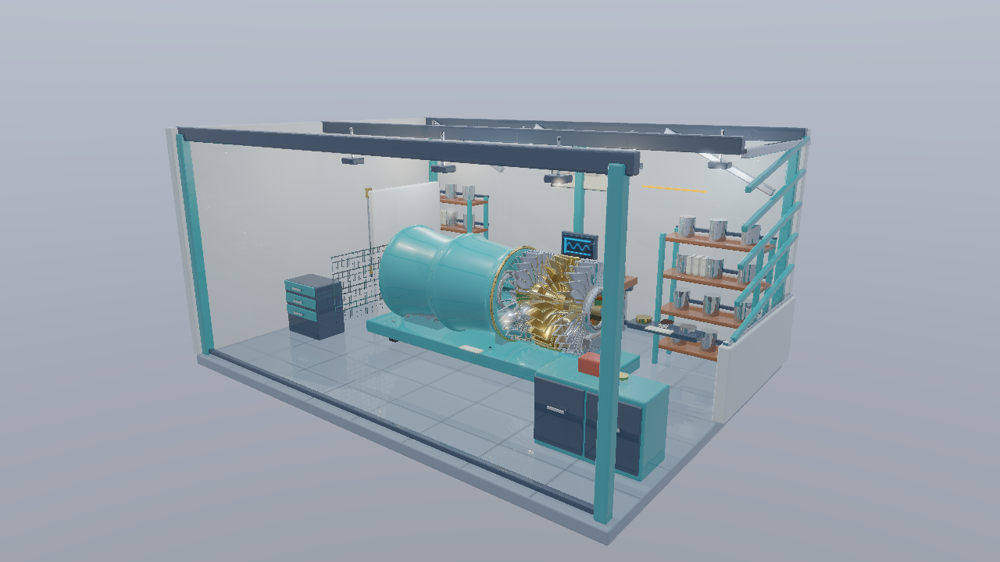
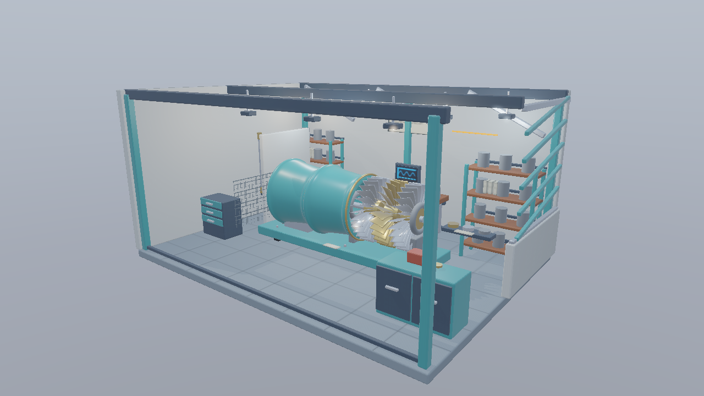
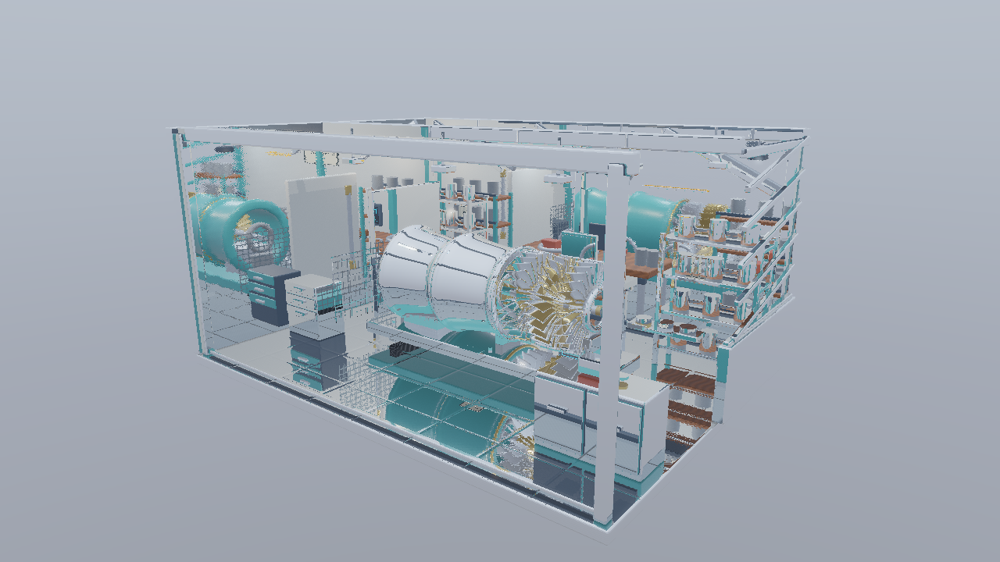

# Deferredから1バウンスの反射を計算する（Vulkan）

基本26 InlineRaytracingShadowsから進む独立した実行プロジェクトです。[共通解説](../InlineRaytracing.md)／[検証記録](../InlineRaytracingVerification.md)も確認してください。

## 実装と観察

基本26のCompute Lightingへ、理想鏡面方向の反射レイを加えます。G-bufferは一次可視面しか持たないため、反射先の頂点・UV・法線・材質をScene Bufferから復元します。画面外の物体も映ります。

反射先もBRDF、直接光、太陽の影、IBL、Emissiveで評価します。反射先から反射レイを追加せず1バウンスで終了し、Missでは環境Cubemapを参照します。一次面の鏡面IBLをFresnel付きの反射光へ置き換え、二重加算しません。

<code>--no-reflections</code>で基本26へ戻り、<code>--shading reflection</code>でFresnelを掛ける前の反射先の光を表示します。太陽の影方式も継承します。点光源の影、粗さに応じたぼけ、時間蓄積、デノイズは今回扱いません。

## 比較画像と既知形状

| 反射OFF（基本26相当） | 反射先からの光 |
|---|---|
|  |  |

自動試験では、画面外に発光する小さな板を置き、中央の鏡へ映る光を検査します。反射先の三角形は回転・移動したInstanceです。[発光板の反射](Images/27_InlineRaytracingReflections-fixture-reflection.png)、[MASKの穴](Images/27_InlineRaytracingReflections-fixture-reflection-mask-hole.png)、[MASKの有効部分](Images/27_InlineRaytracingReflections-fixture-reflection-mask-solid.png)を比較できます。

[反射先の太陽の影](Images/27_InlineRaytracingReflections-fixture-reflection-sun-shadow.png)と[影OFF](Images/27_InlineRaytracingReflections-fixture-reflection-sun-shadow-clear.png)、[環境Miss](Images/27_InlineRaytracingReflections-fixture-environment.png)と[環境OFF](Images/27_InlineRaytracingReflections-fixture-environment-black.png)も独立した条件です。黒い背景を使う試験では、中央の鏡の光に注目してください。

## APIと実行

Vulkan 1.3、KHR Acceleration Structure／Ray Query、Deferred Host Operations、Buffer Device Address、非一様画像参照を使用します。rayQueryを有効化し、rayTracingPipelineは要求しません。

VS 2026／v145、Windows SDK 10.0.26100.0、C++20、SM6.6／HLSL 2021、x64 Debug／Releaseを使用します。発展16はMesh ShaderとBindless、発展17はMesh／Task Shaderも必要です。初期1280×720、OPAQUE／MASK対応です。FullのBLENDはエラーになります。

    msbuild Samples\Vulkan\27_InlineRaytracingReflections\Vulkan_27_InlineRaytracingReflections.vcxproj -p:Configuration=Debug -p:Platform=x64
    .\bin\x64\Debug\Vulkan_27_InlineRaytracingReflections\Vulkan_27_InlineRaytracingReflections.exe

[Sample.cpp](../../Samples/Vulkan/27_InlineRaytracingReflections/Sample.cpp)に初期化、リソース作成、AS構築、描画、同期、解放があります。WASD／Q/E／右ドラッグ／Shift／Rのカメラ操作とImGui入力抑制を継承します。

## 検証

Tools/TestInlineRaytracing.ps1を両構成で実行します。MASK、反射、点光源の距離制限、既存サンプルとのHDR比較、UI／Reset、奇数サイズを検証します。Tools/TestInlineRaytracingShaders.ps1はDXIL／SPIR-VとRayQuery機能宣言を検査します。resize／最小化復帰／終了はTools/TestSamples.ps1、性能はReleaseの-BenchmarkOnlyで測定します。
