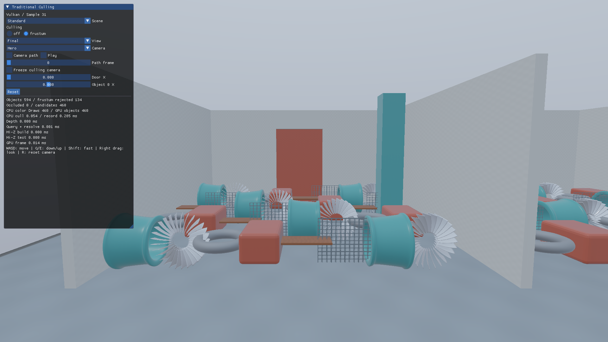
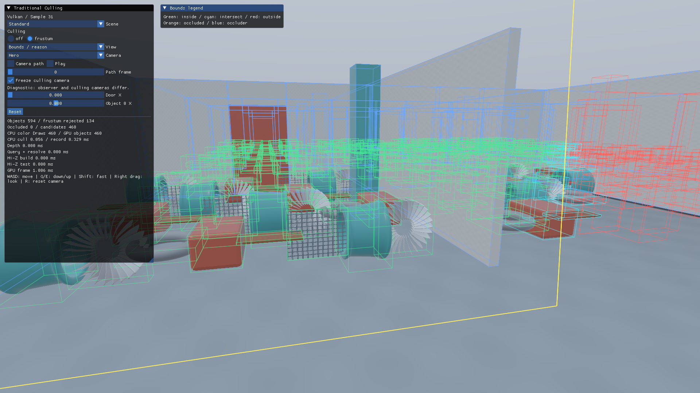

# 第31回 CPUフラスタムカリング — Vulkan



[共通解説](../TraditionalCulling.md)と[CullingLabの制作データ](../Assets/CullingLab.md)を併読してください。通常のPBR／IBLとIndexed Drawを使い、Primitive配置ごとの可視性を学びます。

## 判定の原理

視錐台の6平面とWorld AABBをCPUで比較します。中心 **c**、半寸法 **e**、平面 (**n**, d) に対して `dot(n,c)+d + dot(abs(n),e) < -epsilon` なら完全に外側です。境界交差は残します。

## データの流れ

```text
ローカルPrimitive境界 → 現在のWorld変換で8隅を変換 → World AABB → 6平面判定 → 可視リスト → Indexed Draw
```

CPUの境界・判定データは`Samples/Shared/CullingData.h`にあります。ローカル境界の8隅を現在のWorld変換で動かし、描画と同じカメラ・扉・対象位置を使います。Near面交差、カメラ内包、確定できない投影は可視候補に残します。

## API実装

`OnRender`で描画用と同じViewProjection・World変換を使い、`CullingState::Prepare`を呼びます。`DrawObjects(2)`は可視フラグが0ならCPUでスキップし、残ったものだけ`vkCmdDrawIndexed`を記録します。負のviewport heightとCPU投影のY反転を一致させます。

GPUリソース、Barrier、描画、完了待ち、破棄はこのプロジェクトの`Sample.cpp`／`Culling.cpp`にあります。`Samples/Shared/CullingPanel.h`はCPUのUI、`Shaders/Culling`は両API共通HLSLです。

```powershell
msbuild Samples/Vulkan/31_FrustumCulling/Vulkan_31_FrustumCulling.vcxproj -p:Configuration=Debug -p:Platform=x64
bin/x64/Debug/Vulkan_31_FrustumCulling/Vulkan_31_FrustumCulling.exe --culling frustum
```

VS 2026／v145／Windows SDK 10.0.26100.0／C++20、x64 Debug・Release、HLSL 2021／SM6.6、1920×1080で動作します。

## 可視化と操作

比較モードは**OFF／Frustum**です。Scene、Camera、Camera path、Door X、Object 0 X、Resetを共通UIで操作します。`--culling`と`--culling-view`で同じ設定を再現できます。

Freeze culling cameraを有効にすると判定側だけを固定できます。WASD・右ドラッグで観察側を動かすと、黄色の視錐台と除外されたAABBを外から確認できます。この診断では観察カメラのOFF画像との一致を要求しません。



Boundsの緑は内側、水色は視錐台との交差、赤は外側、橙は遮蔽除外、青は指定遮蔽物です。CPUの色Draw記録数とGPUの可視候補数は別に表示します。候補には画素を生成しない対象が残る場合もあります。

## 正確性と性能

カリングOFFを基準として、Object ID・Depth・完成HDRを比較します。見えている対象を誤って除外した件数はゼロを必須とし、見えない対象を残す保守的な判定は許容します。CPU版の全解像度、奇数サイズ、Near面、開口部、移動する扉・対象、急なカメラ移動、初回フレームを検査します。

`Tools/TestCulling.ps1`は画像とGPUデータの比較、`-UiOnly`は実UI入力とCLI再現、`-MotionOnly`は同一プロセス内のカメラ移動・振り返り・Resetを検査します。`Tools/TestSamples.ps1`はリサイズ・最小化復帰・終了を確認します。

追加の判定処理が描画削減分より高価なら遅くなります。[実機検証記録](../CullingVerification.md)と[5反復の計測表](../Measurements/Culling/Summary.md)で、CPU判定・記録とGPU各パスを比較してください。
