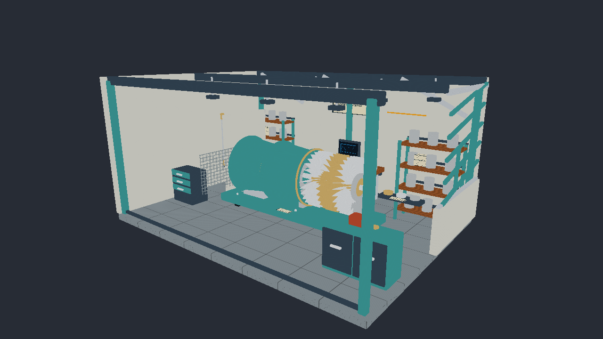

# Vulkan 発展編01 Albedoと一次レイ

カメラから一次レイを発射し、Closest-hitで重心座標からUVを補間してAlbedo×Base Color Factorを表示します。ライティングを加える前に、加速構造・パイプライン・Shader Table／SBT・材質参照を確認します。



1280×720、Workshop Standard／Hero／OpaqueMask。実GPUから取得した画像です。[共通章](../Raytracing.md)と[発展編目次](../AdvancedGraphicsSamples.md)を併せて読んでください。

## ビルドと実行

VS 2026／v145、Windows SDK 10.0.26100.0、C++20、x64 Debug／Releaseを使用します。対応GPUとSDKの条件は[発展編目次](../AdvancedGraphicsSamples.md#環境と今回の範囲)にまとめています。

```powershell
msbuild ShaderjpGraphicsSamples.sln -t:Restore -p:RestorePackagesConfig=true
msbuild Samples\Vulkan\Advanced01_RaytracingBasic\Vulkan_Advanced01_RaytracingBasic.vcxproj -p:Configuration=Debug -p:Platform=x64
& .\bin\x64\Debug\Vulkan_Advanced01_RaytracingBasic\Vulkan_Advanced01_RaytracingBasic.exe
```

## API処理を追う

[Sample.cpp](../../Samples/Vulkan/Advanced01_RaytracingBasic/Sample.cpp)で、Win32との接続、GPU選択、BLAS／TLAS、KHR Ray Tracing Pipeline、Descriptor Set、Shader Binding Table、`vkCmdTraceRaysKHR`、描画・同期・解放を追えます。[Sample.h](../../Samples/Vulkan/Advanced01_RaytracingBasic/Sample.h)にリソースの所有関係があります。

固有PrimitiveのBLASを配置間で共有し、CPUのInstance配列をTLASへ渡します。シェーダはInstance IDとTriangle IDから材質を取得します。MASKのAny-hitはAlbedoの穴を除外します。FullのBLENDプリセットは明確なエラーで終了します。

共通HLSLは[Raytracing](../../Shaders/Raytracing/Scene.hlsli)にあり、SM6.6／HLSL 2021として事前コンパイルします。再帰深度は1です。GPU完了待ち後に定数・ライト・UI Buffer・Descriptorを更新します。

## 操作と診断

SceneとPresetでStandard／Stress、Opaque／OpaqueMaskを選び、CameraとCamera Pathで既存の構図・20秒の経路を再現します。Occluder Xで遮蔽物を動かし、Resetで基準へ戻します。Viewはこの回で利用できる項目だけを表示します。

```powershell
& .\bin\x64\Debug\Vulkan_Advanced01_RaytracingBasic\Vulkan_Advanced01_RaytracingBasic.exe --no-ui --workshop-scene Stress --camera StressHero
& .\bin\x64\Debug\Vulkan_Advanced01_RaytracingBasic\Vulkan_Advanced01_RaytracingBasic.exe --frames 3 --no-ui --capture-gpu --screenshot .\.cache\rt.png
```

Albedoは線形空間で補間し、最後にsRGB変換だけを行います。背景は単色で、Normal／ORM／Emissive・IBL・Bloomは描画へ使用しません。Texture参照は明示的なLOD 0です。

## 検証

`Tools/TestRaytracing.ps1`をDebug／Releaseで実行します。既知UV、MASKの穴と裏面、影の距離制限、画面外の反射、環境Miss、UIとReset、Stress、641×479を実GPUの画像・Bufferで確認します。通常のリサイズ・最小化復帰は`Tools/TestSamples.ps1`で確認します。検証結果と使用環境は[検証記録](../RaytracingVerification.md)に記録します。

## カメラ操作

WASDで移動、Q/Eで上下移動、右ドラッグで視線を回転、Shiftで加速します。Rで選択中の固定カメラへ戻り、UIのResetはカメラと設定を初期化します。ImGuiの操作中はカメラ入力を抑えます。[共通の操作と検証手順](../CameraNavigation.md)も参照してください。
