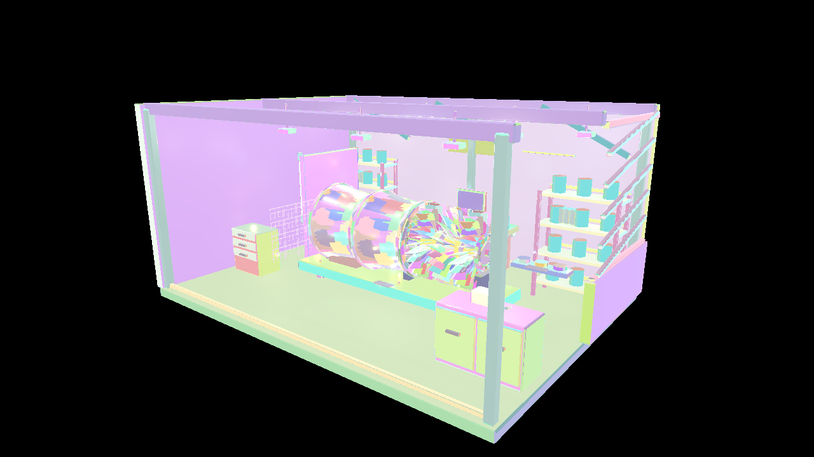
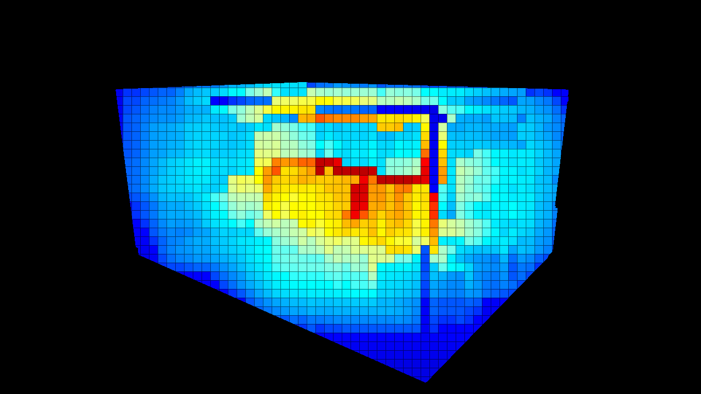
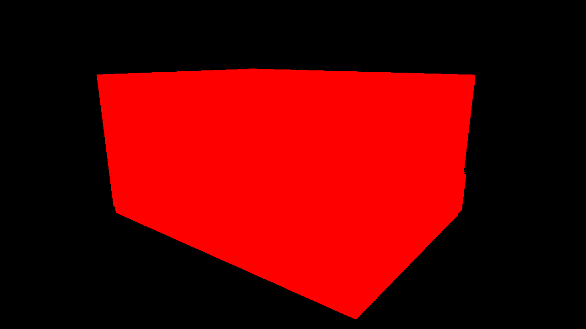

# 発展編09 Mesh ShaderによるTiled Deferred — Vulkan

08のG-bufferへ16×16画素のTiled Deferred Lightingを接続します。Meshlet Cullingは形状を、Tiledは各画素が調べる候補ライトを減らす役割です。









```powershell
msbuild Samples\Vulkan\Advanced09_MeshShaderTiledDeferred\Vulkan_Advanced09_MeshShaderTiledDeferred.vcxproj -p:Configuration=Debug -p:Platform=x64
bin\x64\Debug\Vulkan_Advanced09_MeshShaderTiledDeferred\Vulkan_Advanced09_MeshShaderTiledDeferred.exe
```


## 使用するAPIと事前コンパイル

Vulkan 1.3とSDK付属DXCを使用します。`VK_EXT_mesh_shader`と`meshShader`、必要な出力・グループ上限を起動時に確認します。共通HLSLを`SPV_EXT_mesh_shader`へコンパイルし、NVのMesh Shader経路は使いません。通常描画は`vkCmdDrawMeshTasksEXT`です。負の高さのViewport、左手系、Depth 0〜1を維持します。 `taskShader`を有効にし、ASのHLSLをTaskステージへ変換します。Task Payloadとその上限も確認します。

VS 2026、v145、Windows SDK 10.0.26100.0、C++20、x64 Debug／Releaseを維持します。共通HLSLは`Shaders/MeshShader`にあります。GPUリソース、Pipeline、描画、Barrier、Fence／Semaphore、終了時の解放はこのプロジェクトの`Sample.cpp`で追えます。共有C++はCPUデータとウィジェットです。

## 形状とライトを別の単位で減らす

08と同じMesh G-bufferを使い、画面を16×16画素のタイルへ分けます。Depthからタイルの最小／最大View Zを求め、ライトの影響球が重なる候補を登録します。Compute Lightingは各画素のタイルにあるライトだけを評価します。

Meshletは形状をラスタライズへ渡す単位で、タイルは照明を共有する単位です。Meshletを1個除外した結果と、ライトを1個除外した結果は別の統計として示します。

追加点光源は既存19回と同じ固定配置です。既定値は256個／区画、半径1.6 m、強度0.4。Standardは264個、Stressは2,376個、最大は4,680個です。AllとTiledでライトの列とBRDFを変えません。

## 容量と結果の維持

CLIでは`--light-culling all|tile`、`--lights-per-room 0..512`、`--list-capacity 1..256`、`--light-view none|count|overflow`を指定できます。ライト評価の切替とMeshlet Cullingの切替は独立しています。

ライトリスト容量を超えたタイルでは全ライトを評価し、光を欠落させません。UIで容量を1へ下げ、容量超過表示とAllの画像一致を観察できます。range未指定のライトも候補から落としません。

今回Tiledを選んだ理由は、既存Workshop・GPUでの測定結果と段階的な解説です。Mesh Shaderとの接続だけでClusteredより速くなる性質を保証するものではありません。[ライトカリング共通章](../LightCulling.md)と[既存の測定](../LightCullingVerification.md)も参照してください。


## 操作と比較

全サンプルでWASD移動、Q/E上下移動、Shift加速、右ドラッグ回転、RのカメラResetを使用できます。ImGui操作中やフォーカスを失ったときにはカメラ入力を解放します。初期解像度は1280×720です。 Scene／Preset／Camera／Camera path、Occluder XとResetを継承します。OPAQUE／MASKに対応し、Fullはエラーです。

CLIは`--render-path vertex|mesh|task`、`--meshlet-culling off|frustum|frustum-cone`、`--meshlet-view off|meshlets`を使用します。既存の`--no-ui`、`--frames`、`--test-odd`、`--test-camera`、`--screenshot`、`--capture-gpu`も継承します。04はPNGの画像読戻し、05以降はG-buffer／HDR・Meshletリストの診断読戻しを行います。デバッグ用の既知形状は`--mesh-test-scene`で選びます。

## 検証と性能の読み方

`Tools/TestMeshlets.ps1`はCPUで元の全三角形、局所Indexと境界を検証します。`Tools/TestMeshShaders.ps1`は実GPUで各経路、カリング、材質、UI・Resetとリサイズを検証します。`Tools/TestMeshShaderBinaries.ps1`はDXIL／SPIR-Vと配置を照合します。

05以降の性能はRelease、同一のStandard／Stress、固定カメラ経路、UI・VSyncなしで測定します。60フレーム準備後の1200フレームを記録し、管理・判定の追加コストを含むTotalも比較します。カリングで候補が減ることと、全体が速くなることを別々に報告します。AS／Taskの時間はGeometryへ含みます。

## このGPUでの測定

RTX 4070／610.88、Release、1280×720、同じ固定経路1,200フレームです。値はmsの中央値で、CPUは形状処理のコマンド記録だけを測っています。

| Scene | 経路・条件 | GPU Total | CPU記録 |
|---|---|---:|---:|
| Standard | task／off／Tiled | 1.1743 | 0.0597 |
| Standard | task／frustum-cone／Tiled | 1.2008 | 0.0596 |
| Standard | task／frustum-cone／All | 2.3862 | 0.1014 |
| Stress | task／off／Tiled | 2.1261 | 0.4993 |
| Stress | task／frustum-cone／Tiled | 2.2331 | 0.5000 |
| Stress | task／frustum-cone／All | 17.3172 | 1.0912 |

判定の追加コストによってONが遅くなる条件もあります。平均・p95・全パスの生データと比較条件は[検証記録](../MeshShaderVerification.md)を参照してください。

[Meshletとmeshoptimizerの共通章](../Meshlets.md)・[検証記録](../MeshShaderVerification.md)・[発展編目次](../AdvancedGraphicsSamples.md)
