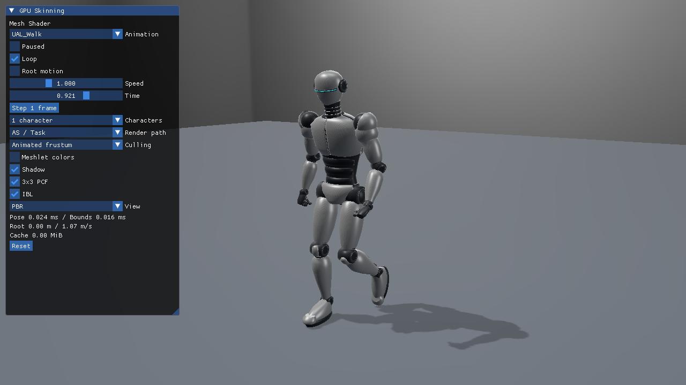
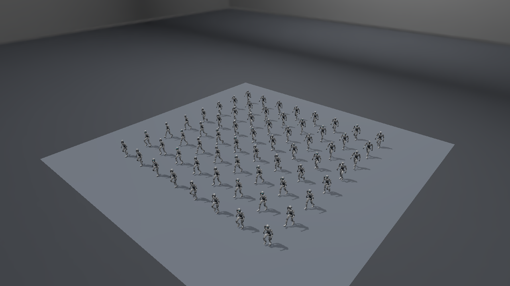
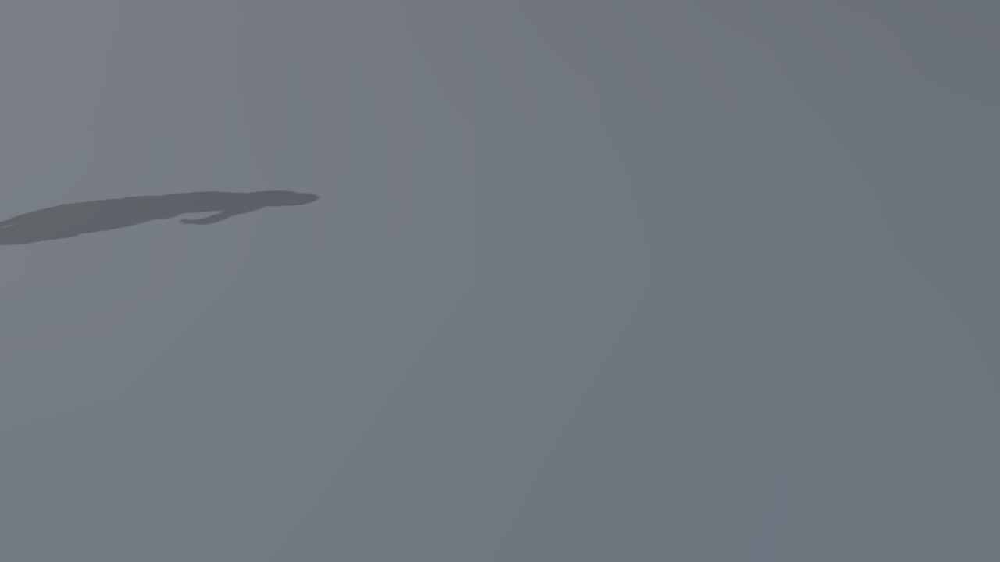
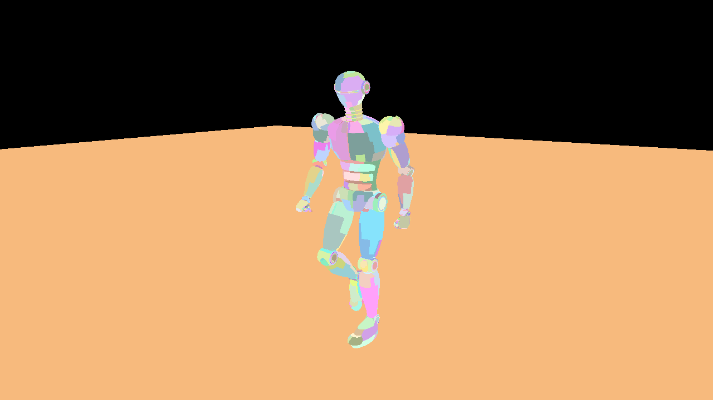

# Vulkan 発展10：Mesh ShaderでスキニングとShadowを描画

Mesh ShaderでスキニングとShadowを描画し、動くロボットのShadowとPBR Colorを描画します。前提は[glTFスキニング対応ローダー](../GltfSkinningLoading.md)と[GPUスキニング共通章](../GpuSkinning.md)です。実装は[Sample.cpp](../../Samples/Vulkan/Advanced10_MeshShaderSkinning/Sample.cpp)にあり、初期化・Buffer作成・転送・描画・同期・終了処理をこのプロジェクト内で追えます。



## 実行動画

プレビュー画像をクリックするとMP4を開きます。

**UAL_Run／64体**：TaskとAnimated frustumを有効にした64体のJogです。歩行のD3D12録画と異なるクリップで独立姿勢を確認できます。

[](../Assets/Videos/Vulkan_Advanced10_MeshShaderSkinning_Run64.mp4)

録画は2026-10-15、1280×720です。[動画一覧と元ファイルの記録](../Assets/Videos/README.md)も参照できます。

## 共通アセットと操作

[SilverRobotAnimated.blendと配布glTF](../Assets/SilverRobotAnimated.md)を使用します。53ボーン、31,138頂点、44,584三角形、5つの定数PBR材質です。1体では53行列、64体ではそれぞれの位相に合わせた53×64行列をCPUで評価します。元形状とIndexは共有します。

初期値はUAL_Walk／速度1／1体／Root motion OFF。ImGuiで6クリップ、Paused、Loop、Root motion、速度、Time、1フレーム送り、Reset、1／64体、Shadow、Hard／3×3 PCF、IBL、診断表示を切り替えられます。JumpStart／JumpLandは終端保持、その他はループが初期値です。カメラはWASD／Q・E／右ドラッグ／Shift／Rを継承します。

```powershell
& .\bin\x64\Debug\Vulkan_Advanced10_MeshShaderSkinning\Vulkan_Advanced10_MeshShaderSkinning.exe `
  --animation UAL_Walk --animation-time 0.3 --pause-animation --characters 1
```

`--animation-speed`、`--characters 64`、`--post-view weights`、`--camera OffscreenCaster`、`--hard-shadow`、`--no-shadow`も使えます。全3方式に同じ引数を与えれば、同じ姿勢と光で比較できます。

`Root motion`をONにするとWalk／Runが前進し、OFFとResetでは元の配置へ戻ります。現在の素材はその場モーションなので、支持足の動きから進行量を復元しています。ループで位置を巻き戻さず、Pause／速度／Seek／1フレーム送りも移動へ反映します。CLIは`--root-motion on|off`、省略時はOFFです。[復元方法と移動・Shadowの扱い](../GpuSkinning.md#root-motionを切り替える)

## Vulkanの初期化と入力

VS 2026／v145／Windows SDK 10.0.26100.0、Vulkan SDK付属DXC、Vulkan 1.3、Dynamic Rendering／Synchronization2を使います。基本22／23は`VK_EXT_mesh_shader`を要求しません。発展10では`meshShader`と`taskShader`を有効にします。共有HLSLをSPIR-Vへ事前コンパイルし、ビルド中に`spirv-val`で検証します。

`CreateDevice`でFeatureを確認し、`CreateMeshResources`／`CreateSkinResources`でBuffer、`CreateMeshDescriptors`でDescriptor set、`CreateMeshPipelines`でPipelineを作ります。新しいbindingをset 0へ追加します。

| データ | set 0 binding | Descriptor |
|---|---|---|
| JOINTS＋WEIGHTS | 38 | STORAGE_BUFFER |
| row-major palette | 39 | STORAGE_BUFFER |
| 動的Meshlet Sphere | 40 | STORAGE_BUFFER |
| 変形済み頂点 | 41 | STORAGE_BUFFER |

毎フレームのpalette／境界はホスト可視Bufferへ書き、非coherentメモリならflushします。Graphics／Computeは同じQueueを使い、Fence完了後にInstance・palette・UIデータを更新します。画面は負の高さのViewportで表示し、ボーン行列にAPI別の反転は加えません。

## この方式の描画と同期

元頂点・ウェイト・paletteはStorage Bufferです。Meshletは既存meshoptimizerで最大64頂点／96三角形に分け、`MeshGeometry.hlsl`／`MeshShadow.hlsl`のMSが元頂点をその場で変形します。Meshlet境界の共有頂点は複数MSで処理される場合があります。

`Mesh direct`は`vkCmdDrawMeshTasksEXT`で直接MSを起動し、`AS / Task`は`MeshTask.hlsl`のTask stageで可視判定を行います。Taskは候補32個ごとの動的Sphereを視錐台で調べ、Payloadへ可視候補を詰めます。Color／ShadowはPipelineを分け、ShadowはライトFrameのUniformと独立したTask判定を使います。

```text
CPU: pose → palette → bone別影響AABB → 動的Sphere Buffer
Shadow Task: light frustum → MS skin → light depth
Color  Task: camera frustum → MS skin → PBR HDR
```

Palette・Sphere Bufferのbindingのstage visibilityにはTASK／MESHを含めます。カメラの結果からライトのCasterを落とすことはせず、両パスで候補を評価します。動的メッシュの静的normal coneは判定を無効にしています。

この方式にComputeの変形済み頂点Bufferはありません。MSは各パスで変形し、CPUは保守境界を更新します。カリングをOFFにした直接描画とのDepth／Shadow／HDR一致、画面外Caster、64体の異なる姿勢を検証してから速度を比較します。

## 直接描画とカリングを再現する

```powershell
--render-path mesh --meshlet-culling off
--render-path task --meshlet-culling frustum
```

UIのRender path／Culling／Meshlet colorsでも切り替えられます。`frustum-cone`は動的なコーンを構築していないため拒否します。カリングOFFでも同じ姿勢、材質、Shadowを描画します。





## Shadow、PBR、HDR表示

静的床、方向光、2048×2048のD32 Shadow、Hard／3×3 PCF、StudioのIrradiance／Specular IBL、BRDF LUTを基本22／23／発展10で揃えます。PBRは定数Base Color／Metallic／Roughness／Emissiveを使い、ColorをHDRへ出してから表示変換します。モデルにUVやTextureがなくても法線と材質を評価できます。

`--post-view normal`で変形後の法線、`depth`でカメラ深度、`shadow`でライト深度、`weights`で4成分のウェイトを確認できます。表示用のポスト処理の前の線形HDRも`--capture-gpu`で読戻せます。3方式の比較はPNGの見た目だけでなく、このDepth・Shadow・HDRとComputeの実頂点を対象にします。

Meshlet単位の色分けでMSへ渡す仕事の分割を確認できます。



## 検証と測定

```powershell
.\Tools\TestSkinningCpu.ps1
.\Tools\TestSkinning.ps1 -Configuration Debug -Api Vulkan
.\Tools\TestSkinning.ps1 -Configuration Release -Api Vulkan
.\Tools\MeasureSkinning.ps1 -Api Vulkan
```

全クリップのCPU参照、1体／64体、Shadow ON/OFF、カリングON/OFF、画面外Caster、リサイズ・最小化／復帰、Seek／Reset、ループ／終端、再生速度を検証します。DebugのGraphics Validationエラーは0件です。Shader欠落時の診断と終了処理も試験します。具体的な誤差・環境・ReleaseのCPU/GPU時間は[検証記録](../SkinningVerification.md)へまとめています。

実行ローダーの対象はglTF JSON＋外部BIN、4インフルエンス、TRS LINEAR／STEPです。Morph、CUBICSPLINE、追加ウェイトセット、任意のTexture材質は対象外として診断します。モデル・モーションのライセンスは[アセット記事](../Assets/SilverRobotAnimated.md#採用素材とライセンス)を参照してください。

次は[3方式の比較と性能計測](../SkinningVerification.md)へ進みます。
