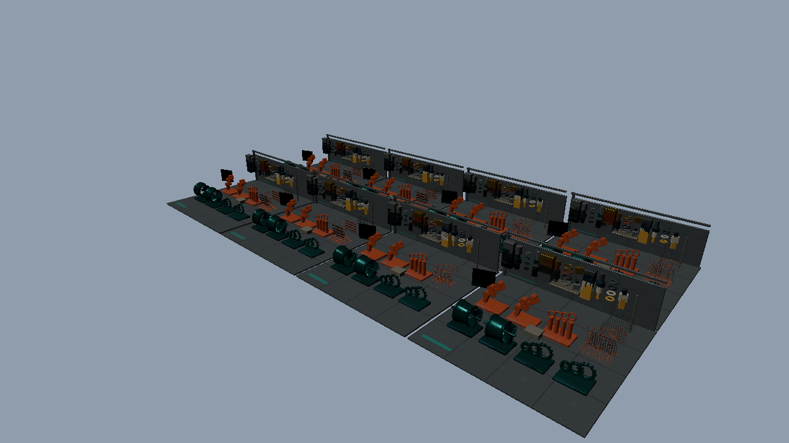

# 発展13：Meshletと形状Bufferをインデックスで参照する（Vulkan）

BindlessGalleryの同じSceneを使い、リソースの取得方法を切り替える独立プロジェクトです。[共通章](../BindlessGraphics.md) → [アセット制作](../Assets/BindlessGallery.md) → このサンプルの順に確認します。



## 比較する処理

直接描画の3モードは同じ順序、同じInstanceごとのMesh Dispatch、同じMeshlet視錐台判定を実行します。`bound`は材質と形状、`textures`は形状の固定スロットを切り替えます。`resources`はGeometryのBuffer IDから頂点・Index・Meshlet・ローカル頂点参照・三角形参照を取得します。

発展05の可視リストと間接描画を`Compute.hlsl`のReset → Cull → Finalizeへ対応させます。`--gpu-driven`は候補MeshletをComputeで選び、複数の形状と材質を1回の間接Mesh Dispatchへまとめます。カリング費用を含めた描画集約の比較です。直接描画による参照方式の比較と別表にします。空のリストでは1グループを発行し、Mesh Shaderが出力数を0にします。64頂点／96三角形の上限を継承しています。

## API側で読む場所

Vulkan 1.3のRuntime Descriptor Arrayと、画像・Storage Buffer・Storage Imageの非一様参照機能を確認します。型別の配列をDescriptor Set 0に配置し、使用する全要素を書き込みます。作成時に配列数を確定するためVariable descriptor count／Partially bound／Update-after-bindは使用しません。`UpdateDescriptors`と`OnInit`で要件と個数上限を確認できます。

[Sample.cpp](../../Samples/Vulkan/Advanced13_BindlessMeshShader/Sample.cpp)に初期化・画像転送・Descriptor作成・描画・待機・解放を残しています。[共有CPUデータ](../../Samples/Shared/BindlessData.h)はAPIを操作しません。[共通HLSL](../../Shaders/Bindless/Scene.hlsli)のGetGeometry／GetMaterial／GetInstance／SampleImageから呼出側を追ってください。

固定のフレーム定数はb0／binding 0、画像はt0／binding 1、Samplerはs0／binding 2、すべてset 0です。追加のBuffer・UAV・G-buffer・ASには別のbindingを割り当てています。行列はrow-major、左手系、深度0..1、Vulkanは負の高さのViewportを使います。

## 実行と観察

```powershell
.\bin\x64\Release\Vulkan_Advanced13_BindlessMeshShader\Vulkan_Advanced13_BindlessMeshShader.exe --gallery-preset Mini --materials 64 --binding bound
.\bin\x64\Release\Vulkan_Advanced13_BindlessMeshShader\Vulkan_Advanced13_BindlessMeshShader.exe --gallery-preset Mini --materials 64 --binding textures
```

UIからBinding、Objects、Materials、Camera、診断表示、Resetを操作できます。配置数と使用材質数は独立です。共通CLIの`--gallery-view material|geometry|uv`でIDと既知UVを確認します。変更による再構築・解放はGPU完了後です。Samplerと全Descriptorは事前作成し、フレームごとのDescriptor更新を行いません。

[既存Advanced05_GpuDrivenRendering](./Advanced05_GpuDrivenRendering.md)、[既存Advanced08_MeshShaderDeferred](./Advanced08_MeshShaderDeferred.md)の処理と比較できます。照明は共有の直接光と環境近似を使います。Cycles参考画像は画作り用であり、正当性は同じ描画経路のモード間で検証します。

## 検証と測定

`Tools/TestBindless.ps1`は64枚を超える画像を使い、HDRと表面情報を浮動小数点で比較します。`Tools/TestBindlessFeatures.ps1`は診断表示、GPU Drivenの空／全可視／端数、UI入力／Reset、入力エラーを検査します。`Tools/TestSamples.ps1`はリサイズ、最小化・1280×720復帰、終了を確認します。

[検証記録と比較表](../BindlessVerification.md)、[測定データ](../BindlessPerformance.json)を併記します。Release・60フレームのウォームアップ・固定経路1,200フレーム・5反復を使います。GPU Drivenの描画集約と参照方式の差を区別し、GPUやシーンにより小差・逆転も起こることを確認してください。

掲載した性能値は固定ランタイムによる46条件×5反復の再測定結果です。初回参考値は別途保存しています。
