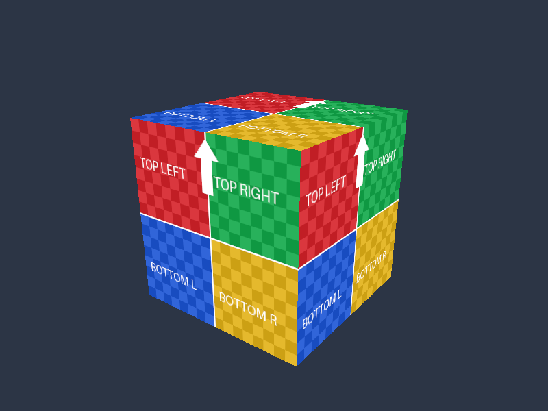

# Shader.jp Graphics Samples

[Shader.jp](https://shader.jp/)のDirect3D12／Vulkanチュートリアル用サンプルです。5つのテーマを両APIで実装し、共通HLSLからDXILとSPIR-Vを生成します。API処理を各プロジェクトで追える構成にしています。

## 必要な環境

- Windows、Visual Studio 2026の「C++によるデスクトップ開発」、v145、Windows SDK 10.0.26100.0。
- x64のDebug／Release構成。初回の検証環境はWindows 11とNVIDIA GeForce RTX 4070です。
- D3D12: FL12_0、Shader Model 6.6対応GPU／ドライバ。Agility SDK 1.619.6とDXC 1.9.2609.5をNuGetで復元します。
- Vulkan: Windows用[Vulkan SDK](https://vulkan.lunarg.com/sdk/home)と付属DXC。Vulkan 1.3、Dynamic Rendering、Synchronization2、graphics/present両対応Queueを持つGPU／ドライバが必要です。
- Debug実行時にはD3D12 Debug Layer／Vulkan Validation Layerを有効化します。D3D12のDebug Interfaceが利用できない場合はWindowsの「グラフィックス ツール」を導入してください。

SDKを導入してもGPU・ドライバの機能対応が追加されるわけではありません。初期化時に必要な対応を確認し、不足している場合はエラーを表示します。

## 取得とビルド

```powershell
git clone --recurse-submodules https://github.com/shaderjp/ShaderjpGraphicsSamples.git
cd ShaderjpGraphicsSamples
```

`ShaderjpGraphicsSamples.sln`をVisual Studio 2026で開き、NuGetパッケージを復元してx64でビルドします。Vulkan SDK導入後はVisual Studioを再起動し、`VULKAN_SDK`を反映してください。

Visual Studio 2026 Developer PowerShellからもビルドできます。

```powershell
msbuild ShaderjpGraphicsSamples.sln -t:Restore -p:RestorePackagesConfig=true
msbuild ShaderjpGraphicsSamples.sln -m -p:Configuration=Debug -p:Platform=x64
msbuild ShaderjpGraphicsSamples.sln -m -p:Configuration=Release -p:Platform=x64
```

D3D12だけをビルドする場合、NuGet復元後に各D3D12プロジェクトを直接指定すればVulkan SDKは不要です。

```powershell
msbuild Samples\Direct3D12\02_Triangle\Direct3D12_02_Triangle.vcxproj -p:Configuration=Debug -p:Platform=x64
```

生成物は`bin/x64/<構成>/<プロジェクト名>`、中間生成物は`obj`、復元したNuGetパッケージは`packages`へ置きます。HLSLの事前コンパイル、アセット配置、Agility DLL配置、SPIR-V検証はビルドに含まれます。アプリは実行ファイル基準でファイルを探すため、作業ディレクトリを変更しても同梱データを読み込めます。

## サンプル一覧

| テーマ | Direct3D12 | Vulkan |
|---|---|---|
| 初期化・画面クリア | [01 Initialization](Docs/Direct3D12/01_Initialization.md) | [01 Initialization](Docs/Vulkan/01_Initialization.md) |
| NDC三角形・頂点カラー | [02 Triangle](Docs/Direct3D12/02_Triangle.md) | [02 Triangle](Docs/Vulkan/02_Triangle.md) |
| NDCテクスチャ・WIC読込 | [03 Texture](Docs/Direct3D12/03_Texture.md) | [03 Texture](Docs/Vulkan/03_Texture.md) |
| BOX・Index／Constant Buffer・深度 | [04 Box](Docs/Direct3D12/04_Box.md) | [04 Box](Docs/Vulkan/04_Box.md) |
| OBJ・指定テクスチャ | [05 Model](Docs/Direct3D12/05_Model.md) | [05 Model](Docs/Vulkan/05_Model.md) |

各プロジェクトをVSのスタートアッププロジェクトに設定して実行できます。ESCまたは閉じるボタンで終了します。



## 共通化と構成

| フォルダ | 内容 |
|---|---|
| `Samples/Direct3D12`, `Samples/Vulkan` | テーマ別の独立したVCプロジェクト。API初期化・描画・同期・解放を明示 |
| `Common` | Win32ライフサイクル、ファイル読込、WIC、OBJ、CPU側のデータと行列計算 |
| `Shaders` | 両APIで共有するHLSL。SM6.6／HLSL 2021、API固有の属性だけマクロ化 |
| `Assets` | 差し替え可能な自作OBJ／PNG |
| `Build` | 共通MSBuild設定とシェーダ・配布ファイルの処理 |
| `Docs` | 日本語解説、実際の描画結果、検証記録 |
| `ThirdParty` | 今後のSubmodule依存関係の運用方針 |
| `Tools`, `Tests` | フィルタ検証、GPUライフサイクル検証、ローダーテスト |

行列・リソース番号・上下方向・色空間については[共通HLSLの規約](Docs/SharedShaders.md)を参照してください。D3D12とVulkanのDXCは別の配布元を使うため、[検証記録](Docs/Verification.md)に各バージョンを残しています。

初回の画像ローダーはWICです。DDS・Cubemapを扱う後続テーマでDirectXTex、GUIテーマでimguiを`ThirdParty`のSubmoduleとして追加します。OBJローダーは外部依存なしで、MTL・複数マテリアル・照明は初回の対象に含めません。

## 実行オプション

```powershell
& .\bin\x64\Debug\Vulkan_05_Model\Vulkan_05_Model.exe --model "D:\Assets\model.obj" --texture "D:\Assets\albedo.png"
& .\bin\x64\Debug\Direct3D12_04_Box\Direct3D12_04_Box.exe --frames 48 --test-window --screenshot ".\.cache\box.png" --log ".\.cache\box.log"
```

| オプション | 動作 |
|---|---|
| `--model <path>` | 05_ModelのOBJを差し替え。省略時は同梱Cube.obj |
| `--texture <path>` | 03_Texture／05_Modelの画像を差し替え。省略時は同梱UV.png |
| `--frames <N>` | 正の整数N回の通常描画で終了 |
| `--test-window` | 12フレームで640×480へ変更、24フレームで最小化・800×600へ復帰 |
| `--screenshot <path>` | 指定フレーム数の終了時、または通常実行の8フレーム後にGPU読戻しPNGを保存 |
| `--log <path>` | 初期化・リサイズ・エラー・検証結果を保存 |

明示指定した相対パスは起動時の作業ディレクトリ基準です。終了コードは0が成功、1がアプリのエラー、2がグラフィックス検証エラーです。初回は1フレームごとにGPU完了を待つ方式を使用し、性能比較用のベンチマークとしては設計していません。

Vulkanのスクリーンショットは、取得済みの画像をPresent前に読み戻すため、キャプチャ用の追加フレームを描画します。Debugの`TestSamples`は子プロセスだけで同期検証（`VK_LAYER_VALIDATE_SYNC=1`）も有効にします。

## 検証

```powershell
.\Tools\ValidateProjects.ps1
.\Tools\TestLoaders.ps1
.\Tools\TestSamples.ps1
.\Tools\TestSamples.ps1 -Configuration Release
.\Tools\TestFailureCases.ps1
```

`ValidateProjects`は`.vcxproj`と`.filters`をXMLで照合し、全項目の一対一対応、物理ファイル、フィルタ宣言、GUIDと親階層を検証します。`TestLoaders`はVSの開発環境を設定し、外部テストライブラリなしでCPU側テストをコンパイルします。`TestSamples`は全10本で描画、リサイズ、最小化復帰、PNG取得、正常終了を確認します。

Docsの実画像を更新する場合は`Tools/TestSamples.ps1 -CaptureDocs`を使い、生成したPNGを目視確認してください。初回の結果は[検証記録](Docs/Verification.md)を参照できます。

## ライセンス・参考資料

サンプルコードと同梱の自作アセットは[MIT License](LICENSE)です。SDK・コンパイラの再配布には各パッケージのライセンスも適用されます。NuGetパッケージ内のライセンスを確認してください。

[Microsoft DirectX Graphics Samples](https://github.com/microsoft/DirectX-Graphics-Samples)の処理順・実装スタイルを参考にしています。外部の参考フォルダやサイトリポジトリはビルドの依存先にはしていません。

参考: [Agility SDK](https://devblogs.microsoft.com/directx/directx12agility/)、[DXC](https://github.com/microsoft/DirectXShaderCompiler)、[Vulkan HLSL](https://github.khronos.org/Vulkan-Site/guide/latest/hlsl.html)
