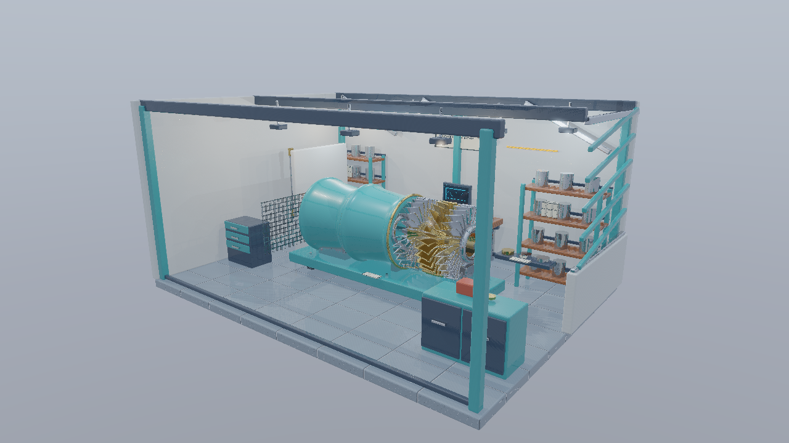
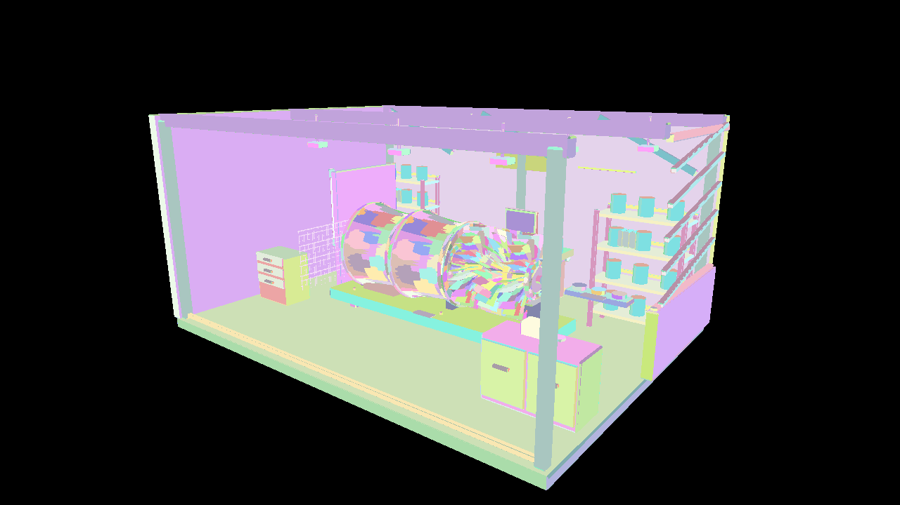

# Shader.jp Graphics Samples

[Shader.jp](https://shader.jp/)のDirect3D12／Vulkanチュートリアル用サンプルです。**基本編23テーマ＋発展編10テーマ、両APIで計66本の独立した実行プロジェクト**を収録しています。共通HLSLからDXILとSPIR-Vを生成し、API処理を各プロジェクトで追える構成にしています。

基本編は初期化からPBR・IBL・Shadow・Compute・Deferred・Visibility Buffer・GPUスキニングへ、発展編はレイトレーシングとMesh Shader・GPU Driven Renderingへ進みます。収録内容は[基本編一覧](#基本編サンプル一覧)と[発展編一覧](#発展編サンプル一覧)から参照できます。

## 必要な環境

- Windows、Visual Studio 2026の「C++によるデスクトップ開発」、v145、Windows SDK 10.0.26100.0。
- x64のDebug／Release構成。初回の検証環境はWindows 11とNVIDIA GeForce RTX 4070です。
- D3D12: FL12_0、Shader Model 6.6対応GPU／ドライバ。Agility SDK 1.619.6とDXC 1.9.2609.5をNuGetで復元します。
- Vulkan: Windows用[Vulkan SDK](https://vulkan.lunarg.com/sdk/home)と付属DXC。Vulkan 1.3、Dynamic Rendering、Synchronization2、graphics/compute/presentに対応するQueue（第14回以降のCompute使用サンプル）を持つGPU／ドライバが必要です。
- 発展編01〜03: D3D12はDXR Tier 1.0以上、VulkanはKHRのAcceleration Structure／Ray Tracing Pipeline／Deferred Host Operations、Buffer Device Addressなどが必要です。[詳細な要件](Docs/AdvancedGraphicsSamples.md#環境と今回の範囲)
- 発展編04〜10: D3D12はMesh Shader Tier、Vulkanは`VK_EXT_mesh_shader`と`meshShader`が必要です。Vulkanの06〜10は`taskShader`も使用します。基本22／23はMesh Shaderを要求しません。[Mesh Shaderの要件と検証](Docs/MeshShaderVerification.md)
- Debug実行時にはD3D12 Debug Layer／Vulkan Validation Layerを有効化します。D3D12のDebug Interfaceが利用できない場合はWindowsの「グラフィックス ツール」を導入してください。

SDKを導入してもGPU・ドライバの機能対応が追加されるわけではありません。初期化時に必要な対応を確認し、不足している場合はエラーを表示します。

## 取得とビルド

```powershell
git clone --recurse-submodules https://github.com/shaderjp/ShaderjpGraphicsSamples.git
cd ShaderjpGraphicsSamples
```

`ShaderjpGraphicsSamples.sln`をVisual Studio 2026で開き、NuGetパッケージを復元してx64でビルドします。Vulkan SDK導入後はVisual Studioを再起動し、`VULKAN_SDK`を反映してください。

Visual Studio 2026 Developer PowerShellからもビルドできます。

```powershell
msbuild ShaderjpGraphicsSamples.sln -t:Restore -p:RestorePackagesConfig=true
msbuild ShaderjpGraphicsSamples.sln -m -p:Configuration=Debug -p:Platform=x64
msbuild ShaderjpGraphicsSamples.sln -m -p:Configuration=Release -p:Platform=x64
```

D3D12だけをビルドする場合、NuGet復元後に各D3D12プロジェクトを直接指定すればVulkan SDKは不要です。

```powershell
msbuild Samples\Direct3D12\02_Triangle\Direct3D12_02_Triangle.vcxproj -p:Configuration=Debug -p:Platform=x64
```

生成物は`bin/x64/<構成>/<プロジェクト名>`、中間生成物は`obj`、復元したNuGetパッケージは`packages`へ置きます。HLSLの事前コンパイル、アセット配置、Agility DLL配置、SPIR-V検証はビルドに含まれます。アプリは実行ファイル基準でファイルを探すため、作業ディレクトリを変更しても同梱データを読み込めます。

## 基本編サンプル一覧

各APIのリンクは解説記事です。対応するプロジェクトは[`Samples/Direct3D12`](Samples/Direct3D12)／[`Samples/Vulkan`](Samples/Vulkan)の同名フォルダにあります。

| テーマ | Direct3D12 | Vulkan |
|---|---|---|
| 初期化・画面クリア | [01 Initialization](Docs/Direct3D12/01_Initialization.md) | [01 Initialization](Docs/Vulkan/01_Initialization.md) |
| NDC三角形・頂点カラー | [02 Triangle](Docs/Direct3D12/02_Triangle.md) | [02 Triangle](Docs/Vulkan/02_Triangle.md) |
| NDCテクスチャ・WIC読込 | [03 Texture](Docs/Direct3D12/03_Texture.md) | [03 Texture](Docs/Vulkan/03_Texture.md) |
| BOX・Index／Constant Buffer・深度 | [04 Box](Docs/Direct3D12/04_Box.md) | [04 Box](Docs/Vulkan/04_Box.md) |
| OBJ・指定テクスチャ | [05 Model](Docs/Direct3D12/05_Model.md) | [05 Model](Docs/Vulkan/05_Model.md) |
| glTF・Albedo・材質参照 | [06 Gltf](Docs/Direct3D12/06_Gltf.md) | [06 Gltf](Docs/Vulkan/06_Gltf.md) |
| Lambert／Blinn-Phongライティング | [07 Lighting](Docs/Direct3D12/07_Lighting.md) | [07 Lighting](Docs/Vulkan/07_Lighting.md) |
| Metallic-Roughness PBR・Normal／ORM | [08 PBR](Docs/Direct3D12/08_PBR.md) | [08 PBR](Docs/Vulkan/08_PBR.md) |
| Dear ImGui・ライト編集・動的Constant／Uniform Buffer | [09 ImGui](Docs/Direct3D12/09_ImGui.md) | [09 ImGui](Docs/Vulkan/09_ImGui.md) |
| Cubemap・HDR・Skybox・理想鏡面 | [10 Cubemap](Docs/Direct3D12/10_Cubemap.md) | [10 Cubemap](Docs/Vulkan/10_Cubemap.md) |
| Irradiance Cubemap・拡散IBL | [11 Diffuse IBL](Docs/Direct3D12/11_DiffuseIBL.md) | [11 Diffuse IBL](Docs/Vulkan/11_DiffuseIBL.md) |
| GGX Prefilter・BRDF LUT・鏡面IBL | [12 Specular IBL](Docs/Direct3D12/12_SpecularIBL.md) | [12 Specular IBL](Docs/Vulkan/12_SpecularIBL.md) |
| ディレクショナルライトのShadow map・バイアス・3×3 PCF | [13 Shadow map](Docs/Direct3D12/13_ShadowMap.md) | [13 Shadow map](Docs/Vulkan/13_ShadowMap.md) |
| HDR Render-to-Texture・ポスト処理・3Dモニター | [14 RenderTexture](Docs/Direct3D12/14_RenderTexture.md) | [14 RenderTexture](Docs/Vulkan/14_RenderTexture.md) |
| ComputeによるHDR Bloom・9 tap Gaussian | [15 ComputeBloom](Docs/Direct3D12/15_ComputeBloom.md) | [15 ComputeBloom](Docs/Vulkan/15_ComputeBloom.md) |
| ComputeによるGPUパーティクル・頂点Bufferの再利用 | [16 GpuParticles](Docs/Direct3D12/16_GpuParticles.md) | [16 GpuParticles](Docs/Vulkan/16_GpuParticles.md) |
| Deferred・Pixel Shader | [17 DeferredPixel](Docs/Direct3D12/17_DeferredPixel.md) | [17 DeferredPixel](Docs/Vulkan/17_DeferredPixel.md) |
| Deferred・Compute Shader | [18 DeferredCompute](Docs/Direct3D12/18_DeferredCompute.md) | [18 DeferredCompute](Docs/Vulkan/18_DeferredCompute.md) |
| Tile-based Deferred・多数点光源のリスト | [19 TiledDeferred](Docs/Direct3D12/19_TiledDeferred.md) | [19 TiledDeferred](Docs/Vulkan/19_TiledDeferred.md) |
| Clustered Shading・対数Zスライス | [20 ClusteredShading](Docs/Direct3D12/20_ClusteredShading.md) | [20 ClusteredShading](Docs/Vulkan/20_ClusteredShading.md) |
| Visibility Buffer・IDから材質と勾配を復元 | [21 VisibilityBuffer](Docs/Direct3D12/21_VisibilityBuffer.md) | [21 VisibilityBuffer](Docs/Vulkan/21_VisibilityBuffer.md) |
| 共通記事：ノード・ボーン・ウェイト・アニメーション読込 | [glTFスキニング対応ローダー](Docs/GltfSkinningLoading.md) | [両API共通](Docs/GltfSkinningLoading.md) |
| Vertex Shaderスキニング・Shadow／PBR | [22 VertexSkinning](Docs/Direct3D12/22_VertexSkinning.md) | [22 VertexSkinning](Docs/Vulkan/22_VertexSkinning.md) |
| Compute変形のVertex BufferキャッシュをShadow／Colorで共有 | [23 ComputeSkinningCache](Docs/Direct3D12/23_ComputeSkinningCache.md) | [23 ComputeSkinningCache](Docs/Vulkan/23_ComputeSkinningCache.md) |

## 発展編サンプル一覧

発展編は01から番号を付け、**10テーマ×2 APIの20本**を同じソリューションに収録しています。[発展編目次](Docs/AdvancedGraphicsSamples.md)から、前提知識・対応機能・読み順も確認できます。

| テーマ | Direct3D12 | Vulkan |
|---|---|---|
| BLAS／TLAS・一次レイ・Albedo・Shader Table／SBT | [01 Raytracing Basic](Docs/Direct3D12/Advanced01_RaytracingBasic.md) | [01 Raytracing Basic](Docs/Vulkan/Advanced01_RaytracingBasic.md) |
| BRDF・ディレクショナルライト／点光源のレイによる影 | [02 Raytracing Shadows](Docs/Direct3D12/Advanced02_RaytracingShadows.md) | [02 Raytracing Shadows](Docs/Vulkan/Advanced02_RaytracingShadows.md) |
| 1バウンスの鏡面反射・反射先のシェーディング | [03 Raytracing Reflections](Docs/Direct3D12/Advanced03_RaytracingReflections.md) | [03 Raytracing Reflections](Docs/Vulkan/Advanced03_RaytracingReflections.md) |
| 単一モデル・Meshlet・Mesh Shaderの基本描画 | [04 MeshShader Basic](Docs/Direct3D12/Advanced04_MeshShaderBasic.md) | [04 MeshShader Basic](Docs/Vulkan/Advanced04_MeshShaderBasic.md) |
| Computeによる可視Meshletリスト・間接描画 | [05 GPU Driven Rendering](Docs/Direct3D12/Advanced05_GpuDrivenRendering.md) | [05 GPU Driven Rendering](Docs/Vulkan/Advanced05_GpuDrivenRendering.md) |
| AS／Taskによる視錐台・法線コーンのMeshlet Culling | [06 Meshlet Culling](Docs/Direct3D12/Advanced06_MeshletCulling.md) | [06 Meshlet Culling](Docs/Vulkan/Advanced06_MeshletCulling.md) |
| Mesh ShaderによるShadow Map・ライト視点のカリング | [07 MeshShader Shadows](Docs/Direct3D12/Advanced07_MeshShaderShadows.md) | [07 MeshShader Shadows](Docs/Vulkan/Advanced07_MeshShaderShadows.md) |
| Mesh ShaderによるG-buffer構築・Deferredとの統合 | [08 MeshShader Deferred](Docs/Direct3D12/Advanced08_MeshShaderDeferred.md) | [08 MeshShader Deferred](Docs/Vulkan/Advanced08_MeshShaderDeferred.md) |
| Meshlet Culling・多数点光源のTiled Deferredとの統合 | [09 MeshShader Tiled Deferred](Docs/Direct3D12/Advanced09_MeshShaderTiledDeferred.md) | [09 MeshShader Tiled Deferred](Docs/Vulkan/Advanced09_MeshShaderTiledDeferred.md) |
| Mesh Shaderスキニング・動的境界・カメラ／ライト別カリング | [10 MeshShader Skinning](Docs/Direct3D12/Advanced10_MeshShaderSkinning.md) | [10 MeshShader Skinning](Docs/Vulkan/Advanced10_MeshShaderSkinning.md) |

## 実行とカメラ操作

各プロジェクトをVSのスタートアッププロジェクトに設定して実行できます。ESCまたは閉じるボタンで終了します。

Visual Studioでは各APIのプロジェクトをDirect3D12／Vulkanのソリューションフォルダに配置します。第13回以降は**WASDで移動、Q/Eで上下、右ドラッグで視線回転、Shiftで加速、Rで固定カメラへ復帰**できます。ImGui操作中はカメラ入力を抑えます。固定カメラ・経路・Resetとの関係と検証手順は[カメラ操作](Docs/CameraNavigation.md)を参照してください。

全サンプルの初期描画領域（ウィンドウのクライアント領域）は**1280×720ピクセル**です。`Common/Application.cpp`の`DefaultClientWidth`／`DefaultClientHeight`で揃えています。3Dの投影行列は実際の幅と高さからアスペクト比を求め、リサイズ時も反映します。初期の記事の800×600画像は維持し、新しい記事画像は1280×720で撮影しています。発展編も同じカメラの移動・回転・Resetに対応します。

## 描画例

以下はサンプルを実際にGPUで描画したスクリーンショットです。Workshopを使った完成表示に加え、Meshletの分割とタイルごとのライト候補数を診断表示で確認できます。

| 発展編03：レイトレーシングの鏡面反射（Direct3D12） | 基本編21：Visibility Bufferの完成表示（Vulkan） |
|---|---|
| [](Docs/Direct3D12/Advanced03_RaytracingReflections.md) | [](Docs/Vulkan/21_VisibilityBuffer.md) |

| 発展編06：Meshletの色分け（Vulkan） | 発展編09：タイルごとのライト候補数（Direct3D12） |
|---|---|
| [](Docs/Vulkan/Advanced06_MeshletCulling.md) | [](Docs/Direct3D12/Advanced09_MeshShaderTiledDeferred.md) |

GPUスキニングの実行動画も追加しました。画像をクリックするとMP4を開きます。[全6本の録画一覧](Docs/Assets/Videos/README.md)

| Vertex：Direct3D12、Walk | Compute Cache：Vulkan、Run | Mesh／Task：Vulkan、64体 |
|---|---|---|
| [](Docs/Assets/Videos/Direct3D12_22_VertexSkinning_Walk.mp4) | [](Docs/Assets/Videos/Vulkan_23_ComputeSkinningCache_Run.mp4) | [](Docs/Assets/Videos/Vulkan_Advanced10_MeshShaderSkinning_Run64.mp4) |

初期のOBJ・テクスチャ描画サンプル（Direct3D12）：


## 使用アセットと共通解説

[Shader BallのBlenderデータとテクスチャ](Docs/Assets/ShaderBall.md)を用意し、06_GltfでAlbedo版を表示します。07は同じAlbedo版へLambert／Blinn-Phong、08はPBR版へNormal・ORM・Emissiveを加えます。[ライティングからPBRへの共通解説](Docs/LightingAndPBR.md)で段階を説明しています。[glTFローダーの共通解説](Docs/GltfLoading.md)ではJSON解析にMITライセンスのnlohmann/jsonを使う理由と対応範囲を説明しています。

第9回の後には、[LambertとBlinn-PhongからPBRへ ライトとシェーディングを振り返る](Docs/LightingToRendering.md)を読んでください。実描画とCyclesの参考画像から光・材質・遮蔽の役割を整理し、今後のCube map、IBL、Shadowへつなげる読み物です。

第10〜13回は[Lighting Labの自作モデル・HDR環境・IBL事前計算](Docs/Assets/LightingLab.md)を使い、[CubemapからIBLとShadow mapへの共通解説](Docs/EnvironmentLighting.md)に沿って拡張します。Blenderの編集正本と生成スクリプトを配布し、アプリの起動にはBlenderやベイクを必要としません。DirectXTex may2026は固定Submoduleで、CPUのDDS読込に限定して利用しています。

第14〜16回は[HDRとComputeの共通章](Docs/PostProcessing.md)に沿って、描画結果を別カメラの[モニター](Docs/Assets/Monitor.md)、Bloom、GPUパーティクルへ再利用します。粒子BufferはComputeの書込み先とインスタンス用頂点入力で同じリソースを使います。

第17・18回のDeferred Renderingと、その後のレイトレーシング・Mesh Shaderの比較には、[Workshopの工房アセット](Docs/Assets/Workshop.md)を使います。標準251,200三角形と、共有部品を3×3へ配置した負荷比較2,260,800三角形、透明合成・MASK、HDR／IBL、固定カメラとCycles参考画像を配布します。第17・18回では拡張CPUローダーを接続し、同じ18 B／画素のG-bufferをPS／CSでシェーディングします。[Deferred共通章](Docs/DeferredRendering.md)と[検証記録](Docs/DeferredVerification.md)を参照してください。

## 共通化と構成

| フォルダ | 内容 |
|---|---|
| `Samples/Direct3D12`, `Samples/Vulkan` | テーマ別の独立したVCプロジェクト。API初期化・描画・同期・解放を明示 |
| `Samples/Shared` | 09以降の共通ImGuiウィジェットとCPU側定数・検証データ。GPU描画バックエンドは各APIのプロジェクト内 |
| `Common` | Win32ライフサイクル、ファイル読込、WIC、OBJ／glTF、CPU側のデータと行列計算 |
| `Shaders` | 両APIで共有するHLSL。SM6.6／HLSL 2021、API固有の属性だけマクロ化 |
| `Assets` | 差し替え可能な自作OBJ／PNG、glTF／PBRアセット |
| `SourceArt` | 編集用Blender正本、生成・ベイク・書出しスクリプト |
| `Build` | 共通MSBuild設定とシェーダ・配布ファイルの処理 |
| `Docs` | 日本語解説、実際の描画結果、検証記録 |
| `ThirdParty` | 固定Submodule依存関係とライセンス |
| `Tools`, `Tests` | フィルタ検証、GPUライフサイクル検証、ローダーテスト |

行列・リソース番号・上下方向・色空間については[共通HLSLの規約](Docs/SharedShaders.md)を参照してください。D3D12とVulkanのDXCは別の配布元を使うため、[検証記録](Docs/Verification.md)に各バージョンを残しています。

初回の画像ローダーはWICです。Dear ImGuiは09で`ThirdParty/imgui`、DirectXTexは10で`ThirdParty/DirectXTex`の固定Submoduleとして導入しました。OBJローダーは外部依存なしで、MTL・複数マテリアル・照明は初回の対象に含めません。

09は08のPBRを使い、ライトの色・強度・方向、回転、環境項、露出、Metallic／Roughness／Normal／AO／Emissiveの係数と表示モードをパネルで変更します。CPU可視のConstant／Uniform BufferをGPU完了後に毎フレーム更新します。UIも共通HLSLを事前コンパイルし、公式Win32入力バックエンドと教材用のAPI別描画バックエンドを組み合わせています。フォントは固定アトラス1枚です。

## 実行オプション

```powershell
& .\bin\x64\Debug\Vulkan_05_Model\Vulkan_05_Model.exe --model "D:\Assets\model.obj" --texture "D:\Assets\albedo.png"
& .\bin\x64\Debug\Direct3D12_04_Box\Direct3D12_04_Box.exe --frames 48 --test-window --screenshot ".\.cache\box.png" --log ".\.cache\box.log"
```

| オプション | 動作 |
|---|---|
| `--model <path>` | 05_ModelのOBJを差し替え。省略時は同梱Cube.obj |
| `--model <path>`（06_Gltf） | glTFを差し替え。省略時は同梱ShaderBall_Albedo.gltf。BIN／PNGのURIはglTF基準 |
| `--texture <path>` | 03_Texture／05_Modelの画像を差し替え。省略時は同梱UV.png |
| `--texture <path>`（06〜09） | glTFの参照Albedoを確認用に置換。省略時は材質のbaseColorTextureを使用 |
| `--model <path>`（07〜09） | 07はAlbedo版、08／09は4画像・接線・共通Sampler・ORMのPBR版glTF |
| `--shading <mode>`（07） | lambert / blinn-phong / albedo。キー1〜3でも切替 |
| `--shading <mode>`（08） | pbr / albedo / normal / metallic / roughness / ao / emissive / pbr-flat。キー1〜8でも切替 |
| `--rotate-light`（07／08） | ディレクショナルライトの回転を開始。Spaceで開始／停止 |
| `--shading <mode>`／`--rotate-light`（09） | 08と同じ表示モード名・回転開始指定。起動後はView／Rotate lightのウィジェットで変更 |
| `--test-ui`（09） | `--frames 36`以上と組み合わせ、スライダー編集・Reset・再編集を入力イベントで検証。`--rotate-light`とは併用不可 |
| `--post-view <mode>`（14〜16） | final / grayscale / monitor / input。15以降はextract / horizontal / bloomも選択 |
| `--particles <N>`／`--pause`／`--gravity <G>`（16） | 1〜65,536粒子、Pause開始、重力指定 |
| `--fixed-dt <seconds>`（14〜16） | 撮影・検証の固定時間刻み。0なら通常の経過時間 |
| `--test-post`（16） | `--frames 36`以上とUI表示で実Step／Reset／Pauseを検証 |
| `--test-odd` | リサイズ検証を641×479へ変更。24フレームで最小化・1280×720復帰 |
| `--capture-gpu`（14〜16） | 撮影時に線形HDR・粒子データとメタデータを`.gpu`へ保存 |
| `--frames <N>` | 正の整数N回の通常描画で終了 |
| `--test-window` | 12フレームで640×480へ変更、24フレームで最小化・1280×720へ復帰 |
| `--screenshot <path>` | 指定フレーム数の終了時、または通常実行の8フレーム後にGPU読戻しPNGを保存 |
| `--log <path>` | 初期化・リサイズ・エラー・検証結果を保存 |

明示指定した相対パスは起動時の作業ディレクトリ基準です。終了コードは0が成功、1がアプリのエラー、2がグラフィックス検証エラーです。初期のサンプルは1フレームごとにGPU完了を待つ方式を使用します。後半の技術比較ではGPU Timestampと固定カメラ経路を使い、[Deferred](Docs/DeferredVerification.md)、[ライトリスト](Docs/LightCullingVerification.md)、[Visibility Buffer](Docs/VisibilityVerification.md)、[Mesh Shader](Docs/MeshShaderVerification.md)の検証記録に計測条件と結果をまとめています。

Vulkanのスクリーンショットは、取得済みの画像をPresent前に読み戻すため、キャプチャ用の追加フレームを描画します。Debugの`TestSamples`は子プロセスだけで同期検証（`VK_LAYER_VALIDATE_SYNC=1`）も有効にします。

## 検証

```powershell
.\Tools\ValidateProjects.ps1
.\Tools\TestLoaders.ps1
.\Tools\TestPostProcessAssets.ps1
.\Tools\TestPostProcess.ps1
.\Tools\TestPostProcess.ps1 -Configuration Release
.\Tools\TestPostProcessFailures.ps1
.\Tools\TestSamples.ps1
.\Tools\TestSamples.ps1 -Configuration Release
.\Tools\TestFailureCases.ps1
.\Tools\TestLighting.ps1
.\Tools\TestLightingLabAssets.ps1
.\Tools\TestLightingLab.ps1
.\Tools\TestLightingLab.ps1 -Configuration Release
.\Tools\TestLightingLabFailures.ps1
.\Tools\TestImGui.ps1
.\Tools\TestImGui.ps1 -Configuration Release
```

`ValidateProjects`は`.vcxproj`と`.filters`をXMLで照合し、全項目の一対一対応、物理ファイル、フィルタ宣言、GUIDと親階層を検証します。`TestLoaders`はVSの開発環境を設定し、外部テストライブラリなしでCPU側テストをコンパイルします。`TestSamples`は基本編・発展編の全60本で描画、リサイズ、最小化復帰、PNG取得、正常終了を確認します。GPUが一部の発展機能に対応しない場合は、`-Topics`で実行するテーマを指定してください。

`TestPostProcess`はHDRの保持と表示変換、モニターの更新、黒・一定色・端のBloom、641×479、257粒子の更新境界、Step／ResetをGPU画像とBufferで検証します。標準Python 3.11以上を`-PythonPath`で指定でき、既定ではアセット制作用Blenderの付属Pythonを使います。`--capture-gpu`はこの診断時だけ読戻しを行い、通常フレームでは読み戻しません。

`TestLighting`は全表示モードと、既知の色・法線を持つ平面のGPU画素を照合します。追加比較画像は`-CaptureDocs`で保存できます。

`TestImGui`は09の実ウィジェットへ入力を与え、照明が変わったGPU画像とReset後の一致を確認します。検証用の3画像は`.cache/imgui-tests/<構成>`へ保存します。UI外の3D領域を比較するので、スライダーの表示だけが変わって成功する試験にはなっていません。

09のライト強度比較画像は`Tools/TestImGui.ps1 -CaptureDocs`で更新できます。

Docsの実画像を更新する場合は`Tools/TestSamples.ps1 -CaptureDocs`を使い、生成したPNGを目視確認してください。初回の結果は[検証記録](Docs/Verification.md)を参照できます。

## ライセンス・参考資料

サンプルコードと同梱の自作アセットは[MIT License](LICENSE)です。SDK・コンパイラの再配布には各パッケージのライセンスも適用されます。NuGetパッケージ内のライセンスを確認してください。

Silver Robot Animatedに適用したQuaternius Universal Animation LibraryのモーションはCC0-1.0です。モデルのMITと区別し、配布版、作者、SHA-256、CC0本文を[アセット記事](Docs/Assets/SilverRobotAnimated.md)と配布フォルダへ保存しています。

[Microsoft DirectX Graphics Samples](https://github.com/microsoft/DirectX-Graphics-Samples)の処理順・実装スタイルを参考にしています。外部の参考フォルダやサイトリポジトリはビルドの依存先にはしていません。

参考: [Agility SDK](https://devblogs.microsoft.com/directx/directx12agility/)、[DXC](https://github.com/microsoft/DirectXShaderCompiler)、[Vulkan HLSL](https://github.khronos.org/Vulkan-Site/guide/latest/hlsl.html)

## 発展編の読み順と検証

### 01〜03：レイトレーシング

基本編のPBR・Deferredと[Workshopのアセット](Docs/Assets/Workshop.md)を土台に、[レイトレーシングの共通章](Docs/Raytracing.md) → 01の一次レイ → 02のBRDFと影 → 03の1バウンス反射へ進みます。3本とも一次レイから描画し、Workshopの固有形状と配置をBLAS／TLASへ接続します。MASKはAny-hitで処理します。BLENDの透明カバー、屈折、時間蓄積・デノイズはこの3本の対象外です。

`Tools/TestRaytracing.ps1`／`-Configuration Release`でRT専用GPU試験を実行できます。`--no-reflections`は03の反射切替、`--rt-test-scene`は診断用です。[レイトレーシングの検証記録](Docs/RaytracingVerification.md)

### 04〜09：Mesh ShaderとGPU Driven Rendering

04で単一Shader BallのMesh Shader描画を確認し、[Meshletとmeshoptimizerの共通章](Docs/Meshlets.md)へ進みます。05からはWorkshopを使い、Compute＋Indirectで仕事量を決めるGPU Driven Rendering、AS／Taskによるカリング、Shadow Map、Deferred、Tiled Deferredを順に統合します。従来の頂点描画とMesh Shader経路を切り替え、同じ形状・照明でGPU時間を比較できます。Workshop使用回はStandard／StressとOPAQUE／MASKに対応します。

meshoptimizer v1.3は`ThirdParty/meshoptimizer`の固定Submoduleです。`git submodule update --init --recursive`で取得してください。共通章のDXR 2／Clustered Geometryは概念解説で、実行サンプルの必須機能には含めません。

検証は`Tools/TestMeshlets.ps1`、`Tools/TestMeshShaderBinaries.ps1`、`Tools/TestMeshShaders.ps1`で実行します。[Mesh Shaderの検証と性能の記録](Docs/MeshShaderVerification.md)

## 多数の点光源とライトリスト

[Tile-based DeferredとClustered Shadingの共通章](Docs/LightCulling.md)では、1区画あたり256個の有限rangeのライトを追加します。Standardは264個、Stressは2,376個、最大4,680個です。同じアプリでAll／Tiled／Clusteredを切り替え、候補数・Zスライス・容量超過とGPU時間を比較します。

検証は Tools/TestLightGrid.ps1、記録は[Light Culling検証記録](Docs/LightCullingVerification.md)です。

## 第21回：Visibility Buffer

[共通解説](Docs/VisibilityBuffer.md)では、G-bufferを配置・三角形IDとDepthへ置き換え、Computeで透視補正した重心座標・UV勾配・材質を復元します。可視性用の画像は12 B／画素で、位置画像は追加しません。Shadow、IBL、HDR、Bloom、Forward透明合成とカメラ操作を引き継ぎます。既定は第19回と同じTiledで、Clusteredと全ライトにも切り替えられます。

`Tools/TestVisibility.ps1`はID・Depth・HDRのGPU読戻し、独立した補間・微分計算と第19・20回の比較を検証します。`-Configuration Release -CaptureDocs`で画像、`-Configuration Release -BenchmarkOnly`で同じ20秒経路の比較CSV／JSONを生成します。`Tools/TestVisibilityShaders.ps1`は両APIのシェーダとCPU／SPIR-VのBuffer配置を検証します。[検証と性能の記録](Docs/VisibilityVerification.md)を参照してください。

## 第22・23回と発展10：GPUスキニング

第21回の後に[glTFスキニング対応ローダー](Docs/GltfSkinningLoading.md)を読み、22のVS、23のCompute Cache、発展10のMSへ進みます。[共通GPU解説](Docs/GpuSkinning.md)では変形の場所、Shadow／Colorでの再利用、Buffer同期、動的Meshlet境界とCPU/GPUの性能差を説明します。

[SilverRobotAnimated.blend](SourceArt/Blender/SilverRobot/SilverRobotAnimated.blend)をBlenderで開くと、6つのリターゲット済みActionとA/T確認ポーズを確認できます。GPUサンプルの初期状態は歩行・速度1・1体。ImGuiでクリップ／再生／Seek／1フレーム送り／Reset／64体／Shadowを操作できます。`--animation UAL_Walk --animation-time 0.3 --pause-animation --characters 64`で同じ条件を再現できます。

`Tools/TestSkinningCpu.ps1`、`Tools/TestSkinning.ps1`、`Tools/TestSkinningFailures.ps1`、`Tools/TestSilverRobotAnimated.ps1`でCPU・GPU・Shader欠落・Blenderを検証し、`Tools/MeasureSkinning.ps1`でReleaseの1体／64体を計測します。[数値結果と検証条件](Docs/SkinningVerification.md)
